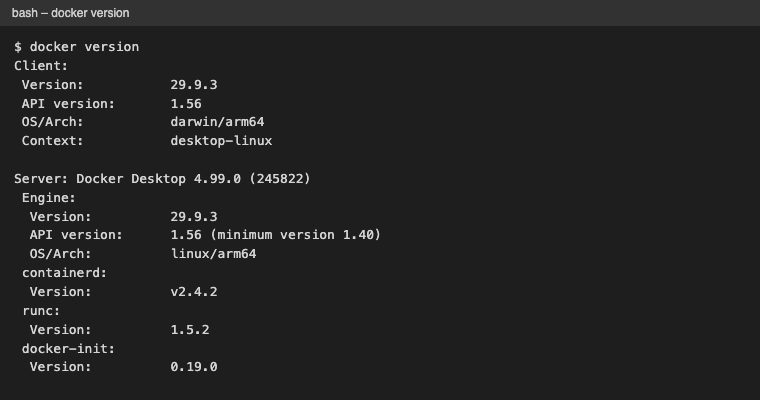

# Lab 1.1 – Lösung: Warum Container?

## Aufgabe 1: Docker Desktop starten

Docker Desktop startet im Hintergrund eine kleine Linux-VM mit der Docker Engine. Erst wenn die Statusleiste `Engine running` zeigt, nimmt Docker Befehle an.

## Aufgabe 2: Erster Container

```bash
docker run hello-world
```

```text
Unable to find image 'hello-world:latest' locally
latest: Pulling from library/hello-world
58dee6a49ef1: Pull complete
Digest: sha256:1e4c05b897a751332ce85c7e9449da2d93514ea2dea6dbb0e2753c9e949b2bfa
Status: Downloaded newer image for hello-world:latest

Hello from Docker!
This message shows that your installation appears to be working correctly.

To generate this message, Docker took the following steps:
 1. The Docker client contacted the Docker daemon.
 2. The Docker daemon pulled the "hello-world" image from the Docker Hub.
    (arm64v8)
 3. The Docker daemon created a new container from that image which runs the
    executable that produces the output you are currently reading.
 4. The Docker daemon streamed that output to the Docker client, which sent it
    to your terminal.
…
```

| Schritt | Beteiligte | Was passiert |
| --- | --- | --- |
| 1 | Docker Client → Docker Daemon | `docker` schickt den Auftrag an den Dienst im Hintergrund |
| 2 | Docker Daemon → Docker Hub | das Image `hello-world` fehlt lokal und wird heruntergeladen |
| 3 | Docker Daemon → Container | aus dem Image entsteht ein Container, der sein Programm startet |
| 4 | Container → Daemon → Terminal | die Ausgabe landet im Terminal; danach endet der Container |

In Klammern steht die Prozessor-Architektur: `arm64v8` auf Apple-Silicon-Macs, `amd64` auf den meisten Windows- und Linux-Rechnern. Docker Hub liefert automatisch die passende Variante. Ohne Versionsangabe (Tag) nimmt Docker `latest`; ab Lab 1.2 steht die Version immer dabei, z. B. `nginx:1.29-alpine`.

## Aufgabe 3: Zweiter Lauf

```text

Hello from Docker!
This message shows that your installation appears to be working correctly.
…
```

Die Zeilen `Unable to find image …` und `Pull complete` fehlen: Das Image liegt seit dem ersten Lauf auf dem Rechner. Jeder Lauf erzeugt trotzdem einen neuen Container aus demselben Image.

## Aufgabe 4: Client und Server

```bash
docker version
```

```text
Client:
 Version:           29.9.3
 API version:       1.56
 OS/Arch:           darwin/arm64
 Context:           desktop-linux

Server: Docker Desktop 4.99.0 (245822)
 Engine:
  Version:          29.9.3
  API version:      1.56 (minimum version 1.40)
  OS/Arch:          linux/arm64
 containerd:
  Version:          v2.4.2
 runc:
  Version:          1.5.2
 …
```



_Quelle: eigener Screenshot, Docker Desktop 4.99 auf macOS, 23.11.2026._

| Teil | Version | OS/Arch | Bedeutung |
| --- | --- | --- | --- |
| Client | 29.9.3 | `darwin/arm64` (Windows: `windows/amd64`) | das Kommando `docker` auf dem Rechner |
| Server | 29.9.3 | `linux/arm64` (bzw. `linux/amd64`) | Docker Engine mit Daemon in der Linux-VM von Docker Desktop |

Versionsnummern weichen je nach Installationsstand ab. `containerd` und `runc` sind die Bausteine unter der Engine, die den Container tatsächlich starten.
