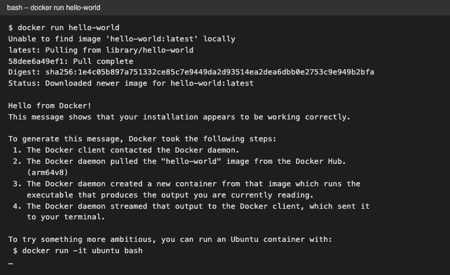
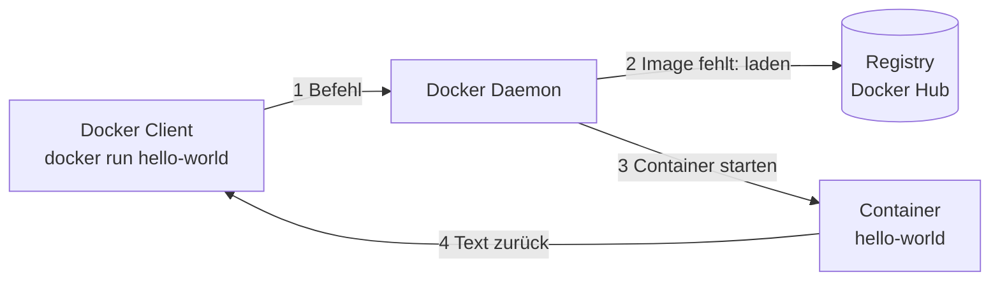

# Lab 1.1: Warum Container?

**Leitfragen:**

Warum läuft eine Anwendung auf dem Entwicklerrechner und auf dem Server manchmal unterschiedlich?

Weil die Umgebung abweicht: andere Python- oder Java-Version, fehlende Bibliothek, anderes Betriebssystem, andere Einstellungen. Der Code ist gleich, das Drumherum nicht.

Was müsste in einem Paket stecken, damit eine Anwendung überall gleich startet?

Der Code, die Laufzeit (z. B. Python), alle Bibliotheken, die nötigen Systemdateien und der Startbefehl. Genau das enthält ein Container-Image.

Warum startet eine virtuelle Maschine langsamer als ein normales Programm?

Eine virtuelle Maschine bootet zuerst ein komplettes eigenes Betriebssystem. Ein normales Programm nutzt das bereits laufende Betriebssystem; ein Container auch.

- Ein Container ist eine abgeschottete, laufende Anwendung samt allem, was sie zum Laufen braucht.
- Container teilen sich den Kern des Betriebssystems (Kernel) mit dem Rechner und sind deshalb leichter und schneller als virtuelle Maschinen.

## Begriffe

| Begriff | Bedeutung |
| --- | --- |
| Abhängigkeit | etwas, das eine Anwendung zusätzlich braucht: Laufzeit (Python, Java, Node.js), Bibliotheken, Systemwerkzeuge, Konfiguration |
| Image | unveränderliche Vorlage für Container: Dateien plus Startbefehl; wie eine Installations-DVD, aus der beliebig viele Installationen entstehen |
| Container | laufende, abgeschottete Kopie eines Images mit eigenem Dateisystem, eigenen Prozessen und eigener Netzwerkadresse |
| Kernel | Kern des Betriebssystems, der Prozesse, Speicher und Hardware verwaltet |
| Host | der Rechner, auf dem Container laufen (Laptop, Server, Cloud-Maschine) |
| virtuelle Maschine (VM) | komplett nachgebildeter Rechner mit eigenem Betriebssystem, betrieben von einem Hypervisor (z. B. Hyper-V, VMware) |
| Docker | das bekannteste Werkzeug, um Images zu bauen, zu verteilen und als Container zu starten |
| Registry | Online-Speicher für Images; die öffentliche Standard-Registry heißt Docker Hub |
| Produktion | die Umgebung, in der eine Anwendung für echte Nutzer läuft; davor liegen Entwicklung und Test |

## Container auf einen Blick

_Quelle: Docker Inc., „What is a Container?" (https://www.docker.com/resources/what-container/), abgerufen am 24.11.2026._

Sechs Anwendungen laufen als Container nebeneinander auf einem Rechner. Docker sitzt zwischen Containern und Betriebssystem und startet, stoppt und trennt sie.

### Definition von Container und Docker

Ein Container ist ein Prozess, den das Betriebssystem vom Rest abschirmt: eigenes Dateisystem aus einem Image, eigene Netzwerkadresse, begrenzte Ressourcen. Docker ist die Software, die solche Images baut, verteilt und als Container startet.

### Schiffscontainer als Vergleich

Vor dem genormten Frachtcontainer wurde jede Ladung einzeln verstaut. Mit der Normkiste verladen Kran, Schiff und Lkw alles gleich, egal was darin steckt. Ein Software-Container ist diese Normkiste für Programme: Laptop, Testserver und Cloud starten ihn auf dieselbe Weise, egal ob Python, Java oder eine Datenbank darin steckt. Das löst das Problem „läuft nur auf meinem Rechner" (englisch „works on my machine").

### Geschichte der Container-Technik

| Jahr | Schritt |
| --- | --- |
| 1979 | `chroot` in Version 7 Unix: Ein Prozess sieht nur einen Teil des Dateisystems ([Wikipedia: chroot](https://en.wikipedia.org/wiki/Chroot)) |
| 2013 | Docker: im März 2013 von Solomon Hykes (Firma dotCloud, danach Docker Inc.) vorgestellt und als Open Source veröffentlicht; Images bauen, teilen und starten mit einem Befehl ([Wikipedia: Docker](https://en.wikipedia.org/wiki/Docker_(software))) |
| 2015 | Open Container Initiative (OCI), gegründet am 22.06.2015: offener Standard für Image-Format und Laufzeit; Images laufen dadurch auch mit anderen Werkzeugen als Docker ([opencontainers.org](https://opencontainers.org/about/overview/)) |

Alle Quellen abgerufen am 24.11.2026. Alternativen in einer Zeile: **Podman** startet dieselben Images ohne Hintergrunddienst ([podman.io](https://podman.io/)), **containerd** ist die Laufzeit unter Docker und in Kubernetes ([containerd.io](https://containerd.io/)).

### Verbreitung 2026

In der Stack Overflow Developer Survey 2026 geben 59,1 % aller Befragten (n = 10.889) an, im letzten Jahr intensiv mit Docker bzw. Docker Compose gearbeitet zu haben; Kubernetes folgt mit 26,0 %, Podman mit 13,0 % ([survey.stackoverflow.co/2026](https://survey.stackoverflow.co/2026/technology/data), abgerufen am 24.11.2026).

### Bekannte Beispiele und Einsatzfälle

- **Docker Official Images** auf Docker Hub wie `nginx`, `alpine`, `python`, `postgres`: fertige Software zum Sofortstarten; der Kurs nutzt `nginx`, `alpine`, `busybox` und `python`.
- **Dev Containers** in VS Code: die Entwicklungsumgebung eines Projekts als Container ([containers.dev](https://containers.dev/), abgerufen am 24.11.2026).
- **Kubernetes** betreibt Container auf vielen Servern; Thema von Tag 2.

| Einsatz | Beispiel |
| --- | --- |
| Entwicklung | Datenbank oder Webserver mit einem Befehl starten, ohne Installation auf dem Rechner |
| Test | jeder Testlauf startet in einer frischen, gleichen Umgebung |
| Auslieferung | dasselbe Image läuft in Entwicklung, Test und Produktion |
| Betrieb | viele kleine Dienste auf wenigen Servern, verwaltet von einem Orchestrator wie Kubernetes |

## Container und virtuelle Maschine

_Quelle: Docker Inc., „What is a Container?" (https://www.docker.com/resources/what-container/), abgerufen am 24.11.2026._

| Kriterium | Container | Virtuelle Maschine |
| --- | --- | --- |
| enthält | Anwendung + Bibliotheken, kein eigener Kernel | komplettes Gastbetriebssystem + Anwendung |
| Startzeit | unter einer Sekunde bis wenige Sekunden | Minuten, weil ein Betriebssystem bootet |
| Größe | meist einige bis einige hundert MB | Gigabytes |
| Ressourcen | wenig Zusatzverbrauch, viele Container je Server | jedes Gastsystem braucht eigenen Speicher und CPU |
| Trennung | gemeinsamer Kernel, gute, aber schwächere Trennung | vollständige Trennung |

Beides schließt sich nicht aus: In der Cloud laufen Container meist in VMs, und Docker Desktop startet unter macOS und Windows selbst eine kleine Linux-VM, weil Linux-Container einen Linux-Kernel brauchen.

## Image und Container

> **Merksatz:** Ein Image ist die Vorlage, ein Container die laufende Kopie davon. Aus einem Image entstehen beliebig viele Container.

| | Image | Container |
| --- | --- | --- |
| Zustand | ruht auf der Festplatte, unveränderlich | läuft (oder ist beendet) |
| Vergleich | Installations-DVD, Bauplan | installiertes, laufendes Programm |
| Anzahl | eines je Version | beliebig viele aus demselben Image |

## Docker Client, Daemon und Registry

_Quelle: Wikimedia Commons, „Docker-architecture.png" (https://commons.wikimedia.org/wiki/File:Docker-architecture.png), nach der Docker-Dokumentation, CC BY-SA 4.0, abgerufen am 24.11.2026._

| Teil | Rolle |
| --- | --- |
| Docker Client | das Kommando `docker` im Terminal; schickt Befehle an den Daemon |
| Docker Daemon (`dockerd`) | Hintergrunddienst auf dem Host; lädt Images, startet und überwacht Container |
| Registry | Speicher für Images im Netz; ohne Angabe nutzt Docker den Docker Hub |
| Docker Desktop | App für Windows, macOS und Linux: Client, Daemon, Linux-VM und Oberfläche in einem Paket |

## Der erste Container mit hello-world

`docker run hello-world` ist der klassische Test einer Docker-Installation. Er startet einen Container aus dem winzigen Image `hello-world`; der Container gibt einen Text aus und endet sofort.

_Quelle: eigener Screenshot, Docker Desktop 4.99 mit Engine 29.9.3, 23.11.2026._

Die Ausgabe beschreibt selbst, welche Teile beteiligt sind:

`docker version` zeigt Client und Daemon getrennt: **Client** läuft auf dem eigenen Betriebssystem (`darwin` = macOS, `windows`), **Server** (die Docker Engine mit dem Daemon) unter `linux` in der VM von Docker Desktop.

## Typische Fehler

| Symptom | Ursache | Lösung |
| --- | --- | --- |
| `Cannot connect to the Docker daemon` oder `failed to connect to the docker API` | Docker Desktop läuft nicht | Docker Desktop starten, warten, bis die Statusleiste `Engine running` zeigt |
| `docker: command not found` | Docker nicht installiert oder Terminal vor der Installation geöffnet | Terminal neu öffnen, sonst [Setup](../../00-setup-and-installation.md) prüfen |
| `docker version` zeigt nur `Client`, danach eine Fehlermeldung | Daemon läuft nicht | Docker Desktop starten |
| `toomanyrequests: You have reached your pull rate limit` | Download-Grenze von Docker Hub für die gemeinsame IP-Adresse erreicht | `docker login` mit kostenlosem Docker-Konto |

## Fazit

- Container bündeln eine Anwendung mit ihren Abhängigkeiten und laufen auf jedem Rechner mit Docker gleich.
- Container teilen sich den Kernel des Hosts: schneller Start, wenig Verbrauch; VMs trennen stärker, sind aber schwerer.
- Ein Image ist die Vorlage, ein Container die laufende Kopie; der Client schickt Befehle an den Daemon, der Images aus der Registry lädt.

In der Übung startet der erste Container, und `docker version` zeigt Client und Server auf dem eigenen Rechner.
