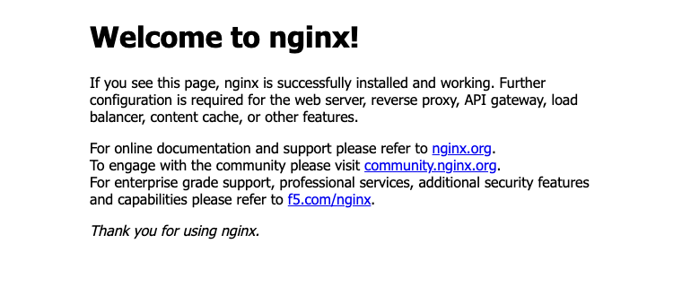
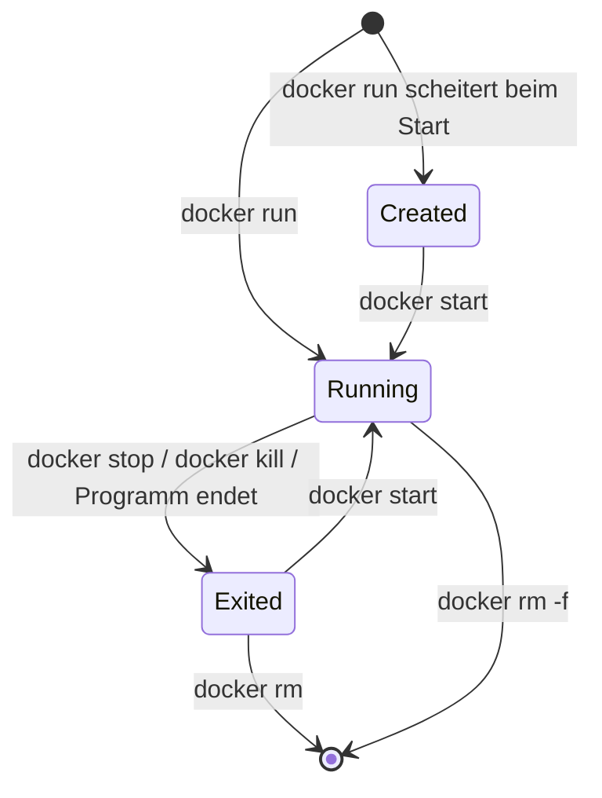
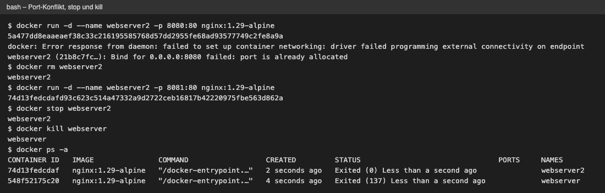

# Lab 1.2: Container über die CLI steuern

**Leitfragen:**

<details>
<summary>Wie lässt sich ein Programm steuern, das im Hintergrund läuft?</summary>

Über Befehle an den Dienst, der es verwaltet: starten, anzeigen, anhalten, löschen. Bei Docker schickt die Kommandozeile diese Befehle an den Docker Daemon (`docker ps`, `docker stop`, `docker rm`).

</details>

<details>
<summary>Zwei Webserver wollen auf demselben Rechner Port 80: was passiert?</summary>

Der zweite bekommt einen Fehler, denn ein Port des Rechners gehört immer nur einem Programm. Container lösen das, indem jeder intern Port 80 nutzt und nach außen auf einen anderen Port des Rechners weitergeleitet wird (`-p 8080:80`, `-p 8081:80`).

</details>

- Alles, was Docker Desktop per Klick kann, geht auch im Terminal mit `docker <befehl> [optionen] [argumente]`.
- Ein Container durchläuft einen Lebenszyklus: erstellt, läuft, beendet, gelöscht. Das Image bleibt dabei unverändert.

## Begriffe

| Begriff | Bedeutung |
| --- | --- |
| CLI | Command Line Interface: Programm, das im Terminal mit Text-Befehlen bedient wird, hier `docker` |
| Pull | ein Image aus der Registry auf den eigenen Rechner herunterladen |
| Tag | Version eines Images hinter dem Doppelpunkt, z. B. `1.29-alpine` in `nginx:1.29-alpine` |
| Containername | eindeutiger Name eines Containers; ohne `--name` vergibt Docker einen Zufallsnamen wie `brave_swirles` |
| Container-ID | eindeutige Kennung eines Containers (64 Zeichen, meist gekürzt auf 12) |
| Port | Nummer, unter der ein Programm im Netzwerk erreichbar ist; Webserver nutzen Port 80 |
| Port-Weiterleitung | ein Port des Rechners wird an einen Port im Container durchgereicht, z. B. `-p 8080:80` |
| Hauptprozess | das Programm, das der Container beim Start ausführt; endet es, endet der Container |
| Signal | Nachricht des Betriebssystems an ein Programm: `SIGTERM` = „bitte beenden", `SIGKILL` = sofort abbrechen |
| Exit-Code | Zahl, mit der ein Programm endet: `0` = normal, `137` = von `SIGKILL` abgebrochen |
| nginx | verbreiteter Webserver; das Image `nginx` liefert eine Willkommensseite auf Port 80 |

## Images laden und Container starten

```bash
docker pull nginx:1.29-alpine        # Image aus Docker Hub laden, ohne Container zu starten
docker images                        # lokal gespeicherte Images anzeigen
```

`docker run` erstellt aus einem Image einen Container und startet ihn; fehlt das Image, lädt `run` es vorher automatisch.

```bash
docker run -d --name webserver -p 8080:80 nginx:1.29-alpine
#          │  │                │           └─ Image:Tag
#          │  │                └─ Port 8080 des Rechners -> Port 80 im Container
#          │  └─ Name des Containers
#          └─ detached: im Hintergrund, das Terminal bleibt frei
```

| Option von `docker run` | Wirkung |
| --- | --- |
| `-d` | im Hintergrund starten (detached); gibt nur die Container-ID aus |
| `--name <name>` | Namen vergeben, mit dem alle weiteren Befehle arbeiten |
| `-p <rechner>:<container>` | Port vom Rechner in den Container weiterleiten |
| `--rm` | Container automatisch löschen, sobald er endet |
| `-it` | interaktiv: Tastatur (`-i`) und Terminal (`-t`) mit dem Container verbinden, z. B. für eine Shell |

```bash
docker run -it --rm alpine:3.22 sh      # Shell in einem kleinen Linux; exit beendet und löscht den Container
```



_Quelle: eigener Screenshot, nginx:1.29-alpine unter http://localhost:8080, 24.11.2026._

nginx lauscht im Container auf Port 80. Erst `-p 8080:80` macht ihn unter `http://localhost:8080` erreichbar. Ein zweiter Container kann im Inneren ebenfalls Port 80 nutzen, braucht aber einen anderen Port auf dem Rechner.

## Container und Images anzeigen

```bash
docker ps        # nur laufende Container
docker ps -a     # alle Container, auch beendete
```

```text
CONTAINER ID   IMAGE               COMMAND                  CREATED        STATUS         PORTS                                     NAMES
548f52175c20   nginx:1.29-alpine   "/docker-entrypoint.…"   1 second ago   Up 1 second    0.0.0.0:8080->80/tcp, [::]:8080->80/tcp   webserver
```

| Spalte | Bedeutung |
| --- | --- |
| `CONTAINER ID` | gekürzte ID; funktioniert in allen Befehlen statt des Namens |
| `IMAGE` | Image, aus dem der Container entstand |
| `STATUS` | `Up …` = läuft, `Exited (0)` = beendet mit Exit-Code 0, `Created` = angelegt, nie gestartet |
| `PORTS` | Port-Weiterleitungen; `[::]` ist dieselbe Weiterleitung für IPv6 |
| `NAMES` | Containername |


_Quelle: Docker Inc., „Docker Desktop" (https://www.docker.com/products/docker-desktop/), abgerufen am 24.11.2026._

Docker Desktop zeigt dieselben Daten grafisch: **Containers** entspricht `docker ps -a`, **Images** entspricht `docker images`. Beide sprechen mit demselben Docker Daemon.

## Lebenszyklus eines Containers



| Befehl | Wirkung |
| --- | --- |
| `docker stop webserver` | beendet sauber: `SIGTERM`, das Programm schließt Dateien und Verbindungen; nach 10 Sekunden ohne Reaktion folgt `SIGKILL` |
| `docker kill webserver` | bricht sofort mit `SIGKILL` ab; nur, wenn `stop` nicht wirkt |
| `docker start webserver` | startet einen beendeten Container wieder, mit allen Änderungen darin |
| `docker rm webserver` | löscht einen beendeten Container |
| `docker rm -f webserver` | stoppt und löscht einen laufenden Container in einem Schritt |

Nach `stop` zeigt `docker ps -a` meist `Exited (0)`, nach `kill` `Exited (137)` (128 + Signal 9 = `SIGKILL`). Gelöscht wird immer nur der Container; das Image bleibt, und ein neues `docker run` beginnt wieder beim Originalzustand.



_Quelle: eigener Screenshot, Docker Engine 29.9.3, 24.11.2026._

## Typische Fehler

| Symptom | Ursache | Lösung |
| --- | --- | --- |
| `Bind for 0.0.0.0:8080 failed: port is already allocated` | ein anderer Container oder Dienst nutzt den Port | anderen Port wählen (`-p 8081:80`); der fehlgeschlagene Container bleibt als `Created` liegen und muss mit `docker rm` weg |
| `Conflict. The container name "/webserver" is already in use` | Container mit diesem Namen existiert noch (auch beendet) | `docker rm -f webserver` oder anderen Namen wählen |
| `docker ps` zeigt einen Container nicht | Container ist beendet | `docker ps -a` |
| Browser zeigt unter `localhost:8080` nichts | `-p` vergessen oder falscher Port | Spalte `PORTS` in `docker ps` prüfen |
| `the input device is not a TTY` (Git Bash) | Git-Bash-Fenster ohne echtes Terminal | `winpty docker run -it …` oder Terminal in VS Code |

## Fazit

- `pull` lädt Images, `run` erstellt und startet Container; `-d`, `--name`, `-p`, `--rm` und `-it` sind die wichtigsten Optionen.
- `ps` zeigt laufende, `ps -a` alle Container, `images` die lokalen Images.
- `stop` beendet sauber, `kill` sofort; `rm` löscht den Container, nie das Image.

In der Übung läuft ein nginx-Webserver im Browser, ein zweiter Container zeigt den Port-Konflikt und die Zustände nach `stop` und `kill`.
