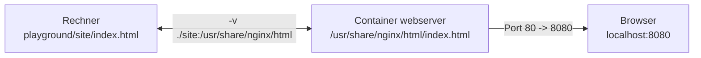

# Lab 1.3: In Container hineinschauen

**Leitfragen:**

<details>
<summary>Wie schaut man in ein laufendes Programm hinein, ohne es anzuhalten?</summary>

Über seine Ausgaben (Logs) und indem man einen zusätzlichen Befehl daneben startet. Bei Docker liest `docker logs` die Ausgaben, `docker exec` führt einen Befehl im laufenden Container aus.

</details>

<details>
<summary>Wie kommt eine Datei vom Laptop in ein Programm, das abgeschottet läuft?</summary>

Entweder einmalig hineinkopieren (`docker cp`) oder einen Ordner des Laptops im Container sichtbar machen (Bind Mount mit `-v`). Beim Bind Mount sehen beide Seiten dieselbe Datei.

</details>

- `logs`, `exec`, `cp` und `inspect` machen einen Container von außen beobachtbar und veränderbar, ohne ihn anzuhalten.
- Änderungen im Container gehören nur diesem Container und sind mit `docker rm` weg. Dateien in einem eingebundenen Ordner des Rechners bleiben.

## Begriffe

| Begriff | Bedeutung |
| --- | --- |
| Shell | Kommandozeile im Container, z. B. `sh` in Alpine-Images; nimmt Befehle wie `ls` entgegen |
| Log | alles, was der Hauptprozess auf die Standardausgabe schreibt; Docker speichert es je Container |
| Container-Schicht | beschreibbare Schicht, die jeder Container über das unveränderliche Image legt; verschwindet mit `docker rm` |
| JSON | Textformat für strukturierte Daten aus Schlüsseln und Werten, z. B. `"Status": "running"` |
| Bind Mount | ein Ordner des Rechners wird an einem Pfad im Container eingebunden; beide Seiten sehen dieselben Dateien |
| Mount-Pfad | Ordner im Container, an dem der eingebundene Ordner erscheint, z. B. `/usr/share/nginx/html` |

## Logs lesen

```bash
docker logs webserver              # bisherige Ausgaben (bei nginx: jede Anfrage)
docker logs --tail 3 webserver     # nur die letzten 3 Zeilen
docker logs -f webserver           # live mitlesen, Strg+C beendet nur das Mitlesen
```

```text
192.168.65.1 - - [23/Nov/2026:23:10:59 +0000] "GET / HTTP/1.1" 200 896 "-" "curl/8.7.1" "-"
192.168.65.1 - - [23/Nov/2026:23:10:59 +0000] "GET /nix HTTP/1.1" 404 153 "-" "curl/8.7.1" "-"
2026/11/23 23:10:59 [error] 24#24: *2 open() "/usr/share/nginx/html/nix" failed (2: No such file or directory) …
```

Die erste Zeile ist ein erfolgreicher Aufruf (`200`), die anderen zeigen eine fehlende Seite (`404`). Logs sind die erste Anlaufstelle, wenn ein Container nicht tut, was er soll.

## Befehle im laufenden Container

`docker exec` führt einen zusätzlichen Befehl in einem laufenden Container aus; der Hauptprozess (hier nginx) läuft ungestört weiter.

```bash
docker exec webserver ls /usr/share/nginx/html     # ein Befehl, Ausgabe kommt zurück: 50x.html index.html
docker exec -it webserver sh                       # Shell im Container; exit beendet nur die Shell
```

In der Shell ersetzt ein einziger Befehl die Startseite von nginx:

```sh
echo '<h1>Hallo aus dem Container</h1>' > /usr/share/nginx/html/index.html
```


_Quelle: eigener Screenshot, nginx:1.29-alpine nach `docker exec`, 24.11.2026._

Alpine-Images haben `sh`, aber kein `bash`. Unter Windows in Git Bash bei `-it` das Terminal von VS Code nutzen oder `winpty` voranstellen.

## Dateien kopieren mit docker cp

`docker cp` kopiert Dateien zwischen Rechner und Container, in beide Richtungen und auch bei beendeten Containern:

```bash
docker cp webserver:/usr/share/nginx/html/index.html .     # aus dem Container in den aktuellen Ordner
docker cp index.html webserver:/usr/share/nginx/html/      # vom Rechner in den Container
```

## Container-Details mit docker inspect

`docker inspect` gibt alle Einstellungen eines Containers als JSON aus (rund 250 Zeilen). Wichtig sind wenige Felder, hier gekürzt:

```jsonc
{
  "Name": "/webserver",
  "State": { "Status": "running", "ExitCode": 0 },          // Zustand wie in docker ps
  "Config": {
    "Image": "nginx:1.29-alpine",                            // Image, aus dem er entstand
    "Cmd": ["nginx", "-g", "daemon off;"],                  // Hauptprozess
    "Env": ["NGINX_VERSION=1.29.8", "…"]                    // Umgebungsvariablen
  },
  "HostConfig": { "PortBindings": { "80/tcp": [{ "HostPort": "8080" }] } },
  "Mounts": [ { "Type": "bind", "Source": "/Users/…/playground/site", "Destination": "/usr/share/nginx/html" } ],
  "NetworkSettings": { "IPAddress": "172.17.0.2" }           // Adresse im Docker-Netzwerk
}
```

Die Kommentare stehen nur hier zur Erklärung; echtes JSON hat keine. Einzelne Felder liefert `--format`:

```bash
docker inspect --format '{{.State.Status}} {{.Config.Image}}' webserver     # running nginx:1.29-alpine
docker inspect --format '{{json .Mounts}}' webserver                       # eingebundene Ordner
```

## Lebensdauer von Änderungen im Container


_Quelle: Docker Inc., „Storage drivers" (https://docs.docker.com/engine/storage/drivers/), abgerufen am 24.11.2026._

- Was im Container geändert wird (per `exec` oder `cp`), landet in seiner beschreibbaren Container-Schicht (oben im Bild).
- `docker stop` und `docker start` behalten diese Schicht; `docker rm` löscht sie mit dem Container.
- Das Image (unten, schreibgeschützt) bleibt unverändert: Ein neuer Container beginnt wieder beim Originalzustand.

## Ordner vom Rechner einbinden mit -v

Ein Bind Mount macht einen Ordner des Rechners im Container sichtbar. Änderungen auf einer Seite sind sofort auf der anderen zu sehen und überstehen das Löschen des Containers.

```bash
docker run -d --name webserver -p 8080:80 -v ./site:/usr/share/nginx/html nginx:1.29-alpine
#                                         │  │      └─ Mount-Pfad im Container (Webseiten von nginx)
#                                         │  └─ Ordner auf dem Rechner, relativ zum aktuellen Ordner
#                                         └─ volume: Ordner einbinden
```




_Quelle: eigener Screenshot, nginx:1.29-alpine mit Bind Mount, 24.11.2026._

- Der eingebundene Ordner überdeckt, was im Image an dieser Stelle liegt; die Willkommensseite ist dann unsichtbar.
- Relative Pfade beginnen mit `./`; ebenso möglich ist ein absoluter Pfad wie `"$(pwd)/site"`.
- Typisch für Quellcode in der Entwicklung und für Konfigurationsdateien. Von Docker verwaltete Speicher für Daten (Named Volumes) folgen in Lab 3.3.

## Typische Fehler

| Symptom | Ursache | Lösung |
| --- | --- | --- |
| `exec: "bash": executable file not found` | Alpine-Images haben keine `bash` | `sh` statt `bash` |
| `Error response from daemon: container … is not running` bei `exec` | Container ist beendet | `docker start <name>`, dann `exec` |
| `the input device is not a TTY` | Git-Bash-Fenster ohne echtes Terminal | `winpty docker exec -it …` oder Terminal in VS Code |
| Pfad wie `C:/Program Files/Git/usr/share/nginx/html` in einer Fehlermeldung | Git Bash wandelt Linux-Pfade um | `export MSYS_NO_PATHCONV=1` vor dem Befehl |
| `403 Forbidden` im Browser nach `-v` | eingebundener Ordner ist leer oder enthält keine `index.html` | mit `ls site` prüfen; Befehl im Ordner starten, der `site/` enthält |
| Änderung im Container ist nach Neustart weg | Container wurde gelöscht und neu erstellt | erwartet; dauerhafte Dateien in einen Bind Mount legen |

## Fazit

- `logs` zeigt die Ausgaben, `exec` führt Befehle im laufenden Container aus, `inspect` liefert alle Einstellungen als JSON.
- `cp` kopiert Dateien hinein und heraus; jede Änderung im Container ist mit `docker rm` weg.
- Ein Bind Mount (`-v ./ordner:/pfad`) legt Dateien auf den Rechner; Container und Rechner sehen dieselbe Datei.

In der Übung wird die Startseite von nginx erst im Container geändert, dann aus einem eigenen Ordner des Rechners geliefert.
