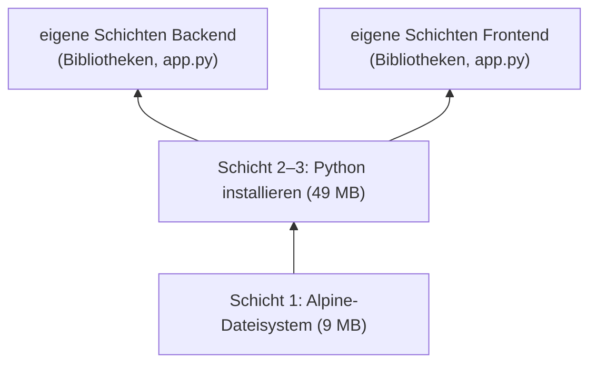
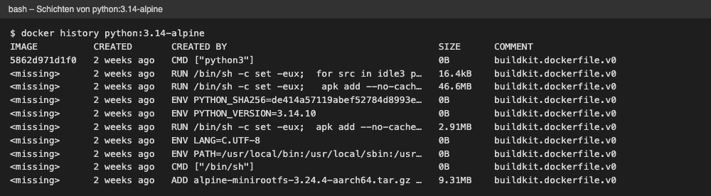
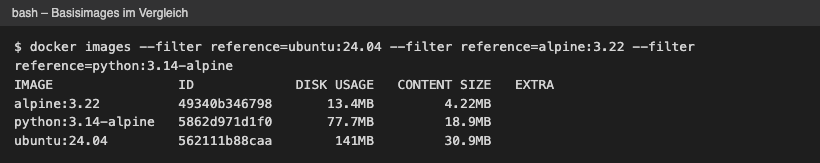

# Lab 2.1: Images und Layer

**Leitfragen:**

Zehn Anwendungen nutzen dasselbe Betriebssystem: muss es zehnmal auf der Festplatte liegen?

Nein. Images bestehen aus Schichten; eine Schicht, die mehrere Images gemeinsam haben (z. B. das Alpine-Dateisystem), liegt nur einmal auf der Festplatte und wird von allen Images und Containern mitbenutzt.

Was kostet ein möglichst kleines Paket?

Es spart Speicher, Download-Zeit und Angriffsfläche. Dafür fehlen Werkzeuge wie Shell und Paketmanager; die Fehlersuche wird mühsamer, und manche Programme brauchen genau die Bibliotheken, die weggelassen wurden.

- Ein Image ist ein Stapel schreibgeschützter Schichten (Layer); jede Schicht enthält die Dateiänderungen eines Bauschritts.
- Gleiche Schichten liegen nur einmal auf der Festplatte und werden nur einmal heruntergeladen; unveränderte Bauschritte kommen beim nächsten Bauen aus dem Cache.
- Die Wahl des Basisimages entscheidet über Größe und Inhalt; feste Tags statt `latest` machen das Ergebnis wiederholbar.

## Begriffe

| Begriff | Bedeutung |
| --- | --- |
| Schicht (Layer) | schreibgeschütztes Paket mit den Dateiänderungen eines Bauschritts, über einen Prüfwert (`sha256:…`) eindeutig benannt |
| Basisimage | fertiges Image, auf dem ein eigenes Image aufbaut, z. B. `python:3.14-alpine` |
| Dockerfile | Textdatei mit den Bauschritten eines Images; eigene Dockerfiles ab Lab 2.2 |
| Layer-Cache (Build-Cache) | gespeicherte Schichten früherer Builds; ein unveränderter Bauschritt wird nicht neu ausgeführt |
| Alpine Linux | sehr kleine Linux-Distribution (rund 4 MB), beliebt als Basis für Images |
| distroless | Images ohne Shell und Paketmanager, nur Anwendung und Laufzeit |
| `latest` | Standard-Tag, den Docker ohne Angabe nutzt; zeigt auf das, was zuletzt so markiert wurde, nicht zwingend auf das Neueste |

## Image als Stapel von Schichten

_Quelle: Docker Inc., „Storage drivers" (https://docs.docker.com/engine/storage/drivers/), abgerufen am 24.11.2026._

- Unten liegen die schreibgeschützten Schichten des Images (Schloss). Jede Schicht speichert nur, was sich gegenüber der Schicht darunter geändert hat.
- Jeder Container legt oben eine eigene dünne, beschreibbare Container-Schicht darüber (aus Lab 1.3).
- Vier Container aus demselben Image belegen die Image-Schichten nur einmal auf der Festplatte. Dasselbe gilt für Images: Alle Images auf Basis von `python:3.14-alpine` teilen sich dessen Schichten.

Die beiden Hello-Images aus Lab 2.2 bringen nur ihre eigenen Schichten mit; Alpine und Python liegen einmal auf der Festplatte.

## Schichten lesen mit docker history

`docker history` zeigt die Bauschritte eines Images von oben (zuletzt) nach unten (Basis), eine Zeile je Schritt:

_Quelle: eigener Screenshot, `docker history python:3.14-alpine`, 24.11.2026._

| Spalte | Bedeutung |
| --- | --- |
| `CREATED BY` | Anweisung des Bauschritts (gekürzt; vollständig mit `--no-trunc`) |
| `SIZE` | Größe der Schicht; `0B` = Schritt ohne Dateiänderung, setzt nur eine Einstellung (z. B. `ENV`, `CMD`) |
| `IMAGE` | `<missing>` bei Schritten, die anderswo gebaut wurden; kein Fehler |

- Die unterste Zeile `ADD alpine-minirootfs-3.24.4-….tar.gz` (9,31 MB) ist das komplette Alpine-Dateisystem.
- Die größte Schicht `RUN … apk add …` (46,6 MB) installiert Python.
- Darüber setzen `ENV` und `CMD` nur Einstellungen (`0B`).

## Layer-Cache beim Bauen

Beim Bauen prüft Docker jeden Schritt: Sind Anweisung und benutzte Dateien unverändert, übernimmt Docker die vorhandene Schicht aus dem Cache, statt den Schritt erneut auszuführen. Ab dem ersten geänderten Schritt wird alles darüber neu gebaut. Wie man das mit der Reihenfolge im Dockerfile ausnutzt, zeigt Lab 2.2.

Beim Herunterladen gilt dasselbe Prinzip: `docker pull` meldet `Already exists` für Schichten, die schon auf dem Rechner liegen, und lädt nur die fehlenden.

## Basisimages und ihre Größe

_Quelle: eigener Screenshot, Docker Desktop auf macOS (`linux/arm64`), 24.11.2026._

| Basisimage | Inhalt | Download (komprimiert, `linux/amd64`) | typischer Einsatz |
| --- | --- | --- | --- |
| `ubuntu:24.04` | vollständiges Ubuntu mit `bash` und `apt` | ca. 30 MB | Programme, die Ubuntu-Pakete brauchen |
| `alpine:3.22` | Alpine Linux mit Shell `sh` und Paketmanager `apk` | ca. 4 MB | kleinste übliche Basis mit Shell |
| `python:3.14` | Debian mit Python und Compilern | ca. 416 MB | wenn beim Bauen Bibliotheken kompiliert werden |
| `python:3.14-slim` | verkleinertes Debian mit Python | ca. 44 MB | Python-Apps, die Debian-Pakete voraussetzen |
| `python:3.14-alpine` | Alpine mit Python | ca. 18 MB | Basis der Hello-App (Lab 2.2) |
| `gcr.io/distroless/static-debian13` | keine Shell, kein Paketmanager | ca. 2 MiB | fertig kompilierte Programme in Produktion |

Quellen: [Docker Hub](https://hub.docker.com/_/python) (Tag-Seiten von `python`, `alpine`, `ubuntu`) und [GoogleContainerTools/distroless](https://github.com/GoogleContainerTools/distroless), abgerufen am 24.11.2026; die Größen ändern sich mit jeder neuen Version.

| Spalte von `docker images` | Bedeutung |
| --- | --- |
| `DISK USAGE` | Platz der entpackten Schichten; gemeinsame Schichten zählen bei jedem Image mit |
| `CONTENT SIZE` | komprimierte Größe, ungefähr die Download-Menge |
| `EXTRA` | `U` = von mindestens einem Container genutzt |

- **Alpine** nutzt die C-Bibliothek `musl` statt `glibc`; die meisten Programme laufen damit, vorkompilierte Pakete für `glibc` können fehlen.
- **distroless** hat keine Shell: `docker exec … sh` aus Lab 1.3 funktioniert dort nicht. Für die Fehlersuche gibt es `:debug`-Varianten mit Shell.
- Kleine Images laden schneller und enthalten weniger Programme, die Sicherheitslücken haben können (Lab 2.4).

## Feste Tags und der Tag latest

- `nginx` ohne Tag heißt `nginx:latest`. `latest` wandert mit jeder neuen Version weiter; derselbe Befehl liefert nach Monaten ein anderes Image.
- Feste Tags wie `python:3.14-alpine` oder `nginx:1.29-alpine` legen fest, welche Version läuft. Der Kurs nutzt nur feste Tags.

## Typische Fehler

| Symptom | Ursache | Lösung |
| --- | --- | --- |
| `toomanyrequests` beim Pull | Download-Grenze von Docker Hub für die gemeinsame IP-Adresse | `docker login`; Images vorab mit `pull-images.sh` laden |
| `failed to resolve reference "docker.io/library/python:3.14-alpne": … not found` | Tippfehler im Image-Namen oder Tag | Namen auf Docker Hub prüfen |
| Größen weichen vom Handout ab | andere Prozessor-Architektur (`amd64` statt `arm64`) oder neuere Bauversion | erwartet; die Größenordnung zählt |
| `bash: not found` in einem Alpine-Container | Alpine enthält nur `sh` | `sh` statt `bash` |

## Fazit

- Ein Image ist ein Stapel schreibgeschützter Schichten; `docker history` zeigt sie mit Größe und Bauschritt.
- Gleiche Schichten liegen nur einmal auf der Festplatte und kommen beim Bauen und Laden aus dem Cache.
- Alpine-Images sind ein Bruchteil von Ubuntu oder vollem Debian; feste Tags statt `latest` machen Images wiederholbar.

In der Übung werden drei Basisimages verglichen und die Schichten von `python:3.14-alpine` gelesen.
