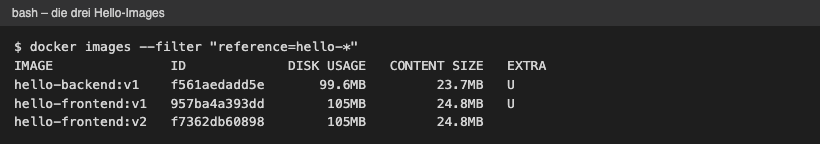
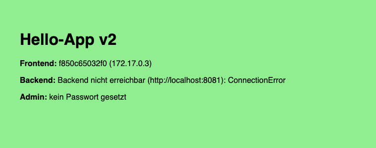

# Lab 2.2 – Lösung: Eigene Images mit Dockerfile

Fertige Dateien: `project/examples/m02-images/l02-dockerfile/backend/Dockerfile` und `…/frontend/Dockerfile`.

## Aufgabe 1: Backend-Dockerfile und hello-backend:v1

`playground/backend/Dockerfile` (die vier TODO-Zeilen ersetzt):

```dockerfile
# Lab 2.2 – Starter: Dockerfile für das Hello-Backend
# Kopieren nach playground/backend/Dockerfile, dann die "# TODO:"-Zeilen ersetzen.

FROM python:3.14-alpine

WORKDIR /app

COPY requirements.txt .
RUN pip install --no-cache-dir -r requirements.txt

COPY app.py .

ENV APP_VERSION=v1 \
    PORT=80

EXPOSE 80

CMD ["python", "app.py"]
```

```bash
cd playground/backend
docker build -t hello-backend:v1 .
```

```text
#5 [1/5] FROM docker.io/library/python:3.14-alpine@sha256:5862d971d1f0…
#6 [2/5] WORKDIR /app
#7 [3/5] COPY requirements.txt .
#8 [4/5] RUN pip install --no-cache-dir -r requirements.txt
#8 6.271 Successfully installed blinker-1.9.0 click-8.5.1 flask-3.1.3 itsdangerous-2.2.0 jinja2-3.1.6 markupsafe-3.0.4 werkzeug-3.1.9
#9 [5/5] COPY app.py .
#10 naming to docker.io/library/hello-backend:v1 done
```

Die Zeiten hängen von Rechner und Internetverbindung ab; ohne vorab geladenes Basisimage lädt der erste Schritt `python:3.14-alpine`.

## Aufgabe 2: Frontend-Dockerfile und hello-frontend:v1

`playground/frontend/Dockerfile`:

```dockerfile
# Lab 2.2 – Starter: Dockerfile für das Hello-Frontend
# Kopieren nach playground/frontend/Dockerfile, dann die "# TODO:"-Zeilen ersetzen.

FROM python:3.14-alpine

ARG APP_VERSION=v1
ARG APP_COLOR=lightblue

WORKDIR /app

COPY requirements.txt .
RUN pip install --no-cache-dir -r requirements.txt

COPY app.py .

ENV APP_VERSION=${APP_VERSION} \
    APP_COLOR=${APP_COLOR} \
    PORT=80

EXPOSE 80

CMD ["python", "app.py"]
```

```bash
cd ../frontend
docker build -t hello-frontend:v1 .
```

Ohne `--build-arg` gelten die Standardwerte `v1` und `lightblue`. Das Frontend installiert zusätzlich `requests`; sonst sind die Schritte dieselben wie beim Backend.

## Aufgabe 3: hello-frontend:v2 mit Build-Argumenten

```bash
docker build -t hello-frontend:v2 --build-arg APP_VERSION=v2 --build-arg APP_COLOR=lightgreen .
docker images --filter "reference=hello-*"
```

```text
#5 [1/5] FROM docker.io/library/python:3.14-alpine@sha256:5862d971d1f0…
#6 [2/5] WORKDIR /app
#6 CACHED
#7 [3/5] COPY requirements.txt .
#7 CACHED
#8 [4/5] RUN pip install --no-cache-dir -r requirements.txt
#8 CACHED
#9 [5/5] COPY app.py .
#9 CACHED
#10 naming to docker.io/library/hello-frontend:v2 done
```



_Quelle: eigener Screenshot, Hello-Images, 24.11.2026._

- Alle Bauschritte kommen aus dem Cache: Die Build-Argumente werden erst in der `ENV`-Zeile benutzt, und `ENV` ändert nur Einstellungen des Images, keine Dateien.
- `v1` und `v2` haben verschiedene IDs, aber dieselben Schichten; auf der Festplatte liegen sie praktisch nur einmal.

## Aufgabe 4: Backend und Frontend starten

```bash
docker run -d --name hello-backend -p 8081:80 hello-backend:v1
docker run -d --name hello-frontend -p 8080:80 hello-frontend:v2
```

`http://localhost:8081`:

```json
{"ip":"172.17.0.2","pod":"dcf0d96667c5","time":"23:12:22","version":"v1"}
```

`pod` enthält den Rechnernamen des Containers (seine gekürzte ID), `ip` seine Adresse im Docker-Netzwerk. Der Feldname `pod` stammt aus Kubernetes (Tag 2).



_Quelle: eigener Screenshot, `hello-frontend:v2` ohne Backend, 24.11.2026._

Das Frontend fragt `http://localhost:8081`; im Container ist `localhost` aber der Frontend-Container selbst, dort lauscht nichts auf 8081. Die Fehlermeldung ist deshalb erwartet und wird in Lab 3.1 mit Compose behoben.

## Aufgabe 5: Farbe beim Start ändern und aufräumen

```bash
docker rm -f hello-frontend
docker run -d --name hello-frontend -p 8080:80 -e APP_COLOR=orange hello-frontend:v1
docker rm -f hello-frontend hello-backend
```

Die Seite zeigt „Hello-App v1" auf orangem Hintergrund. `-e` überschreibt den `ENV`-Wert `lightblue` nur für diesen Container; ein neuer Container ohne `-e` ist wieder hellblau. Zur Kontrolle der Werte im Image ersetzt ein Befehl hinter dem Image-Namen den `CMD`:

```bash
docker run --rm hello-frontend:v2 env
```

```text
PATH=/usr/local/bin:/usr/local/sbin:/usr/local/bin:/usr/sbin:/usr/bin:/sbin:/bin
HOSTNAME=c672ed3c762d
LANG=C.UTF-8
PYTHON_VERSION=3.14.10
PYTHON_SHA256=de414a57119abef52784d8993e341d53aed635fc2b05c2607d9f98a2c5b72032
APP_VERSION=v2
APP_COLOR=lightgreen
PORT=80
HOME=/root
```
