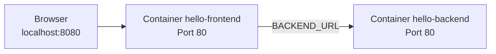
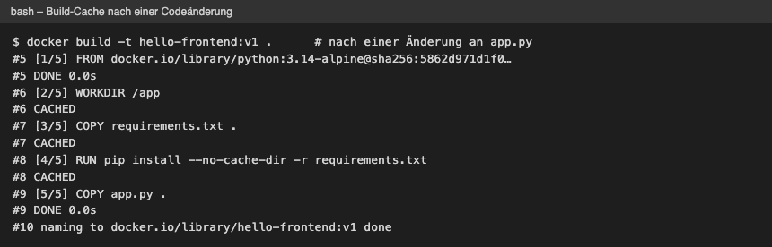
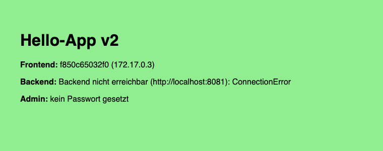

# Lab 2.2: Eigene Images mit Dockerfile

**Leitfragen:**

<details>
<summary>Welche Schritte sind nötig, um eine Python-Web-App auf einem frischen Server zu starten?</summary>

Betriebssystem mit Python bereitstellen, Arbeitsordner anlegen, Bibliotheken installieren (`pip install`), Code kopieren, Einstellungen setzen, Programm starten. Ein Dockerfile schreibt genau diese Schritte einmal auf.

</details>

<details>
<summary>Wie kann ein Kollege diese Schritte in einem Jahr genauso wiederholen?</summary>

Nur wenn sie aufgeschrieben und ausführbar sind, mit festen Versionen. Ein Dockerfile mit festen Tags lässt sich jederzeit erneut mit `docker build` ausführen; das gebaute Image enthält das Ergebnis dauerhaft.

</details>

<details>
<summary>Woran soll später erkennbar sein, welche Version gerade läuft?</summary>

Am Namen des Images mit Versions-Tag (`hello-frontend:v2`) und an der Anwendung selbst, die ihre Version anzeigt. Die Hello-App bekommt Version und Farbe beim Bauen mit und zeigt beides auf der Seite.

</details>

- Ein Dockerfile ist das Rezept für ein Image: Anweisungen von oben nach unten, jede baut auf dem Ergebnis der vorherigen auf.
- `docker build -t name:tag .` baut, `docker run` startet; Build-Argumente machen aus einem Dockerfile mehrere Versionen, `-e` ändert Einstellungen beim Start.
- In diesem Lab entstehen die drei Images der Hello-App, mit denen der ganze Kurs arbeitet.

## Begriffe

| Begriff | Bedeutung |
| --- | --- |
| Anweisung | eine Zeile im Dockerfile, beginnt mit einem Schlüsselwort in Großbuchstaben (`FROM`, `COPY` …) |
| Build-Zeit / Laufzeit | Build-Zeit: während `docker build`; Laufzeit: während der Container läuft |
| Build-Kontext | Ordner, dessen Dateien `docker build` an Docker übergibt; nur daraus kann `COPY` Dateien holen |
| `.dockerignore` | Liste von Dateien, die nicht in den Build-Kontext gelangen |
| Umgebungsvariable | benannter Wert, den ein Programm beim Start liest, z. B. `APP_COLOR=lightblue` |
| Build-Argument | Variable, die nur beim Bauen existiert (`ARG`), Wert per `docker build --build-arg` |
| Flask | kleines Python-Framework für Webanwendungen; die Hello-App nutzt es |
| `requirements.txt` | Liste der Python-Bibliotheken, die `pip install -r` installiert |

## Die Hello-App

Die Hello-App besteht aus zwei kleinen Python-Webanwendungen im Ordner `project/playground/`:

| Dienst | Ordner | Antwort | wichtige Umgebungsvariablen |
| --- | --- | --- | --- |
| Backend | `playground/backend/` | JSON mit Name, IP, Uhrzeit und Version | `APP_VERSION`, `PORT` |
| Frontend | `playground/frontend/` | HTML-Seite „Hello-App v1" in der Farbe `APP_COLOR`, mit eigener IP und der Antwort des Backends | `APP_VERSION`, `APP_COLOR`, `BACKEND_URL`, `PORT` |



Jeder Ordner enthält `app.py` (Code), `requirements.txt` (Bibliotheken) und `.dockerignore`; das `Dockerfile` entsteht in diesem Lab. Beide Dienste lauschen im Container auf Port 80. Die Verbindung zwischen Frontend und Backend entsteht erst mit Compose (Lab 3.1).

## Dockerfile-Anweisungen

| Anweisung | Wirkung | wirkt bei | Beispiel |
| --- | --- | --- | --- |
| `FROM` | Basisimage festlegen; immer die erste Anweisung | Build | `FROM python:3.14-alpine` |
| `WORKDIR` | Arbeitsordner im Image anlegen und wechseln | Build und Laufzeit | `WORKDIR /app` |
| `COPY` | Dateien aus dem Build-Kontext ins Image kopieren | Build | `COPY app.py .` |
| `RUN` | Befehl beim Bauen ausführen; das Ergebnis wird eine Schicht | Build | `RUN pip install --no-cache-dir -r requirements.txt` |
| `ENV` | Umgebungsvariable mit Standardwert ins Image schreiben | Build und Laufzeit | `ENV APP_COLOR=lightblue` |
| `ARG` | Build-Argument mit Standardwert, nur beim Bauen | Build | `ARG APP_VERSION=v1` |
| `EXPOSE` | dokumentiert den Port der Anwendung; öffnet ihn nicht | Doku | `EXPOSE 80` |
| `USER` | Benutzer für folgende Anweisungen und den Container (Standard: root) | Build und Laufzeit | `USER 10001` |
| `CMD` | Standardbefehl beim Start, in JSON-Schreibweise; ein Befehl hinter dem Image-Namen bei `docker run` ersetzt ihn | Laufzeit | `CMD ["python", "app.py"]` |
| `ENTRYPOINT` | festes Startprogramm; Argumente bei `docker run` werden angehängt statt ersetzt | Laufzeit | `ENTRYPOINT ["python"]` |

`RUN` läuft beim **Bauen** (einmal), `CMD` beim **Starten** (bei jedem Container). Die JSON-Schreibweise `["python", "app.py"]` startet das Programm direkt als Hauptprozess; so erreicht das `SIGTERM` von `docker stop` (Lab 1.2) das Programm. Alle Anweisungen: [Dockerfile reference](https://docs.docker.com/reference/dockerfile/), abgerufen am 24.11.2026.

## Das Dockerfile des Backends

```dockerfile
# Basisimage: Python 3.14 auf Alpine Linux (klein, aktuell unterstützt)
FROM python:3.14-alpine

# Arbeitsordner im Image; alle folgenden Pfade beziehen sich darauf
WORKDIR /app

# Erst nur die Abhängigkeiten kopieren und installieren: diese Schicht bleibt im Cache,
# solange sich requirements.txt nicht ändert
COPY requirements.txt .
RUN pip install --no-cache-dir -r requirements.txt

# Danach den Code kopieren (ändert sich oft)
COPY app.py .

# Standardwerte, beim Start überschreibbar (docker run -e, Compose, Kubernetes)
ENV APP_VERSION=v1 \
    PORT=80

# Dokumentiert den Port, auf dem die App lauscht
EXPOSE 80

# Startbefehl des Containers
CMD ["python", "app.py"]
```

Fertige Datei: `project/examples/m02-images/l02-dockerfile/backend/Dockerfile`. `--no-cache-dir` verhindert, dass `pip` seinen Download-Zwischenspeicher im Image ablegt.

## Image bauen mit docker build

```bash
cd project/playground/backend
docker build -t hello-backend:v1 .
#            │                  └─ Build-Kontext: aktueller Ordner mit Dockerfile, app.py, requirements.txt
#            └─ Name:Tag des neuen Images
```

```text
#5 [1/5] FROM docker.io/library/python:3.14-alpine@sha256:5862d971d1f0…
#6 [2/5] WORKDIR /app
#7 [3/5] COPY requirements.txt .
#8 [4/5] RUN pip install --no-cache-dir -r requirements.txt
#8 6.271 Successfully installed blinker-1.9.0 click-8.5.1 flask-3.1.3 itsdangerous-2.2.0 jinja2-3.1.6 markupsafe-3.0.4 werkzeug-3.1.9
#8 DONE 6.4s
#9 [5/5] COPY app.py .
#10 naming to docker.io/library/hello-backend:v1 done
```

Jede Zeile `[n/5]` ist ein Bauschritt; `ENV`, `EXPOSE` und `CMD` setzen nur Einstellungen und erscheinen nicht als eigener Schritt. `docker build -f <pfad>/Dockerfile -t … <kontext>` nutzt ein Dockerfile an einem anderen Ort.

## Reihenfolge für guten Cache


_Quelle: Docker Inc., „Docker build cache" (https://docs.docker.com/build/cache/), abgerufen am 24.11.2026. Das Beispiel der Quelle nutzt noch `ubuntu:latest`._

Ändert sich ein Schritt oder eine Datei, die er kopiert, baut Docker diesen und alle folgenden Schritte neu (Layer-Cache aus Lab 2.1). Deshalb steht Seltenes oben, Häufiges unten: erst `requirements.txt` und `pip install`, dann `app.py`. Nach einer Codeänderung kommt die Paketinstallation aus dem Cache:



_Quelle: eigener Screenshot, Build des Hello-Frontends, 24.11.2026._

## .dockerignore

```text
__pycache__/
*.pyc
.venv/
.env
Dockerfile
.dockerignore
```

Was hier steht, landet nicht im Build-Kontext: keine Python-Caches, keine lokale virtuelle Umgebung, keine `.env` mit Geheimnissen. Die Datei liegt bereits in `playground/backend/` und `playground/frontend/`.

## Build-Argumente für Version und Farbe

Das Frontend bekommt Version und Farbe beim Bauen. Ein einziges Dockerfile liefert so `v1` und `v2`:

```dockerfile
FROM python:3.14-alpine

# Build-Argumente: nur beim Bauen gültig, mit Standardwert
ARG APP_VERSION=v1
ARG APP_COLOR=lightblue

WORKDIR /app
COPY requirements.txt .
RUN pip install --no-cache-dir -r requirements.txt
COPY app.py .

# Build-Argumente als Umgebungsvariablen ins Image übernehmen
ENV APP_VERSION=${APP_VERSION} \
    APP_COLOR=${APP_COLOR} \
    PORT=80

EXPOSE 80
CMD ["python", "app.py"]
```

```bash
cd project/playground/frontend
docker build -t hello-frontend:v1 .                                                            # Standardwerte v1, lightblue
docker build -t hello-frontend:v2 --build-arg APP_VERSION=v2 --build-arg APP_COLOR=lightgreen .
```

| | `ARG` | `ENV` |
| --- | --- | --- |
| verfügbar | nur beim Bauen | beim Bauen und im laufenden Container |
| Wert setzen | `docker build --build-arg NAME=Wert` | im Dockerfile; beim Start mit `docker run -e NAME=Wert` überschreibbar |
| im Image gespeichert | nein | ja |

Passwörter gehören weder in `ARG` noch in `ENV`: `docker history` zeigt die Werte. `v2` unterscheidet sich nur in den `ENV`-Werten; der Build kommt komplett aus dem Cache.

## Umgebungsvariablen beim Start mit -e

```bash
docker run -d --name hello-frontend -p 8080:80 -e APP_COLOR=orange hello-frontend:v1
```

`-e` überschreibt einen `ENV`-Wert nur für diesen Container; das Image bleibt unverändert. So läuft dasselbe Image in Test und Produktion mit verschiedenen Einstellungen.



_Quelle: eigener Screenshot, `hello-frontend:v2` ohne Backend, 24.11.2026._

Das Frontend fragt standardmäßig `http://localhost:8081`. Im Container zeigt `localhost` auf den Container selbst, nicht auf den Rechner; deshalb meldet die Seite „Backend nicht erreichbar", auch wenn das Backend auf Port 8081 des Rechners läuft. Compose verbindet beide Container über den Namen `backend` (Lab 3.1).

## Typische Fehler

| Symptom | Ursache | Lösung |
| --- | --- | --- |
| `failed to read dockerfile: open Dockerfile: no such file or directory` | falscher Ordner oder Datei heißt anders (`dockerfile`, `Dockerfile.txt`) | `cd playground/backend`, Dateiname exakt `Dockerfile` |
| `"/requirements.txt": not found` bei `COPY` | Build-Kontext stimmt nicht (Punkt vergessen oder falscher Ordner) | im App-Ordner mit `.` am Ende bauen |
| `unknown instruction: TODO:` | TODO-Zeile ohne `#` | jede `# TODO:`-Zeile ganz durch die Anweisung ersetzen |
| Container endet sofort, `docker logs` zeigt `can't open file '/app/app.py'` | `COPY app.py .` fehlt oder steht vor `WORKDIR` | Reihenfolge wie im Beispiel |
| Seite zeigt `v1` statt `v2` | alter Container läuft weiter oder Build ohne `--build-arg` | `docker rm -f hello-frontend`, mit `hello-frontend:v2` neu starten |
| jeder Build installiert alle Pakete neu | `COPY app.py` steht vor `pip install` | erst `requirements.txt` kopieren und installieren, dann den Code |
| „Backend nicht erreichbar" | Frontend und Backend laufen getrennt | erwartet bis Lab 3.1 |

## Fazit

- `FROM`, `WORKDIR`, `COPY`, `RUN`, `ENV` und `CMD` reichen für die Hello-App; `docker build -t name:tag .` baut das Image.
- Seltenes oben, Häufiges unten: Dann kommt die Paketinstallation bei Codeänderungen aus dem Cache.
- `ARG` gilt beim Bauen, `ENV` auch zur Laufzeit; `--build-arg` macht aus einem Dockerfile `v1` und `v2`, `-e` ändert Werte beim Start.

In der Übung entstehen aus zwei Startern die Images `hello-backend:v1`, `hello-frontend:v1` und `hello-frontend:v2`.
