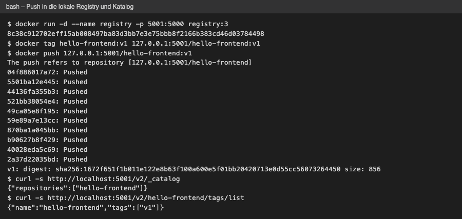
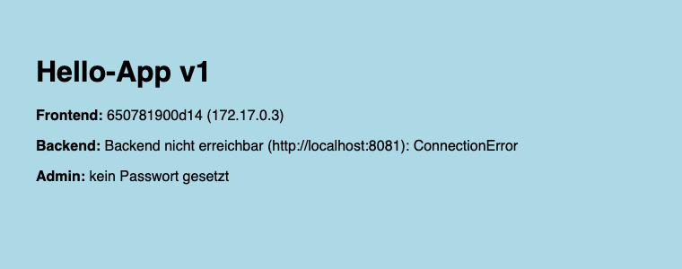

# Lab 2.3 – Lösung: Tags und Registry

Alle Schritte als Skript: `project/examples/m02-images/l03-registry/registry.sh`.

## Aufgabe 1: Registry starten

```bash
docker run -d --name registry -p 5001:5000 registry:3
```

```text
8c38c912702eff15ab008497ba83d3bb7e3e75bbb8f2166b383cd46d03784498
```

Die Registry lauscht im Container auf Port 5000 und ist auf dem Rechner unter Port 5001 erreichbar.

## Aufgabe 2: Taggen und pushen

```bash
docker tag hello-frontend:v1 127.0.0.1:5001/hello-frontend:v1
docker push 127.0.0.1:5001/hello-frontend:v1
docker images
```

```text
The push refers to repository [127.0.0.1:5001/hello-frontend]
04f886017a72: Pushed
5501ba12e445: Pushed
44136fa355b3: Pushed
…
2a37d22035bd: Pushed
v1: digest: sha256:1672f651f1b011e122e8b63f100a600e5f01bb20420713e0d55cc56073264450 size: 856
```

```text
IMAGE                              ID             DISK USAGE   CONTENT SIZE   EXTRA
127.0.0.1:5001/hello-frontend:v1   1672f651f1b0        105MB         24.8MB
hello-frontend:v1                  1672f651f1b0        105MB         24.8MB
…
```

- Beide Namen haben dieselbe ID: `docker tag` legt nur einen zweiten Namen an.
- Die Registry-Adresse im Namen bestimmt, wohin `docker push` hochlädt. Jede Zeile `Pushed` ist eine Schicht; IDs und Digest sind auf jedem Rechner anders.

## Aufgabe 3: Katalog und Tag-Liste

| Adresse | Antwort |
| --- | --- |
| `http://localhost:5001/v2/_catalog` | `{"repositories":["hello-frontend"]}` |
| `http://localhost:5001/v2/hello-frontend/tags/list` | `{"name":"hello-frontend","tags":["v1"]}` |



_Quelle: eigener Screenshot, Registry `registry:3`, 24.11.2026._

`repositories` nennt die Image-Namen ohne Registry-Adresse, `tags` die Versionen eines Repositories.

## Aufgabe 4: Aus der Registry starten

```bash
docker rmi 127.0.0.1:5001/hello-frontend:v1
docker run -d --name hello-registry -p 8080:80 127.0.0.1:5001/hello-frontend:v1
```

```text
Untagged: 127.0.0.1:5001/hello-frontend:v1
```

```text
Unable to find image '127.0.0.1:5001/hello-frontend:v1' locally
v1: Pulling from hello-frontend
Digest: sha256:1672f651f1b011e122e8b63f100a600e5f01bb20420713e0d55cc56073264450
Status: Downloaded newer image for 127.0.0.1:5001/hello-frontend:v1
650781900d14df77c5b25836a147e67fedfc4887411c67c7fa34279909237154
```



_Quelle: eigener Screenshot, `127.0.0.1:5001/hello-frontend:v1` aus der lokalen Registry, 24.11.2026._

- `docker rmi` entfernt nur den Namen (`Untagged`); das Image bleibt unter `hello-frontend:v1` erhalten, das Tag 2 braucht.
- `docker run` findet den Namen nicht lokal und zieht das Image aus der Registry. Die Schichten liegen schon auf dem Rechner und werden nicht erneut übertragen; auf einem frischen Rechner lädt `pull` alle Schichten.
- „Backend nicht erreichbar" ist wie in Lab 2.2 erwartet.

## Aufgabe 5: Aufräumen

```bash
docker rm -f hello-registry registry
docker images hello-frontend
```

```text
hello-registry
registry
IMAGE               ID             DISK USAGE   CONTENT SIZE   EXTRA
hello-frontend:v1   1672f651f1b0        105MB         24.8MB
hello-frontend:v2   922229415249        105MB         24.8MB
```

Mit dem Container `registry` sind auch die gepushten Daten weg; die lokalen Hello-Images bleiben. Der Name `127.0.0.1:5001/hello-frontend:v1` aus Aufgabe 4 kann mit `docker rmi` entfernt werden.

## Erweiterung: Push nach Docker Hub

```bash
docker login --username <docker-id>                     # Token einfügen
docker tag hello-frontend:v1 <docker-id>/hello-frontend:1.0.0
docker push <docker-id>/hello-frontend:1.0.0
```

```text
The push refers to repository [docker.io/<docker-id>/hello-frontend]
…
1.0.0: digest: sha256:… size: 856
```

Ohne Registry-Adresse im Namen geht der Push nach `docker.io`. Der erste Push legt das Repository mit der Standard-Sichtbarkeit des Kontos an (**My Hub > Settings > Default privacy**); das kostenlose Konto erlaubt ein privates Repository.
