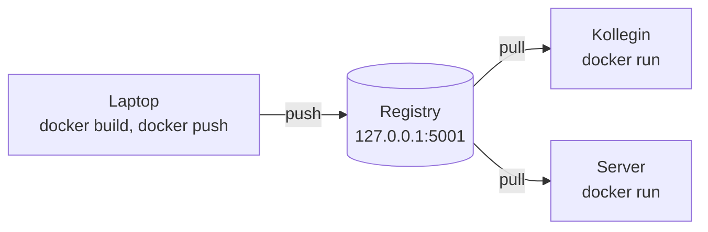
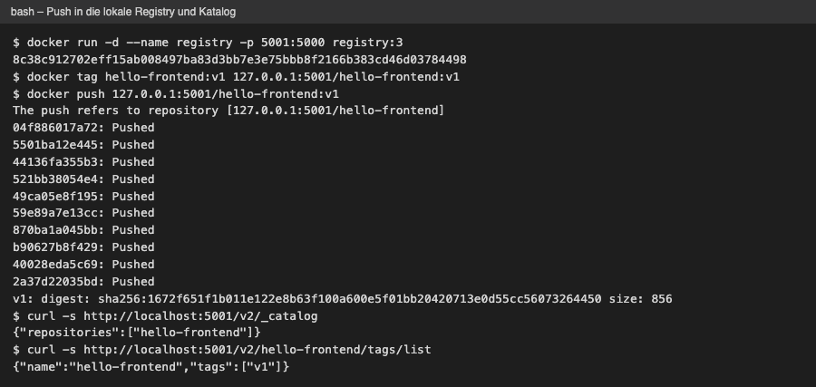

# Lab 2.3: Tags und Registry

**Leitfragen:**

<details>
<summary>Ein Team von zehn Personen braucht dieselben Images: wo sollen sie liegen?</summary>

An einem gemeinsamen Ort, den alle erreichen: in einer Registry. Ein Image wird einmal hochgeladen (`push`) und von allen heruntergeladen (`pull`); jede Person bekommt exakt dasselbe Image.

</details>

<details>
<summary>Ein Server soll in drei Monaten genau dieselbe Version starten wie heute: woran macht man „dieselbe" fest?</summary>

An einer festen Versionsnummer im Tag (`hello-frontend:1.0.0`), nie an `latest`. Ganz sicher ist nur der Digest (`sha256:…`): Er ändert sich mit jedem Byte des Images, ein Tag lässt sich dagegen neu vergeben.

</details>

- Eine Registry speichert Images und liefert sie aus; ein Repository fasst alle Versionen eines Images unter einem Namen zusammen.
- Der vollständige Image-Name enthält Registry, Repository und Tag. `docker tag` vergibt einen weiteren Namen, `docker push` lädt hoch, `docker pull` lädt herunter.
- Feste Versionen nach `MAJOR.MINOR.PATCH` machen nachvollziehbar, was läuft; `latest` gehört nicht auf Server.

## Begriffe

| Begriff | Bedeutung |
| --- | --- |
| Registry | Server, der Images speichert und über HTTP(S) ausliefert; wie ein App-Store für Images |
| Repository | alle Versionen eines Images unter einem Namen in einer Registry, z. B. `hello-frontend` mit den Tags `v1` und `v2` |
| `push` / `pull` | Image in eine Registry hochladen / aus ihr herunterladen |
| öffentliche / private Registry | öffentlich: jede Person kann Images laden (Docker Hub); privat: nur nach Anmeldung, z. B. im Firmennetz |
| Digest | Prüfwert eines Images (`sha256:…`); ändert sich bei jeder Änderung am Inhalt, im Gegensatz zum Tag |
| semantische Versionierung | Versionsnummer `MAJOR.MINOR.PATCH`, deren Teile die Art der Änderung anzeigen |
| Zugangstoken | geheime Zeichenfolge, die bei `docker login` statt des Passworts dient und sich einzeln widerrufen lässt |

## Registry und Repository



Der vollständige Name eines Images sagt Docker, aus welcher Registry es kommt:

```text
127.0.0.1:5001/hello-frontend:v1
└─ Registry ─┘ └─Repository─┘ └Tag┘
```

| Name wie eingegeben | vollständiger Name | Registry |
| --- | --- | --- |
| `nginx:1.29-alpine` | `docker.io/library/nginx:1.29-alpine` | Docker Hub, offizielles Image (`library`) |
| `<konto>/hello-frontend:1.0.0` | `docker.io/<konto>/hello-frontend:1.0.0` | Docker Hub, eigenes Konto |
| `ghcr.io/<konto>/hello-frontend:1.0.0` | unverändert | GitHub Container Registry |
| `127.0.0.1:5001/hello-frontend:v1` | unverändert | eigene Registry auf Port 5001 |

Ohne Registry-Adresse ergänzt Docker `docker.io`, ohne Konto `library`, ohne Tag `latest`.

## Docker Hub

Docker Hub ist die größte öffentliche Registry: offizielle Images (`nginx`, `python`, `ubuntu`), Images von Herstellern und von Nutzerinnen und Nutzern.

| Konto | Pulls je 6 Stunden | private Repositories |
| --- | --- | --- |
| ohne Anmeldung | 100 je IPv4-Adresse bzw. IPv6-/64-Netz | – |
| Personal (kostenlos, angemeldet) | 200 | bis zu 1 |
| Pro, Team, Business (bezahlt) | unbegrenzt | unbegrenzt |

Quelle: [Docker Hub usage and limits](https://docs.docker.com/docker-hub/usage/), Stand 24.11.2026. In einem Schulungsraum teilen sich alle eine IP-Adresse; deshalb lädt `pull-images.sh` die Kurs-Images vorab, und `docker login` hebt die Grenze auf 200 je Konto.

Für `docker login` empfiehlt Docker ein persönliches Zugangstoken (Personal Access Token) statt des Passworts: Es hat eigene Rechte (z. B. nur Lesen), ein Ablaufdatum und lässt sich einzeln widerrufen. Erzeugt wird es auf `app.docker.com` unter **Account settings > Personal access tokens** ([Access tokens](https://docs.docker.com/security/access-tokens/), abgerufen am 24.11.2026).

```bash
docker login --username <docker-id>     # bei "Password:" das Token einfügen
```

## Private Registries

| Registry | Art | Einsatz |
| --- | --- | --- |
| `registry:3` (CNCF Distribution) | Open Source, ein Container, ohne Oberfläche | Lernen, Tests, kleine Teams |
| Harbor | Open Source, CNCF-Projekt mit Weboberfläche, Benutzern, Rollen und Scans | firmeninterne Registry |
| GitHub Container Registry (`ghcr.io`) | Cloud-Dienst von GitHub | Images neben dem Quellcode |
| Cloud-Registries | Amazon ECR, Azure Container Registry, Google Artifact Registry | Images für Server in derselben Cloud |

Quellen: [CNCF Distribution](https://distribution.github.io/distribution/), [CNCF: Harbor](https://www.cncf.io/projects/harbor/), [GitHub Docs: Container registry](https://docs.github.com/en/packages/working-with-a-github-packages-registry/working-with-the-container-registry), abgerufen am 24.11.2026.


_Quelle: Harbor-Projekt, „Repositories" (https://goharbor.io/docs/main/working-with-projects/working-with-images/repositories/), Apache-2.0, abgerufen am 24.11.2026._

## Lokale Registry mit registry:3

Die einfachste private Registry ist das offizielle Image `registry:3`. Im Container lauscht sie auf Port 5000; im Kurs wird sie auf Port 5001 des Rechners veröffentlicht, weil macOS Port 5000 für den AirPlay-Empfänger belegt.

```bash
docker run -d --name registry -p 5001:5000 registry:3            # Registry starten
docker tag hello-frontend:v1 127.0.0.1:5001/hello-frontend:v1     # zweiter Name mit Registry-Adresse
docker push 127.0.0.1:5001/hello-frontend:v1                      # hochladen
docker pull 127.0.0.1:5001/hello-frontend:v1                      # herunterladen, z. B. auf einem anderen Rechner
```

| Adresse im Browser | Inhalt |
| --- | --- |
| `http://localhost:5001/v2/_catalog` | alle Repositories, z. B. `{"repositories":["hello-frontend"]}` |
| `http://localhost:5001/v2/<name>/tags/list` | Tags eines Repositories, z. B. `{"name":"hello-frontend","tags":["v1"]}` |



_Quelle: eigener Screenshot, Registry `registry:3`, 24.11.2026._

- `docker tag` kopiert nichts: Beide Namen zeigen auf dasselbe Image (gleiche ID in `docker images`).
- `docker push` überträgt nur Schichten, die in der Registry noch fehlen; gemeinsame Schichten (z. B. von `python:3.14-alpine`) liegen dort nur einmal.
- Die Kurs-Registry nutzt HTTP ohne Verschlüsselung und ohne Anmeldung. Docker erlaubt das ohne weitere Einstellung nur für Adressen auf dem eigenen Rechner (`127.0.0.1`, `localhost`); im Firmennetz gehören TLS (verschlüsselte HTTPS-Verbindung) und Benutzerverwaltung dazu.
- Die Daten der Registry liegen in ihrer Container-Schicht und sind mit `docker rm` weg; dauerhaft speichern lassen sie sich mit einem Volume (Lab 3.3).

## Tags und semantische Versionierung


_Quelle: Docker Inc., „Trusted content" (https://docs.docker.com/docker-hub/image-library/trusted-content/), abgerufen am 24.11.2026. Stand des Bildes: Februar 2024; heute zeigt `latest` bei Ubuntu auf 24.04._

Ein Image kann beliebig viele Tags tragen. Das Bild zeigt, warum `latest` unzuverlässig ist: Der Tag wandert mit jeder neuen Version weiter.


_Quelle: Wikimedia Commons, Surjit Bains, CC BY-SA 4.0 (https://commons.wikimedia.org/wiki/File:Semantic-versioning.svg), abgerufen am 24.11.2026._

| Stelle | erhöhen bei | Beispiel ab `1.0.0` |
| --- | --- | --- |
| `MAJOR` | inkompatiblen Änderungen | `2.0.0` |
| `MINOR` | neuen, kompatiblen Funktionen | `1.1.0` |
| `PATCH` | Fehlerkorrekturen | `1.0.1` |

Quelle: [semver.org](https://semver.org/lang/de/), abgerufen am 24.11.2026.

- **Kein `latest` auf Servern:** Zwei Server mit `latest` laufen unbemerkt mit unterschiedlichen Versionen.
- **Vergebene Versionen nie überschreiben:** `1.0.0` bleibt `1.0.0`; jede Änderung bekommt eine neue Nummer.
- **Mehrere Tags je Image:** `1.0.0`, `1.0` und `1` auf dasselbe Image; ein Server wählt, ob er genau eine Version oder automatisch alle Korrekturen bekommt.
- **Digest für absolute Sicherheit:** `nginx:1.29-alpine@sha256:…` lädt genau dieses Image, auch wenn der Tag später verschoben wird.
- Die Hello-Images nutzen der Kürze halber `v1` und `v2`; in einer Firmen-Registry hießen sie z. B. `1.0.0` und `2.0.0`.

## Typische Fehler

| Symptom | Ursache | Lösung |
| --- | --- | --- |
| `Bind for 0.0.0.0:5001 failed: port is already allocated` | Registry läuft schon oder ein anderes Programm nutzt den Port | `docker ps`; alte Registry mit `docker rm -f registry` entfernen |
| `tag does not exist: 127.0.0.1:5001/…` beim Push | Image nicht mit Registry-Adresse getaggt | erst `docker tag`, dann `docker push` |
| `http: server gave HTTP response to HTTPS client` | Registry ohne TLS unter einer anderen Adresse als `127.0.0.1`/`localhost` | Kurs-Registry über `127.0.0.1:5001` ansprechen |
| `denied: requested access to the resource is denied` beim Push nach Docker Hub | nicht angemeldet oder fremdes Konto im Namen | `docker login`; Name mit eigenem Konto (`<konto>/hello-frontend:1.0.0`) |
| `unauthorized: incorrect username or password` | Passwort statt Token oder Token abgelaufen | neues Token erzeugen und bei `docker login` einfügen |
| Katalog leer nach Neustart der Registry | Container wurde gelöscht, Daten lagen in der Container-Schicht | Images erneut pushen; dauerhaft mit Volume (Lab 3.3) |

## Fazit

- Eine Registry speichert und verteilt Images: `docker tag` mit Registry-Adresse, dann `docker push`; andere Rechner nutzen `docker pull`.
- Docker Hub ist öffentlich und hat Pull-Grenzen; private Registries (`registry:3`, Harbor, `ghcr.io`, Cloud) halten Firmen-Images im eigenen Zugriff.
- Feste Versionen nach `MAJOR.MINOR.PATCH` statt `latest`; der Digest identifiziert ein Image eindeutig.

In der Übung landet `hello-frontend:v1` in der eigenen Registry und startet von dort wieder.
