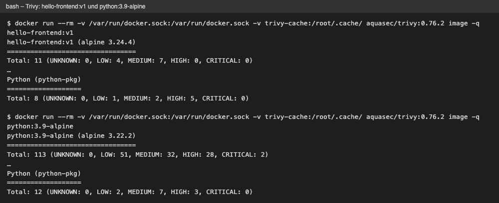
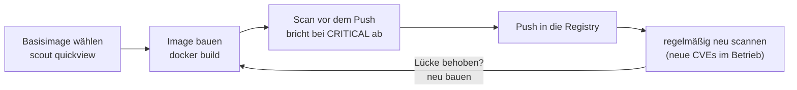

# Lab 2.4: Images auf Schwachstellen prüfen

**Leitfragen:**

<details>
<summary>Woher weiß man, ob in einem fertigen Paket eine bekannte Sicherheitslücke steckt?</summary>

Man vergleicht die enthaltenen Programme und ihre Versionen mit öffentlichen Listen bekannter Lücken. Ein Scanner erledigt das automatisch für alle Pakete eines Images.

</details>

<details>
<summary>Wann sollte eine solche Prüfung laufen: vor dem Bauen, nach dem Bauen oder im Betrieb?</summary>

Zu allen drei Zeitpunkten: beim Auswählen des Basisimages, nach jedem Build vor dem Push und regelmäßig für laufende Images, weil täglich neue Lücken bekannt werden.

</details>

- Ein Image-Scan listet die Pakete eines Images und vergleicht ihre Versionen mit Schwachstellen-Datenbanken. Ergebnis: bekannte Lücken (CVEs) mit Schweregrad und der Version, die sie behebt.
- Die meisten Lücken stecken im Basisimage, nicht im eigenen Code. Wirksamstes Gegenmittel: schlanke, aktuelle Basisimages und regelmäßig neu bauen.

## Begriffe

| Begriff | Bedeutung |
| --- | --- |
| CVE | Common Vulnerabilities and Exposures: weltweit eindeutige Nummer einer bekannten Lücke, z. B. `CVE-2026-31789` |
| Schweregrad | Einstufung einer Lücke: `CRITICAL`, `HIGH`, `MEDIUM`, `LOW` (in Docker Scout C, H, M, L) |
| Image-Scan | automatische Prüfung aller Pakete eines Images gegen Schwachstellen-Datenbanken |
| SBOM | Software Bill of Materials: Stückliste aller Pakete und Versionen eines Images; Grundlage des Scans |
| Fixed Version | erste Paketversion, in der die Lücke behoben ist; leer = noch keine Korrektur verfügbar |
| CI/CD-Pipeline | automatischer Ablauf, der bei jeder Codeänderung baut, testet und ausliefert (z. B. GitHub Actions) |

## Ablauf eines Image-Scans


_Quelle: Trivy Docs, „Container Image" (https://trivy.dev/docs/latest/guide/target/container_image/), Aqua Security, Apache-2.0, abgerufen am 24.11.2026._

1. Der Scanner lädt eine Schwachstellen-Datenbank (Quellen wie die US-Datenbank NVD, GitHub Advisories und die Sicherheitsmeldungen von Alpine, Debian, Ubuntu).
2. Er liest die Schichten des Images (Lab 2.1) und erkennt Betriebssystem-Pakete (`apk`, `apt`) und Sprachpakete (`pip`, `npm`).
3. Er vergleicht jede Paketversion mit der Datenbank und meldet Treffer mit Schweregrad und Fixed Version.

Der Scan findet nur **bekannte** Lücken in **erkannten** Paketen; Fehler im eigenen Code und unbekannte Lücken bleiben unsichtbar.

## Scanner Docker Scout, Trivy und Grype

| Werkzeug | Herkunft | Voraussetzung |
| --- | --- | --- |
| Docker Scout | Docker; in Docker Desktop und als CLI-Plugin `docker scout` enthalten | kostenloses Docker-Konto, `docker login` |
| Trivy | Aqua Security, Open Source | keine; läuft als Container |
| Grype | Anchore, Open Source | keine; läuft als Container |

Das frühere `docker scan` gibt es nicht mehr; Nachfolger ist Docker Scout. Quellen: [Docker Scout](https://docs.docker.com/scout/), [trivy.dev](https://trivy.dev/), [anchore/grype](https://github.com/anchore/grype), abgerufen am 24.11.2026.

| Befehl | Wirkung |
| --- | --- |
| `docker scout quickview <image>` | Kurzfassung: Anzahl Lücken je Schweregrad für Image und Basisimage |
| `docker scout cves <image>` | alle Lücken, gruppiert nach Paket, mit CVE-Nummer, Schweregrad und Fixed Version |
| `docker scout cves --only-severity critical,high <image>` | nur kritische und hohe Lücken |
| `docker scout recommendations <image>` | Vorschläge für ein Basisimage mit weniger Lücken |


_Quelle: Docker Inc., „Docker Scout" (https://www.docker.com/products/docker-scout/), abgerufen am 24.11.2026._

Docker Desktop zeigt dieselbe Analyse unter **Images** → Image auswählen → Lücken je Paket. Lokale Images werden auf dem Rechner analysiert; zum Abgleich geht nur die Stückliste (SBOM) an Docker.

## Altes und aktuelles Basisimage im Vergleich

Trivy-Scan des Hello-Frontends (Basis `python:3.14-alpine`, Alpine 3.24) und des veralteten `python:3.9-alpine` (Alpine 3.22, Python 3.9 ohne Sicherheitsupdates seit 31.10.2025 laut [Status of Python versions](https://devguide.python.org/versions/)):



_Quelle: eigener Screenshot, Trivy 0.76.2, 24.11.2026._

| Image | Betriebssystem-Pakete | Python-Pakete |
| --- | --- | --- |
| `hello-frontend:v1` (Alpine 3.24) | 11 (0 C, 0 H, 7 M, 4 L) | 8 (0 C, 5 H, 2 M, 1 L) |
| `python:3.9-alpine` (Alpine 3.22) | 113 (2 C, 28 H, 32 M, 51 L) | 12 (0 C, 3 H, 7 M, 2 L) |

- Die Zahlen ändern sich täglich, weil neue Lücken bekannt und behoben werden; der Vergleich zählt, nicht die genaue Zahl.
- Beispiel einer kritischen Lücke in `python:3.9-alpine`: `CVE-2026-31789` in OpenSSL (`libcrypto3`, `libssl3`), installiert `3.5.4-r0`, behoben in `3.5.6-r0`.
- Die Lücken der Python-Pakete von `hello-frontend:v1` stecken in Kopien, die `pip` aus dem Basisimage selbst mitbringt (z. B. `urllib3` 2.7.0, behoben in 2.8.0). Die Bibliotheken der App aus `requirements.txt` sind aktuell (`urllib3` 2.8.0); ein späterer Neubau mit neuem Basisimage behebt auch die `pip`-Kopien.

## Scan in der Pipeline



| Gegenmittel | Umsetzung |
| --- | --- |
| schlankes Basisimage | Alpine, `-slim` oder distroless (Lab 2.1): weniger Pakete, weniger Lücken |
| aktuelles Basisimage | unterstützte Versionen wie `python:3.14-alpine` statt `python:3.9-alpine` |
| regelmäßig neu bauen | `docker build --pull …` lädt das Basisimage neu und übernimmt dessen Sicherheitsupdates |
| Scan automatisieren | fertige Schritte für GitHub Actions, z. B. `docker/scout-action`, `aquasecurity/trivy-action` |

## Befehle zum Nachmachen

Docker Scout (nach `docker login` mit kostenlosem Docker-Konto):

```bash
docker scout quickview hello-frontend:v1
docker pull python:3.9-alpine
docker scout quickview python:3.9-alpine
docker scout cves --only-severity critical,high python:3.9-alpine
docker scout recommendations python:3.9-alpine
```

Trivy als Container in einer Zeile, ohne Konto (`-v /var/run/docker.sock:…` gibt Trivy Zugriff auf den Docker Daemon und damit auf die lokalen Images; die Datenbank landet im Docker-verwalteten Speicher `trivy-cache`, Volumes in Lab 3.3):

```bash
docker run --rm -v /var/run/docker.sock:/var/run/docker.sock -v trivy-cache:/root/.cache/ \
  aquasec/trivy:0.76.2 image -q hello-frontend:v1
docker run --rm -v /var/run/docker.sock:/var/run/docker.sock -v trivy-cache:/root/.cache/ \
  aquasec/trivy:0.76.2 image -q --severity CRITICAL,HIGH python:3.9-alpine
```

Der erste Trivy-Lauf lädt die Schwachstellen-Datenbank und dauert deshalb länger. Aufräumen danach: `docker volume rm trivy-cache`.

| Symptom | Ursache | Lösung |
| --- | --- | --- |
| `Log in with your Docker ID or email address to use docker scout.` | nicht angemeldet | `docker login`; ohne Konto Trivy nutzen |
| `docker: 'scout' is not a docker command` | Docker Engine unter Linux ohne Scout-Plugin | Trivy nutzen |
| Trivy unter Git Bash: `invalid mount config` | Git Bash wandelt `/var/run/docker.sock` um | `export MSYS_NO_PATHCONV=1` |
| Zahlen weichen vom Handout ab | Datenbanken ändern sich täglich | erwartet |

## Fazit

- Ein Image-Scan gleicht die Pakete eines Images mit Datenbanken bekannter Lücken ab; Docker Scout braucht ein Docker-Konto, Trivy und Grype laufen ohne.
- Ein altes Basisimage bringt ein Vielfaches an bekannten Lücken mit; ein aktuelles, schlankes Basisimage ist die wirksamste Einzelmaßnahme.
- Scans gehören vor jeden Push und regelmäßig in den Betrieb; neu bauen holt die Korrekturen ins Image.

Die Demo vergleicht `hello-frontend:v1` mit `python:3.9-alpine`; alle Befehle stehen oben zum Nachmachen.
