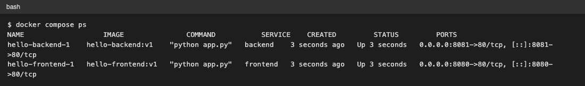
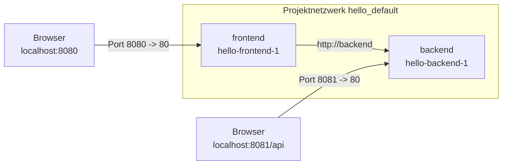
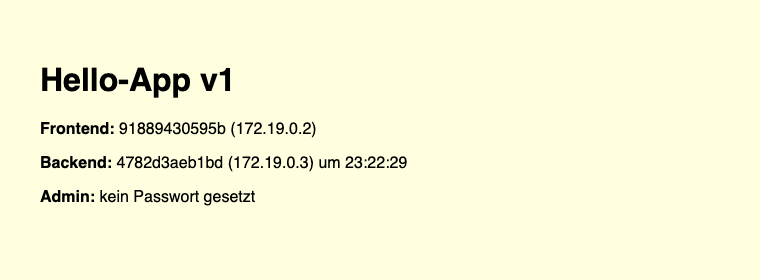

# Lab 3.1: Compose-Grundlagen

**Leitfragen:**

<details>
<summary>Welche Angaben aus den <code>docker run</code>-Befehlen von heute Vormittag müssten in einer Datei stehen?</summary>

Image, Containername, Ports (`-p`), eingebundene Ordner (`-v`) und Umgebungsvariablen (`-e`), für jeden Container einzeln. Docker Compose schreibt genau diese Angaben je Dienst in eine YAML-Datei.

</details>

<details>
<summary>Wie startet ein neues Teammitglied am ersten Tag die ganze Anwendung?</summary>

Mit einem Befehl im Projektordner: `docker compose up -d`. Alle Container, ihr gemeinsames Netzwerk und ihre Einstellungen kommen aus der Compose-Datei, die im Projekt liegt.

</details>

- Die Hello-App besteht aus zwei Containern. Bisher brauchte jeder einen eigenen `docker run`-Befehl mit allen Optionen, und das Frontend fand das Backend nicht („Backend nicht erreichbar", Lab 2.2).
- Docker Compose beschreibt alle Container einer Anwendung in einer Datei `compose.yml` und startet sie mit einem Befehl; die Dienste finden sich dabei über ihren Namen.

## Begriffe

| Begriff | Bedeutung |
| --- | --- |
| Docker Compose | Werkzeug, das mehrere Container nach einer Beschreibungsdatei gemeinsam startet, anzeigt und entfernt; Teil von Docker Desktop, Aufruf `docker compose` |
| Compose-Datei | YAML-Datei mit der Beschreibung der Anwendung, Standardname `compose.yaml` oder `compose.yml`; wie ein Bauplan für alle Container auf einmal |
| YAML | Textformat für Konfiguration: `schlüssel: wert`, Einrückung mit Leerzeichen zeigt, was wozu gehört, `-` beginnt einen Listeneintrag |
| Dienst (Service) | ein Baustein der Anwendung in der Compose-Datei, z. B. `frontend`; Compose startet daraus einen oder mehrere gleiche Container |
| Projekt | alle Container, Netzwerke und Volumes einer Compose-Datei; Name aus `name:` oder sonst der Ordnername |
| Projektnetzwerk | Netzwerk, das Compose je Projekt anlegt (`hello_default`); darin erreichen sich die Dienste über ihren Dienstnamen |
| `.env` | Datei neben der Compose-Datei, aus der Compose Werte für Platzhalter wie `${FRONTEND_PORT}` liest |

## Docker Compose: eine Anwendung in einer Datei


_Quelle: Docker Inc., „How Compose works" (https://docs.docker.com/compose/intro/compose-application-model/), abgerufen am 24.11.2026._

Das Bild zeigt, was eine Compose-Datei beschreibt: Dienste (Frontend, Backend), den Port nach außen, das Netzwerk zwischen den Diensten und ein Volume für dauerhafte Daten. Netzwerke vertieft Modul 4, Volumes Lab 3.3.

| Szenario | Einsatz von Compose |
| --- | --- |
| Entwicklung | Anwendung samt Datenbank und weiteren Diensten startet mit einem Befehl, für alle im Team gleich |
| Tests | Testumgebung mit festen Versionen, die jedes Mal gleich startet |
| Betrieb auf einem Server | kleine Anwendungen auf einem einzelnen Rechner; für mehrere Server gibt es Orchestrierer (Lab 4.4, Tag 2) |

## Aufbau der compose.yml der Hello-App

Die Datei liegt in `project/playground/compose.yml`, neben den Ordnern `frontend/` und `backend/`:

```yaml
name: hello                               # Projektname (ohne diese Zeile: Ordnername "playground")

services:                                 # oberste Ebene: alle Dienste der Anwendung
  backend:                                # Dienstname, frei wählbar; zugleich Hostname im Projektnetzwerk
    image: hello-backend:v1               # Image aus Lab 2.2
    ports:
      - "8081:80"                         # Rechner-Port 8081 -> Container-Port 80 (wie -p 8081:80)

  frontend:
    image: hello-frontend:v1
    ports:
      - "${FRONTEND_PORT}:80"             # Rechner-Port aus der Datei .env
    environment:                          # wie -e bei docker run
      BACKEND_URL: http://backend         # Dienstname statt IP; ohne Port bedeutet http:// Port 80
      APP_COLOR: ${APP_COLOR}             # Hintergrundfarbe aus .env
```

| YAML-Regel | Beispiel |
| --- | --- |
| Einrückung nur mit Leerzeichen, meist zwei je Ebene; gleiche Einrückung = gleiche Ebene | `backend:` und `frontend:` stehen beide unter `services:` |
| `schlüssel: wert` mit Leerzeichen nach dem Doppelpunkt | `image: hello-backend:v1` |
| `- ` beginnt einen Listeneintrag | `- "8081:80"` |
| `#` beginnt einen Kommentar | `# Image aus Lab 2.2` |
| Ports in Anführungszeichen | `"8081:80"`; ohne Anführungszeichen kann YAML Zahlen mit Doppelpunkt falsch lesen |

Compose findet ohne weitere Angabe `compose.yaml`, `compose.yml` und die älteren Namen `docker-compose.yaml`/`.yml` im aktuellen Ordner. Eine Datei mit anderem Namen wählt `-f` vor dem Unterbefehl: `docker compose -f test.yml up -d`.

## Dienst-Optionen und ihre docker-run-Entsprechung

| Option | entspricht | Zweck |
| --- | --- | --- |
| `image` | Image-Name bei `docker run` | fertiges Image nutzen, z. B. `hello-backend:v1` oder `nginx:1.29-alpine` |
| `build` | `docker build` (Lab 2.2) | Image aus einem Ordner mit Dockerfile bauen, z. B. `build: ./frontend`; mit `image` daneben bekommt es diesen Namen |
| `ports` | `-p` | Rechner-Port mit Container-Port verbinden |
| `environment` | `-e` | Umgebungsvariablen für den Container |
| `env_file` | `--env-file` | Umgebungsvariablen aus einer eigenen Datei laden, z. B. `env_file: [frontend.env]` |
| `volumes` | `-v` | Ordner oder Volume einbinden (Lab 3.3) |

`build` baut nur, wenn das Image noch fehlt. Nach einer Änderung am Code erzwingt `docker compose up -d --build` den Neubau (genutzt in Lab 3.2).

## Werte aus der Datei .env

Werte, die sich je Rechner oder Umgebung ändern, stehen nicht fest in der Compose-Datei. Compose liest beim Start die Datei `.env` im selben Ordner und setzt die Werte für `${…}` ein:

```bash
# playground/.env
FRONTEND_PORT=8080
APP_COLOR=lightyellow
```

| Mechanismus | Wer liest die Werte? | Wann? |
| --- | --- | --- |
| `.env` + `${VAR}` in `compose.yml` | Compose selbst | beim Einlesen der Datei, bei jedem `docker compose`-Befehl |
| `environment:` | der Container | beim Start des Containers |
| `env_file:` | der Container | beim Start des Containers |

- `docker compose config` zeigt die Datei so, wie Compose sie nach dem Einsetzen versteht: der schnellste Test, ob `.env` wirkt.
- `${FRONTEND_PORT:-8080}` gibt einen Standardwert vor, falls die Variable fehlt; ohne Standardwert warnt Compose (`The "FRONTEND_PORT" variable is not set. Defaulting to a blank string.`) und setzt einen leeren Text ein.
- `APP_COLOR` steht als Standard `lightblue` im Image (Lab 2.2); `environment` überschreibt ihn beim Start, das Image bleibt gleich.

## Befehle für ein Compose-Projekt

| Befehl | Wirkung |
| --- | --- |
| `docker compose up -d` | Netzwerk anlegen, fehlende Images bauen, alle Dienste im Hintergrund starten; Änderungen an der Datei übernehmen |
| `docker compose ps` | Container dieses Projekts mit Status und Ports |
| `docker compose logs` | Ausgaben aller Dienste; `logs -f backend` liest einen Dienst live mit |
| `docker compose config` | Datei mit eingesetzten Werten anzeigen |
| `docker compose down` | Container und Projektnetzwerk stoppen und entfernen; Images bleiben |



_Quelle: eigener Screenshot, Hello-App mit compose.yml aus Lab 3.1, 24.11.2026._

Container heißen `<projekt>-<dienst>-<nummer>`, z. B. `hello-frontend-1`. Ein zweites `up -d` nach einer Änderung erstellt nur die betroffenen Container neu.

## Projektnetzwerk und Dienstnamen

Compose legt für das Projekt das Netzwerk `hello_default` an und hängt beide Dienste hinein. Darin ist jeder Dienstname zugleich ein Hostname: Das Frontend fragt `http://backend`, ohne eine IP-Adresse zu kennen. Deshalb zeigt die Hello-Seite jetzt die Antwort des Backends. Wie das funktioniert, zeigt Modul 4.





_Quelle: eigener Screenshot, Hello-App mit compose.yml und .env (APP_COLOR=lightyellow), 24.11.2026._

## Compose-Versionen und das Feld version:


_Quelle: Docker Inc., „History and development of Docker Compose" (https://docs.docker.com/compose/intro/history/), abgerufen am 24.11.2026._

- Heute: `docker compose` (Leerzeichen, Teil von Docker); `docker compose version` zeigt die Version (Stand 24.11.2026 mit Docker Desktop: v5.7.0). Das alte Programm `docker-compose` (v1, mit Bindestrich) wird nicht mehr unterstützt.
- Ältere Dateien beginnen mit `version: "3.8"`. Das Feld ist veraltet; Compose meldet ``the attribute `version` is obsolete, it will be ignored``. Neue Dateien lassen es weg.

## Typische Fehler

| Symptom | Ursache | Lösung |
| --- | --- | --- |
| `no configuration file provided: not found` | Befehl im falschen Ordner | `cd playground` (dort liegt `compose.yml`) |
| `services.frontend must be a mapping` | Dienst ohne Inhalt, z. B. nur `TODO`-Kommentare darunter | Optionen unter dem Dienst ergänzen |
| `go-yaml load error … at L6.C3-L13.C5: did not find expected key` | Einrückung falsch | gleich weit einrücken; Zeile (`L6`) und Spalte (`C3`) stehen in der Meldung |
| `go-yaml load error … found character that cannot start any token` | Tab statt Leerzeichen | Tabs durch Leerzeichen ersetzen; VS Code zeigt unten rechts „Spaces: 2" |
| `Bind for 0.0.0.0:8080 failed: port is already allocated` | Container aus einem früheren Lab belegt den Port | `docker ps`, alten Container mit `docker rm -f <name>` entfernen |
| Warnung `The "FRONTEND_PORT" variable is not set`, Seite nicht auf Port 8080 | `.env` fehlt, liegt im falschen Ordner oder heißt anders (`env`, `.env.txt`); aus `"${FRONTEND_PORT}:80"` wird `":80"`, Docker wählt einen zufälligen Port | `.env` neben `compose.yml` anlegen (`ls -a` zeigt sie), `up -d` |
| Seite: „Backend nicht erreichbar (http://localhost:8081)" | `BACKEND_URL` fehlt, das Frontend nutzt seinen Standardwert | `environment:` mit `BACKEND_URL: http://backend` ergänzen, `up -d` |

## Fazit

- Eine Compose-Datei beschreibt Dienste mit `image` oder `build`, `ports`, `environment` und `env_file`; `docker compose up -d` und `down` starten und entfernen alles auf einmal.
- Compose legt ein Projektnetzwerk an; darin erreichen sich die Dienste über ihren Namen, deshalb gilt `BACKEND_URL=http://backend`.
- `.env` liefert Werte für die Compose-Datei, `environment` und `env_file` liefern Werte für den Container; `version:` ist veraltet.

In der Übung entsteht `playground/compose.yml` für die Hello-App, Port und Farbe kommen aus `.env`.
