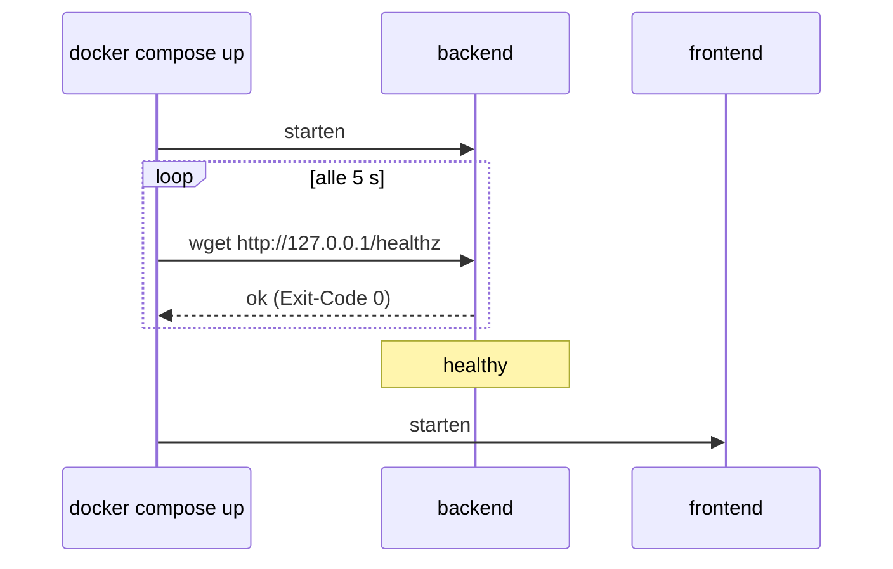
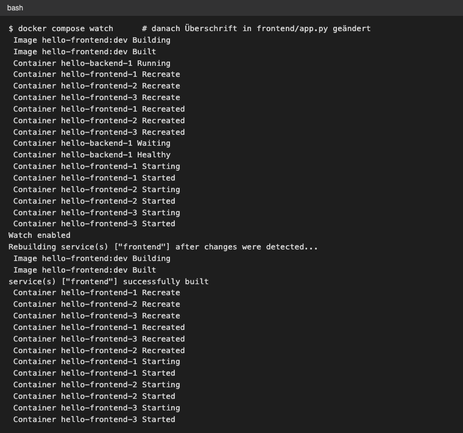
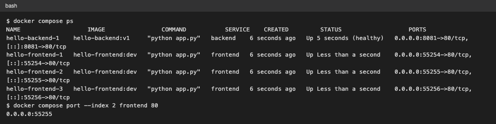

# Lab 3.2: Healthcheck, Watch und Replikas

**Leitfragen:**

<details>
<summary>Ein Programm läuft, antwortet aber nicht mehr: woran merkt man das von außen?</summary>

Nur durch regelmäßiges Nachfragen, z. B. eine Testanfrage alle paar Sekunden. Docker macht das mit einem Healthcheck und markiert den Container als `healthy` oder `unhealthy`.

</details>

<details>
<summary>Das Frontend startet schneller als das Backend: was sieht der erste Besucher?</summary>

Eine Seite mit „Backend nicht erreichbar", obwohl beide Container laufen. Abhilfe: Das Frontend startet erst, wenn das Backend nachweislich antwortet (`depends_on` mit `condition: service_healthy`).

</details>

<details>
<summary>Drei Kopien desselben Dienstes: wie bekommen sie unterschiedliche Ports?</summary>

Gar nicht von Hand: Steht nur der Container-Port in der Datei (`"80"`), wählt Docker für jede Kopie einen freien Rechner-Port.

</details>

- „Container läuft" heißt nicht „Programm antwortet". Ein Healthcheck prüft das regelmäßig; `depends_on` kann auf das Ergebnis warten.
- Zwei weitere Compose-Werkzeuge sparen Zeit: `develop.watch` baut nach jeder Code-Änderung selbst neu, `deploy.replicas` startet mehrere gleiche Container eines Dienstes.

## Begriffe

| Begriff | Bedeutung |
| --- | --- |
| Healthcheck | Befehl, den Docker in festen Abständen im Container ausführt, um zu prüfen, ob das Programm antwortet; wie ein Kontrollanruf |
| `healthy` / `unhealthy` | Ergebnis des Healthchecks: Prüfung erfolgreich / mehrfach hintereinander fehlgeschlagen; vorher `health: starting` |
| `/healthz` | Adresse in der Hello-App, die nur „ok" antwortet, solange das Programm gesund ist; Name nach verbreiteter Konvention |
| `depends_on` | legt fest, auf welchen Dienst ein anderer beim Start wartet |
| Compose Watch | Modus, in dem Compose Dateien beobachtet und den Dienst bei Änderungen neu baut oder aktualisiert (`docker compose watch`) |
| Replika | eine von mehreren gleichen Kopien eines Dienstes |
| Skalieren | die Anzahl der Replikas erhöhen oder senken, um mehr oder weniger Last zu tragen |

## Healthcheck auf /healthz

Ein Healthcheck ist ein Befehl im Container. Endet er mit Exit-Code `0`, gilt die Prüfung als erfolgreich, jeder andere Code als Fehlschlag. Beide Hello-Dienste haben dafür den Endpunkt `/healthz`.

```yaml
  backend:
    image: hello-backend:v1
    healthcheck:
      test: ["CMD", "wget", "-qO-", "http://127.0.0.1/healthz"]   # Prüfbefehl im Container
      interval: 5s          # alle 5 Sekunden prüfen
      timeout: 2s           # Antwort muss nach 2 Sekunden da sein
      retries: 3            # nach 3 Fehlschlägen in Folge: unhealthy
      start_period: 5s      # Anlaufzeit, in der Fehlschläge nicht zählen
```

| Feld | Bedeutung |
| --- | --- |
| `test` | Prüfbefehl als Liste; `"CMD"` führt das Programm direkt aus, `"CMD-SHELL"` über eine Shell |
| `interval` | Abstand zwischen zwei Prüfungen |
| `timeout` | maximale Dauer einer Prüfung; länger zählt als Fehlschlag |
| `retries` | Anzahl Fehlschläge in Folge bis `unhealthy` |
| `start_period` | Anlaufzeit nach dem Start, in der Fehlschläge nicht mitzählen |

Warum `wget` und `127.0.0.1`:

- Das Basisimage `python:3.14-alpine` enthält kein `curl`, aber das Kleinwerkzeug `wget` aus Alpine (busybox). `-qO-` lädt die Adresse ohne Fortschrittsanzeige und gibt den Inhalt aus; bei HTTP-Fehlern wie 500 endet `wget` mit Exit-Code `1`.
- `wget http://localhost/…` versucht im Container zuerst die IPv6-Adresse `::1`; die Hello-App lauscht nur auf IPv4. Mit `127.0.0.1` ist die Adresse eindeutig.
- Alternative ohne `wget`: `["CMD", "python", "-c", "import urllib.request; urllib.request.urlopen('http://127.0.0.1/healthz')"]`.

Der Status steht in `docker compose ps` in der Spalte `STATUS`: `Up 2 seconds (health: starting)`, danach `(healthy)` oder `(unhealthy)`. Die letzten Prüfungen mit Ausgabe zeigt `docker inspect --format '{{json .State.Health}}' hello-backend-1`. Docker startet einen `unhealthy` Container nicht von selbst neu; das übernehmen Orchestrierer (Lab 4.4, Tag 2).

## Startreihenfolge mit depends_on

```yaml
  frontend:
    depends_on:
      backend:
        condition: service_healthy   # erst starten, wenn das Backend "healthy" ist
```

| `condition` | Frontend startet, wenn … |
| --- | --- |
| `service_started` | der Backend-Container läuft (entspricht der Kurzform `depends_on: [backend]`) |
| `service_healthy` | der Healthcheck des Backends erfolgreich war |
| `service_completed_successfully` | der Backend-Container fertig ist und mit Exit-Code `0` endete (z. B. ein Einrichtungsschritt) |



Während `up -d` wartet, steht beim Backend `Waiting`, danach `Healthy`; erst dann folgt `Started` für das Frontend.

## Entwicklungsmodus mit Compose Watch

Ohne Watch heißt jede Code-Änderung: `docker compose up -d --build`, warten, Browser neu laden. Mit `develop.watch` beobachtet Compose die angegebenen Pfade und reagiert selbst:

```yaml
  frontend:
    image: hello-frontend:dev        # eigener Tag: hello-frontend:v1 aus Lab 2.2 bleibt unverändert
    build: ./frontend                # Watch braucht build: Dockerfile in playground/frontend/
    develop:
      watch:
        - path: ./frontend/app.py    # relativ zur Compose-Datei
          action: rebuild            # Datei geändert -> Image neu bauen, Container ersetzen
```

| `action` | Wirkung | geeignet für |
| --- | --- | --- |
| `rebuild` | baut das Image neu und ersetzt den Container | Programme, die ihren Code nur beim Start lesen (Hello-App mit Flask) |
| `sync` | kopiert geänderte Dateien nach `target` in den laufenden Container | Programme, die Code selbst neu laden (z. B. Node.js mit Live-Reload) |
| `sync+restart` | kopiert die Dateien und startet den Container neu | Konfigurationsdateien, die nur beim Start gelesen werden |


_Quelle: Docker Inc., „Announcing Docker Compose Watch GA Release" (https://www.docker.com/blog/announcing-docker-compose-watch-ga-release/), abgerufen am 24.11.2026._

`docker compose watch` startet die Dienste und beobachtet danach; `Strg+C` beendet nur das Beobachten, die Container laufen weiter. Nach einer Änderung an `frontend/app.py` meldet Watch den Neubau:



_Quelle: eigener Screenshot, Hello-App mit compose.yml aus Lab 3.2, 24.11.2026._

Quelle Watch-Optionen: Docker Docs, „Use Compose Watch" (https://docs.docker.com/compose/how-tos/file-watch/), abgerufen am 24.11.2026.

## Mehrere Replikas eines Dienstes

| Weg | Beispiel | Wirkung |
| --- | --- | --- |
| in der Compose-Datei | `deploy:` → `replicas: 3` | jedes `up -d` startet drei Container des Dienstes |
| beim Start | `docker compose up -d --scale frontend=5` | überschreibt den Wert aus der Datei für diesen Aufruf |

Mehrere Kopien können nicht denselben Rechner-Port belegen. Bei skalierten Diensten steht deshalb nur der Container-Port:

```yaml
  frontend:
    ports:
      - "80"          # nur Container-Port: Docker wählt je Kopie einen freien Rechner-Port
    deploy:
      replicas: 3
```



_Quelle: eigener Screenshot, Hello-App mit compose.yml aus Lab 3.2 (drei Replikas), 24.11.2026._

`docker compose port --index 2 frontend 80` nennt den Rechner-Port der zweiten Kopie. Jede Kopie zeigt auf der Hello-Seite eine eigene Container-ID und IP. Das Backend bleibt eine Kopie; alle Frontends fragen es über den Namen `backend`.

## Typische Fehler

| Symptom | Ursache | Lösung |
| --- | --- | --- |
| `dependency failed to start: container hello-backend-1 is unhealthy`, `inspect` zeigt `wget: can't connect to remote host: Connection refused` | `localhost` statt `127.0.0.1` im Healthcheck (IPv6) oder falscher Port | `http://127.0.0.1/healthz` eintragen, `up -d` |
| `exec: "curl": executable file not found in $PATH` im Health-Log | `curl` ist im Python-Alpine-Image nicht enthalten | `wget` oder die Python-Variante nutzen |
| `docker compose ps` zeigt beim Start nur das Backend | das Frontend ist erst erstellt (`Created`) und wartet auf `healthy`; `ps` listet nur laufende Container | `docker compose ps -a` |
| `failed to read dockerfile: open Dockerfile: no such file or directory` | `playground/frontend/Dockerfile` aus Lab 2.2 fehlt | im Ordner `project/`: `cp examples/m02-images/l02-dockerfile/frontend/Dockerfile playground/frontend/` |
| Watch reagiert nicht | `develop.watch` ohne `build`, Pfad falsch oder Datei woanders gespeichert | `build: ./frontend` ergänzen, `path: ./frontend/app.py` relativ zur Compose-Datei |
| `Bind for 0.0.0.0:8080 failed: port is already allocated` bei `replicas: 3` | fester Rechner-Port bei mehreren Kopien | nur Container-Port angeben: `"80"` |

## Fazit

- Ein Healthcheck macht „läuft, antwortet aber nicht" sichtbar; im Python-Alpine-Image prüft `wget -qO- http://127.0.0.1/healthz`.
- `depends_on` mit `condition: service_healthy` startet das Frontend erst, wenn das Backend antwortet.
- `develop.watch` mit `rebuild` erspart das manuelle Neubauen; `deploy.replicas` mit `"80"` startet mehrere Kopien mit eigenen Ports.

In der Übung bekommt die Hello-App einen Healthcheck, Watch und drei Frontends.
