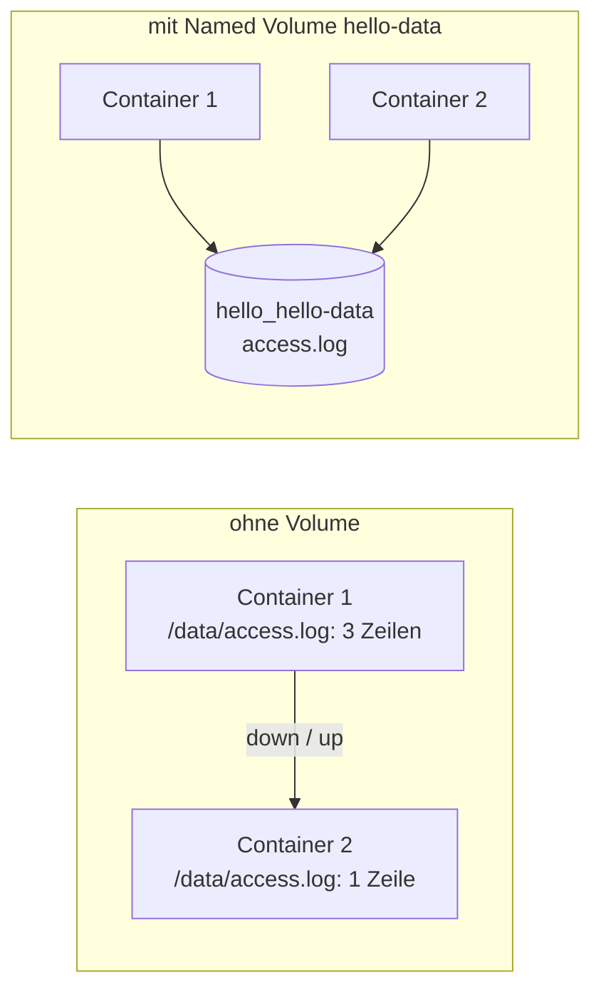
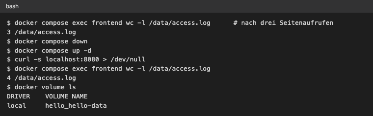

# Lab 3.3: Volumes und Persistenz

**Leitfragen:**

<details>
<summary>Ein Container wird durch eine neue Version ersetzt: was passiert mit Dateien, die er geschrieben hat?</summary>

Die Dateien sind weg: Der neue Container startet wieder vom unveränderten Image (wie die geänderte `index.html` in Lab 1.3). Erhalten bleiben sie nur, wenn sie außerhalb des Containers liegen, in einem Volume oder einem eingebundenen Ordner des Rechners.

</details>

<details>
<summary>Welche Daten einer Web-App dürfen verloren gehen, welche nicht?</summary>

Zwischenspeicher, temporäre Dateien und der Programmcode selbst (steckt im Image) dürfen verloren gehen. Datenbankinhalte, hochgeladene Dateien und Protokolle nicht; sie gehören in ein Volume.

</details>

- Was ein Programm im Container schreibt, liegt in der beschreibbaren Schicht des Containers und verschwindet mit ihm, auch bei `docker compose down`.
- Ein Named Volume ist ein von Docker verwalteter Speicher außerhalb des Containers. Compose legt es an, bindet es ein und lässt es bei `down` stehen; erst `down -v` löscht es.

## Begriffe

| Begriff | Bedeutung |
| --- | --- |
| Persistenz | Daten bleiben erhalten, auch wenn der Container beendet und ersetzt wird |
| Volume | von Docker verwalteter Speicherbereich außerhalb des Containers, eingebunden in einen Container-Ordner; wie ein USB-Stick, der von Container zu Container wandert |
| Named Volume | Volume mit festem Namen (z. B. `hello-data`), über den es wiederverwendet wird |
| Bind Mount | ein Ordner des eigenen Rechners, der im Container sichtbar ist (`-v ./site:/usr/share/nginx/html` aus Lab 1.3) |
| Mountpoint | Ordner, an dem ein Volume erscheint: im Container z. B. `/data`; bei `docker volume inspect` der Speicherort auf dem Docker-Host |
| `access.log` | Datei, in die das Hello-Frontend jeden Seitenaufruf als eine Zeile schreibt (`/data/access.log`) |

## Warum Daten im Container verloren gehen


_Quelle: Docker Inc., „Storage drivers" (https://docs.docker.com/engine/storage/drivers/), abgerufen am 24.11.2026._

Die Image-Schichten sind nur lesbar (Lab 2.1). Jeder Container bekommt darüber eine dünne beschreibbare Schicht. Das Hello-Frontend schreibt `access.log` dorthin, solange kein Volume eingebunden ist. `docker compose down` löscht den Container samt dieser Schicht; der nächste Container beginnt mit einer leeren Datei.



## Named Volume und Bind Mount

| | Named Volume | Bind Mount (Lab 1.3) |
| --- | --- | --- |
| Angabe | Name vorn: `-v hello-data:/data` | Pfad vorn: `-v ./site:/usr/share/nginx/html` |
| liegt | im Speicher von Docker (bei Docker Desktop in dessen Linux-VM) | im gewählten Ordner des Rechners |
| verwaltet mit | `docker volume …`, Docker Desktop **Volumes** | Dateimanager, Editor |
| erstes Einbinden | ein leeres Volume übernimmt die Dateien, die das Image an diesem Pfad hat | der Ordner überdeckt die Dateien des Images |
| typisch für | Daten der Anwendung: Datenbank, Uploads, Protokolle | Quellcode und Konfiguration in der Entwicklung |

Steht vor dem Doppelpunkt ein Pfad (`/…`, `./…`), ist es ein Bind Mount, sonst ein Named Volume.

## Volumes mit der Docker-CLI verwalten

| Befehl | Wirkung |
| --- | --- |
| `docker volume create test-data` | Named Volume anlegen; `docker run -v test-data:/data …` legt es sonst beim ersten Start selbst an |
| `docker volume ls` | alle Volumes auflisten |
| `docker volume inspect hello_hello-data` | Details als JSON: Treiber, `Mountpoint`, zu welchem Compose-Projekt es gehört |
| `docker volume rm test-data` | Volume samt Daten löschen; nur, wenn kein Container es nutzt |
| `docker volume prune` | alle ungenutzten Volumes löschen; nur mit Vorsicht |

```text
$ docker volume inspect hello_hello-data
[
    {
        "CreatedAt": "2026-11-23T23:12:42Z",
        "Driver": "local",                                              ← Standardtreiber: Festplatte des Docker-Hosts
        "Labels": {
            "com.docker.compose.project": "hello",                      ← gehört zum Compose-Projekt hello
            "com.docker.compose.volume": "hello-data",                  ← Name in der Compose-Datei
            …                                                           ← weitere Labels: ignorierbar
        },
        "Mountpoint": "/var/lib/docker/volumes/hello_hello-data/_data", ← Speicherort in der Docker-VM
        "Name": "hello_hello-data",
        "Options": null,
        "Scope": "local"
    }
]
```

Bei Docker Desktop liegt der `Mountpoint` in der Linux-VM, nicht im Dateisystem von macOS oder Windows. Den Inhalt zeigt Docker Desktop in der Ansicht **Volumes** (linke Navigation): Volume anklicken, Reiter **Stored data** listet die Dateien, Textdateien lassen sich dort öffnen; **Container in-use** zeigt, welcher Container das Volume unter welchem Pfad nutzt (Quelle: Docker Docs, „Volumes view", https://docs.docker.com/desktop/use-desktop/volumes/, abgerufen am 24.11.2026).


_Quelle: Docker Inc., Docker Desktop (https://www.docker.com/products/docker-desktop/), abgerufen am 24.11.2026._

## Volumes in Compose

Ein Volume steht in der Compose-Datei an zwei Stellen: beim Dienst (wo wird eingebunden?) und auf oberster Ebene (welche Named Volumes gibt es?).

```yaml
services:
  frontend:
    image: hello-frontend:v1
    # … ports, environment, depends_on wie bisher
    volumes:
      - hello-data:/data          # Named Volume hello-data im Container unter /data

volumes:
  hello-data:                     # oberste Ebene: Compose legt das Volume an
```

- Compose stellt dem Namen den Projektnamen voran: aus `hello-data` im Projekt `hello` wird `hello_hello-data`.
- Die Hello-App schreibt nach `DATA_DIR` (Standard `/data`); deshalb wird das Volume genau dort eingebunden.

| Befehl | Container | Projektnetzwerk | Named Volumes | Images |
| --- | --- | --- | --- | --- |
| `docker compose down` | gelöscht | gelöscht | bleiben | bleiben |
| `docker compose down -v` | gelöscht | gelöscht | gelöscht | bleiben |



_Quelle: eigener Screenshot, Hello-App mit compose.yml aus Lab 3.3, 24.11.2026._

`docker compose exec frontend wc -l /data/access.log` zählt die Zeilen der Datei im laufenden Frontend (`exec` aus Lab 1.3, hier für einen Compose-Dienst). Mit Volume zählt die Datei über `down`/`up` hinweg weiter.

## Typische Fehler

| Symptom | Ursache | Lösung |
| --- | --- | --- |
| Log nach `docker compose down -v` leer | `-v` löscht auch die Named Volumes | `down` ohne `-v`, wenn Daten bleiben sollen |
| `service "frontend" refers to undefined volume hello-data: invalid compose project` | Volume beim Dienst genutzt, aber nicht auf oberster Ebene angelegt | `volumes:` mit `hello-data:` ganz links (gleiche Ebene wie `services:`) ergänzen |
| Log trotz Volume nach Neustart weg | falscher Pfad im Container, z. B. `/daten` statt `/data` | Pfad aus der App-Beschreibung nehmen (`DATA_DIR`, Standard `/data`) |
| `cat: can't open '/data/access.log': No such file or directory` | seit dem Start noch kein Seitenaufruf | Seite einmal laden, dann erneut prüfen |
| `volume is in use` bei `docker volume rm` | ein Container (auch gestoppt) nutzt das Volume | Container zuerst entfernen (`docker compose down`) |

## Fazit

- Daten in der beschreibbaren Container-Schicht verschwinden mit dem Container; Named Volumes und Bind Mounts halten sie außerhalb.
- `docker volume ls`, `inspect` und `rm` verwalten Volumes; Docker Desktop zeigt ihren Inhalt unter **Volumes**.
- In Compose steht ein Volume beim Dienst (`hello-data:/data`) und auf oberster Ebene (`volumes:`); `down` behält es, `down -v` löscht es.

In der Übung verliert die Hello-App ihr `access.log` zuerst bei jedem Neustart und behält es danach mit dem Volume `hello-data`.
