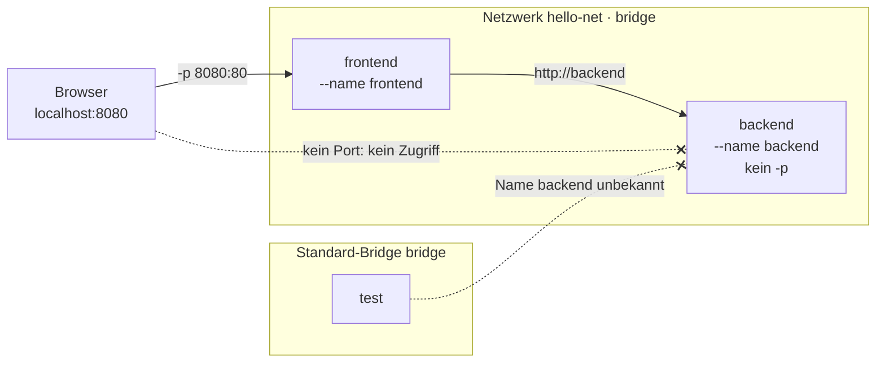
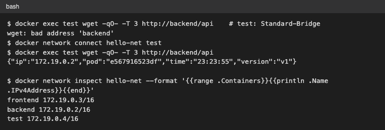

# Lab 4.1: Docker-Netzwerke

**Leitfragen:**

<details>
<summary>Zwei abgeschottete Programme sollen miteinander reden: was müssen sie voneinander wissen?</summary>

Eine Adresse, unter der das andere erreichbar ist, und einen gemeinsamen Weg dorthin. Bei Containern ist der Weg ein gemeinsames Docker-Netzwerk; die Adresse ist eine IP oder besser ein Name.

</details>

<details>
<summary>Warum ist eine feste IP-Adresse als Ziel schlecht, wenn Programme oft neu gestartet werden?</summary>

Ein neu gestarteter Container bekommt oft eine andere IP. Ein Name, den Docker bei jedem Start auf die aktuelle IP abbildet (DNS), bleibt gleich.

</details>

- Jeder Container hängt in mindestens einem Docker-Netzwerk, bekommt dort eine eigene IP-Adresse und ist von anderen Netzwerken abgeschottet.
- In einem selbst angelegten Netzwerk finden sich Container über ihren Namen. Genau das hat Compose in Lab 3.1 automatisch eingerichtet; dieses Lab baut es von Hand nach.

## Begriffe

| Begriff | Bedeutung |
| --- | --- |
| Docker-Netzwerk | virtuelles Netz auf dem Docker-Host, in dem Container IP-Adressen bekommen und sich erreichen; wie ein eigener Switch nur für Container |
| Docker-Host | der Rechner, auf dem die Docker Engine läuft; bei Docker Desktop eine kleine Linux-VM |
| Netzwerktreiber | Bauart eines Netzwerks: `bridge`, `host`, `none`, `overlay` |
| Bridge | virtueller Switch auf dem Docker-Host; verbindet die Container eines Netzwerks untereinander und über den Host mit der Außenwelt |
| Standard-Bridge | das Netzwerk `bridge`, in dem jeder Container ohne `--network` landet |
| benutzerdefiniertes Netzwerk | jedes selbst angelegte Netzwerk (`docker network create`) und jedes Compose-Netzwerk |
| DNS, Namensauflösung | übersetzt einen Namen wie `backend` in eine IP-Adresse; wie ein Telefonbuch |
| Subnetz | Adressbereich eines Netzwerks, z. B. `172.19.0.0/16` = alle Adressen `172.19.x.x` |

## Netzwerktreiber

```bash
docker network ls
```

```text
NETWORK ID     NAME      DRIVER    SCOPE
1d62a60aa40d   bridge    bridge    local     ← Standard-Bridge: Container ohne --network
42a751622b23   host      host      local     ← Container nutzen direkt das Netzwerk des Hosts
a58314f0838f   none      null      local     ← Container ohne Netzwerk
```

Diese drei Netzwerke legt Docker selbst an. Jedes weitere ist benutzerdefiniert.

| Treiber | Wirkung | Einsatz |
| --- | --- | --- |
| `bridge` | eigenes Netz auf einem Host, eigene IP je Container, Zugriff von außen nur über veröffentlichte Ports | Standard für Anwendungen auf einem Rechner |
| `host` | Container nutzt das Netzwerk des Hosts direkt: keine eigene IP, keine Abschottung, `-p` wirkungslos | Sonderfälle mit sehr vielen Ports; unter Docker Desktop ist der Host die VM |
| `none` | nur die eigene Loopback-Adresse `127.0.0.1`, weder andere Container noch Internet | Verarbeitung vertraulicher Daten ohne Netzzugang |
| `overlay` | ein Netz über mehrere Docker-Hosts | Docker Swarm (Lab 4.4) |

## Standard-Bridge und benutzerdefiniertes Netzwerk

| | Standard-Bridge `bridge` | benutzerdefiniertes Netzwerk |
| --- | --- | --- |
| entsteht | bei der Installation, genau eins | `docker network create` oder durch Compose |
| Container landen dort | automatisch ohne `--network` | mit `--network <name>` oder über Compose |
| Erreichbarkeit untereinander | nur über IP-Adressen | über Container- bzw. Dienstnamen und IPs |
| Isolation | alle Container ohne Netzwerkangabe teilen sich ein Netz | nur die Container, die bewusst hinzugefügt werden |

Jeder Container in einem benutzerdefinierten Netzwerk fragt den eingebauten DNS-Server von Docker unter `127.0.0.11` (steht in `/etc/resolv.conf` des Containers). Der antwortet auf `backend` mit der aktuellen IP des Containers `backend`. Startet das Backend neu und bekommt eine andere IP, liefert der Name automatisch die neue. In der Standard-Bridge gibt es diese Namen nicht.

## Die Hello-App ohne Compose

```bash
docker network create hello-net                                     # benutzerdefiniertes Bridge-Netzwerk
docker run -d --name backend --network hello-net hello-backend:v1    # kein -p: nur im Netzwerk erreichbar
docker run -d --name frontend --network hello-net -p 8080:80 \
  -e BACKEND_URL=http://backend hello-frontend:v1                   # einziger veröffentlichter Port
```



- Der Containername `backend` ist zugleich der Hostname im Netzwerk; deshalb passt `BACKEND_URL=http://backend`.
- `-p` veröffentlicht nur nach außen: Der Rechner leitet Port 8080 an Port 80 des Frontends weiter. Zwischen Containern im selben Netzwerk ist kein `-p` nötig; das Backend hat keinen und ist von außen nicht erreichbar.


_Quelle: Wikimedia Commons, „NAT Concept-en.svg" (https://commons.wikimedia.org/wiki/File:NAT_Concept-en.svg), CC BY-SA 4.0, abgerufen am 24.11.2026._

Bei `-p 8080:80` spielt der Docker-Host die Rolle des Routers im Bild: Er übersetzt Anfragen an `localhost:8080` auf die private Container-IP, Port 80 (Network Address Translation, NAT). Die Container-IP bleibt außen unsichtbar.


_Quelle: eigener Screenshot, Hello-App im Netzwerk hello-net (ohne Compose), 24.11.2026._

## Befehle für Netzwerke

| Befehl | Wirkung |
| --- | --- |
| `docker network ls` | alle Netzwerke mit Treiber |
| `docker network create hello-net` | Bridge-Netzwerk anlegen (Standardtreiber) |
| `docker network inspect hello-net` | Treiber, Subnetz, Gateway und verbundene Container als JSON |
| `docker network connect hello-net test` | laufenden Container zusätzlich in ein Netzwerk hängen, ohne Neustart |
| `docker network disconnect hello-net test` | Container aus einem Netzwerk entfernen |
| `docker network rm hello-net` | Netzwerk löschen; nur ohne verbundene Container |
| `docker run --network hello-net …` | Container beim Start einem Netzwerk zuordnen |

`inspect` liefert viel JSON. Nur Namen und IPs der Container zeigt ein Format:

```bash
docker network inspect hello-net --format '{{range .Containers}}{{println .Name .IPv4Address}}{{end}}'
```

```text
frontend 172.19.0.3/16
backend 172.19.0.2/16
test 172.19.0.4/16
```

`docker exec <container> wget -qO- -T 3 http://backend/api` prüft aus einem Container heraus, ob ein Name erreichbar ist: `wget` lädt die Adresse und gibt sie aus, `-T 3` bricht nach 3 Sekunden ab. `busybox:1.37` und die Hello-Images bringen `wget` mit.



_Quelle: eigener Screenshot, Hello-App im Netzwerk hello-net, 24.11.2026._

## Typische Fehler

| Symptom | Ursache | Lösung |
| --- | --- | --- |
| `Bind for 0.0.0.0:8080 failed: port is already allocated` | Compose-Fassung aus Modul 3 läuft noch | im Ordner `playground`: `docker compose down` |
| `Conflict. The container name "/backend" is already in use` | Container aus einem früheren Versuch | `docker rm -f backend` |
| `wget: bad address 'backend'` | Container hängt in einem anderen Netzwerk oder in der Standard-Bridge | `docker network connect hello-net <container>` |
| Seite: „Backend nicht erreichbar (http://backend): ConnectionError" | Backend fehlt, heißt anders oder hängt nicht in `hello-net` | `docker ps`, Name `backend` und `--network hello-net` prüfen |
| `curl: (6) Could not resolve host: backend` auf dem eigenen Rechner | Containernamen gibt es nur innerhalb des Docker-Netzwerks | von außen `localhost` mit veröffentlichtem Port nutzen |
| `error while removing network: … has active endpoints` | noch Container im Netzwerk | Container zuerst entfernen (`docker rm -f …`) |

## Fazit

- Docker-Netzwerke verbinden Container und schotten sie zugleich ab; der Treiber bestimmt die Bauart (`bridge`, `host`, `none`, `overlay`).
- Nur in benutzerdefinierten Netzwerken lösen Namen wie `backend` per DNS (`127.0.0.11`) auf die aktuelle IP auf; die Standard-Bridge kennt nur IPs.
- `-p` veröffentlicht einen Port nach außen; Container im selben Netzwerk brauchen ihn untereinander nicht.

In der Übung läuft die Hello-App ohne Compose im Netzwerk `hello-net`, und ein dritter Container erreicht das Backend erst nach `docker network connect`.
