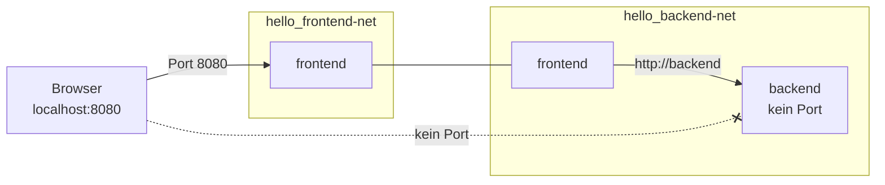
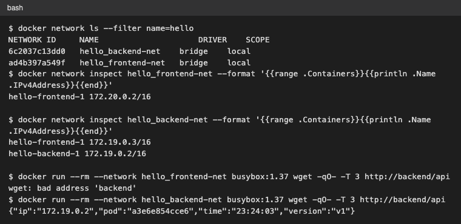

# Lab 4.2: Netzwerke in Compose

**Leitfragen:**

<details>
<summary>Welche Teile einer Web-Anwendung müssen von außen erreichbar sein, welche nicht?</summary>

Nur der Teil, den Browser aufrufen, also das Frontend. Backend und Datenbank sprechen nur mit dem Frontend und bleiben von außen unerreichbar; jeder offene Port ist eine mögliche Angriffsstelle.

</details>

<details>
<summary>Was erledigt Compose automatisch, das in Lab 4.1 von Hand nötig war?</summary>

Compose legt die Netzwerke an, hängt die Dienste hinein, macht die Dienstnamen auflösbar und räumt mit `down` wieder auf. Von Hand waren das `docker network create`, `docker run --network … --name …` je Container und `docker rm`/`docker network rm`.

</details>

- Ohne Angabe hängt Compose alle Dienste in ein gemeinsames Projektnetzwerk `<projekt>_default`. Mit `networks:` legt die Compose-Datei eigene Netzwerke an und bestimmt, welcher Dienst in welchem hängt.
- Muster für Web-Anwendungen: Nur das Frontend hat einen Port nach außen, das Backend ist nur intern erreichbar.

## Begriffe

| Begriff | Bedeutung |
| --- | --- |
| Projektnetzwerk | Netzwerk `<projekt>_default`, das Compose anlegt, wenn die Datei keine eigenen Netzwerke nennt (Lab 3.1) |
| `networks:` (oberste Ebene) | Liste der Netzwerke, die Compose für das Projekt anlegt; Name im Docker: `<projekt>_<netzwerk>` |
| `networks:` (beim Dienst) | Netzwerke, in die genau dieser Dienst gehängt wird; ein Dienst erreicht nur Dienste in gemeinsamen Netzwerken |
| intern erreichbar | nur aus Containern im selben Netzwerk erreichbar, nicht vom eigenen Rechner oder aus dem Firmennetz |

## Was Compose automatisch erledigt

| Schritt | von Hand (Lab 4.1) | Compose |
| --- | --- | --- |
| Netzwerk anlegen | `docker network create hello-net` | beim ersten `up` (`hello_default` oder eigene Netzwerke) |
| Container ins Netzwerk | `--network hello-net` je Container | alle Dienste automatisch bzw. nach `networks:` |
| Namen | `--name backend` | Dienstname `backend` |
| Port veröffentlichen | `-p 8080:80` | `ports: - "8080:80"` |
| Startreihenfolge | Befehle in der richtigen Reihenfolge tippen | `depends_on` mit Healthcheck (Lab 3.2) |
| Aufräumen | `docker rm -f …`, `docker network rm …` | `docker compose down` |


_Quelle: Docker Inc., „How Compose works" (https://docs.docker.com/compose/intro/compose-application-model/), abgerufen am 24.11.2026._

Das Bild aus Lab 3.1 zeigt das Muster: Der Nutzer erreicht nur das Frontend über einen veröffentlichten Port; Frontend und Backend sprechen über ein eigenes Netzwerk.

## Eigene Netzwerke mit networks:

```yaml
services:
  backend:
    image: hello-backend:v1
    # kein ports: – das Backend ist nur in backend-net erreichbar
    networks:
      - backend-net

  frontend:
    image: hello-frontend:v1
    ports:
      - "${FRONTEND_PORT:-8080}:80"   # einziger Weg von außen in die Anwendung
    networks:
      - frontend-net                  # Seite für Browser (und später z. B. einen Proxy)
      - backend-net                   # Weg zum Backend
    environment:
      BACKEND_URL: http://backend
    # … depends_on, volumes wie in Lab 3.3

networks:                             # oberste Ebene: Compose legt beide Netzwerke an
  frontend-net:
  backend-net:
```



- Das Frontend hängt in zwei Netzwerken und hat in jedem eine eigene IP (im Diagramm zweimal gezeichnet, es ist derselbe Container).
- Ein Dienst, der nur in `frontend-net` hängt, z. B. ein späterer Proxy, sieht das Frontend, aber nicht das Backend.
- Sobald ein Dienst `networks:` nennt, hängt er nur noch in diesen Netzwerken, nicht mehr in `hello_default`.
- Ohne `ports:` hat das Backend keinen Weg nach außen; `http://localhost:8081/api` aus Lab 3.1 funktioniert nicht mehr.

## Wer erreicht wen? Prüfen mit inspect und wget

| Befehl | Zeigt |
| --- | --- |
| `docker network ls --filter name=hello` | die Netzwerke des Projekts: `hello_backend-net`, `hello_frontend-net` |
| `docker network inspect hello_backend-net --format '{{range .Containers}}{{println .Name .IPv4Address}}{{end}}'` | welche Container in einem Netzwerk hängen |
| `docker run --rm --network hello_frontend-net busybox:1.37 wget -qO- -T 3 http://backend/api` | ob ein Container in diesem Netzwerk das Backend erreicht |

`--rm` löscht den Testcontainer nach dem Befehl wieder. Er sieht genau das, was jeder andere Container im angegebenen Netzwerk sieht.



_Quelle: eigener Screenshot, Hello-App mit compose.yml aus Lab 4.2, 24.11.2026._

## Typische Fehler

| Symptom | Ursache | Lösung |
| --- | --- | --- |
| Seite: „Backend nicht erreichbar (http://backend): ConnectionError" | Frontend und Backend haben kein gemeinsames Netzwerk | `backend-net` auch beim Frontend eintragen, `up -d` |
| `service "frontend" refers to undefined network backend-net: invalid compose project` | Netzwerk beim Dienst genutzt, aber nicht auf oberster Ebene angelegt | `networks:` mit `frontend-net:` und `backend-net:` ganz links ergänzen |
| `http://localhost:8081/api` antwortet noch | Container nicht neu erstellt oder `ports:` beim Backend noch vorhanden | `ports:` beim Backend löschen, `docker compose up -d` |
| `network hello_backend-net not found` beim `docker run --network` | Projekt läuft nicht oder heißt anders | `docker compose up -d`, Namen mit `docker network ls` prüfen |
| `Found orphan containers` | Container eines älteren Stands laufen noch | `docker compose up -d --remove-orphans` |

## Fazit

- Ohne Angabe hängen alle Dienste in `<projekt>_default`; `networks:` auf oberster Ebene und beim Dienst bestimmt, wer mit wem reden kann.
- Muster: nur das Frontend mit `ports:`, das Backend nur in einem internen Netzwerk; das Frontend hängt in beiden.
- `docker network inspect` und ein Testcontainer mit `wget` zeigen, wer wen erreicht.

In der Übung bekommt die Hello-App die Netzwerke `frontend-net` und `backend-net`, und das Backend verliert seinen Port.
