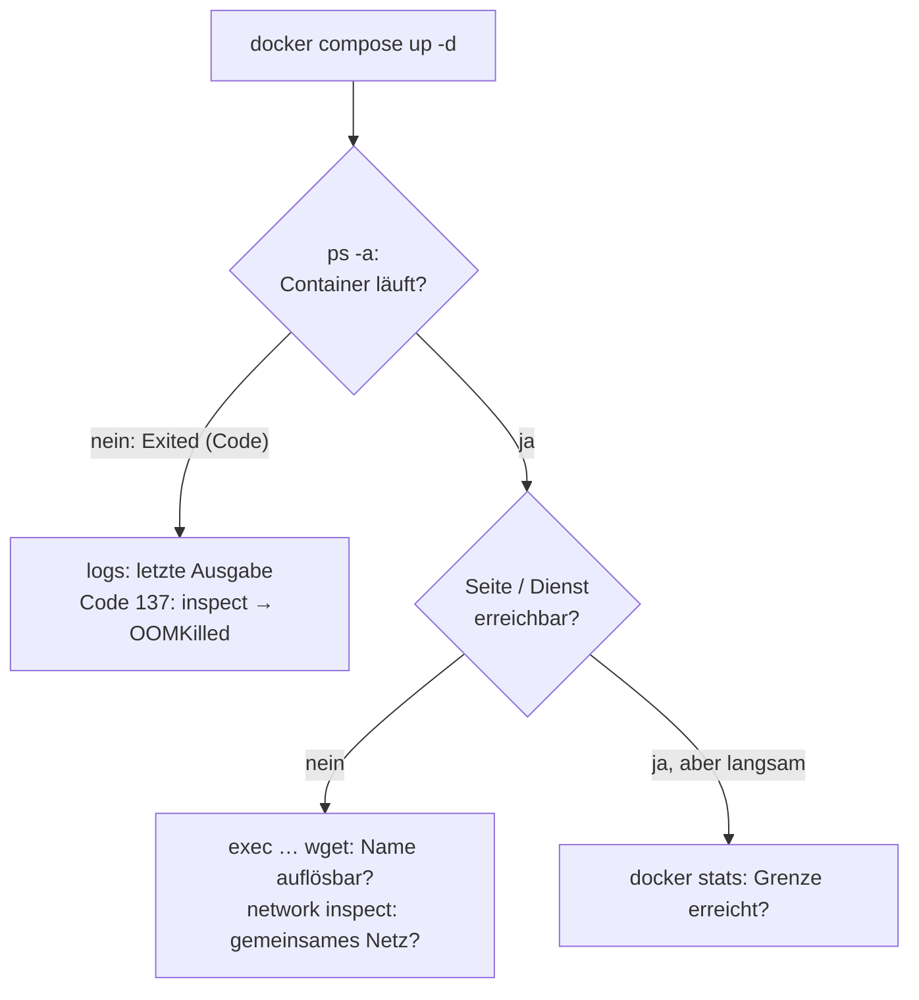
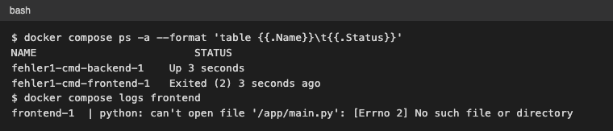
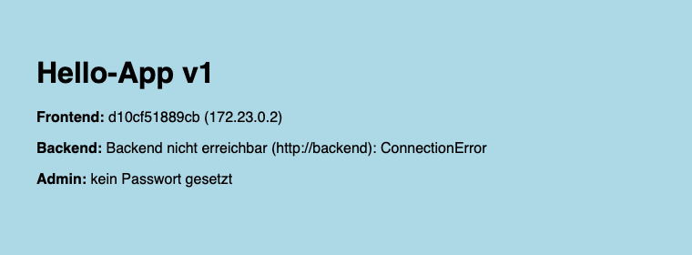
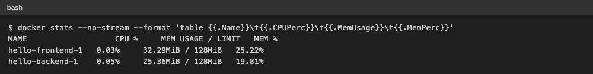
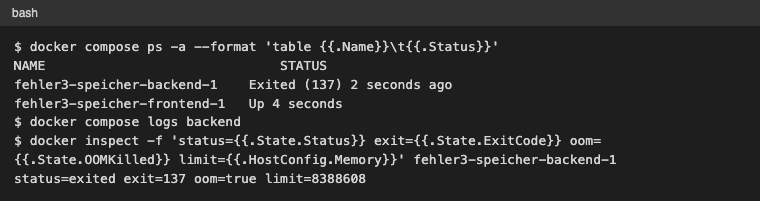

# Lab 4.3: Fehlersuche und Ressourcengrenzen

**Leitfragen:**

<details>
<summary>Ein Programm startet und beendet sich sofort wieder: wo sucht man zuerst?</summary>

In seinen letzten Ausgaben und im Exit-Code. Bei Containern zeigen `docker compose ps -a` den Exit-Code und `docker compose logs` die Ausgaben, auch wenn der Container schon beendet ist.

</details>

<details>
<summary>Zehn Programme teilen sich einen Server: was passiert, wenn eines plötzlich allen Speicher will?</summary>

Ohne Grenzen nimmt es den anderen den Speicher weg; der Server wird langsam, und das Betriebssystem beendet irgendein Programm, nicht unbedingt das schuldige. Mit Grenzen trifft es nur das Programm, das seine eigene Grenze überschreitet.

</details>

- Fast jeder Container-Fehler zeigt sich an einer von drei Stellen: Der Container startet nicht, er läuft, erreicht aber einen anderen Dienst nicht, oder er wird wegen Ressourcen beendet.
- Die Werkzeuge sind bekannt (`ps -a`, `logs`, `inspect`, `exec` aus Modul 1); neu ist eine feste Lesereihenfolge, dazu `docker stats` und Grenzen für Speicher und CPU.

## Begriffe

| Begriff | Bedeutung |
| --- | --- |
| Exit-Code | Zahl, mit der sich ein Programm beendet: `0` = in Ordnung, alles andere = Fehler; Docker merkt sie sich je Container |
| Ressourcengrenze | Obergrenze für Arbeitsspeicher oder CPU eines Containers |
| Cgroup (Control Group) | Funktion des Linux-Kernels, mit der Docker Speicher und CPU eines Containers begrenzt und misst; wie ein Stromzähler mit Sicherung |
| OOM-Killer | Teil des Linux-Kernels, der bei Speichermangel („out of memory") einen Prozess beendet |
| Exit-Code 137 | Prozess wurde hart beendet (Signal `KILL`, 128 + 9): durch den OOM-Killer oder `docker kill` (Lab 1.2) |
| `docker stats` | Liveanzeige von CPU, Speicher und Grenze je Container |

## Lesereihenfolge bei der Fehlersuche



| Schritt | Befehl | Frage |
| --- | --- | --- |
| 1 | `docker compose ps -a` | Läuft jeder Container? Mit welchem Exit-Code endete er? (`ps` ohne `-a` zeigt beendete Container nicht) |
| 2 | `docker compose logs <dienst>` | Was hat das Programm zuletzt ausgegeben? |
| 3 | `docker inspect <container>` | Welche Konfiguration, welcher Zustand (`State`, `OOMKilled`, Netzwerke, Grenzen)? |
| 4 | `docker compose exec <dienst> sh` | Wie sieht es im laufenden Container aus (Dateien, `env`, `wget`)? |

## Container startet nicht: Exit-Code und Logs



_Quelle: eigener Screenshot, Hello-App, Fehlerbild 1 aus `variants/m04-l03-debugging`, 24.11.2026._

| Exit-Code | Bedeutung | typischer Anlass |
| --- | --- | --- |
| `0` | Programm hat sich regulär beendet | bei einem Webserver unerwartet: Startbefehl falsch |
| `1` | allgemeiner Fehler des Programms | Ausnahme im Code, fehlende Konfiguration |
| `2` | falscher Aufruf | Python findet die Startdatei aus `CMD` nicht |
| `127` | Befehl nicht gefunden | Tippfehler im Programmnamen in `CMD` |
| `137` | hart beendet (`KILL`) | Speichergrenze überschritten oder `docker kill` |

Die Logs nennen die Datei, die fehlt. Ob sie im Image liegt, zeigt ein neuer Container aus demselben Image mit anderem Befehl: `docker run --rm <image> ls /app`. Nach einer Korrektur am Dockerfile baut `docker compose up -d --build` das Image neu.

## Container läuft, Dienst nicht erreichbar



_Quelle: eigener Screenshot, Hello-App, Fehlerbild 2 aus `variants/m04-l03-debugging`, 24.11.2026._

Die Prüfung läuft aus dem Container heraus, der die Verbindung braucht:

```bash
docker compose exec frontend wget -qO- -T 3 http://backend/api      # Sicht des Frontends
docker compose exec frontend env                                     # tatsächlicher Wert von BACKEND_URL
docker network inspect <projekt>_backend-net --format '{{range .Containers}}{{println .Name .IPv4Address}}{{end}}'
```

| Ausgabe von `wget` | Bedeutung |
| --- | --- |
| JSON des Backends | Verbindung funktioniert; Fehler liegt woanders, z. B. in `BACKEND_URL` |
| `wget: bad address 'backend'` | Name unbekannt: kein gemeinsames Netzwerk, Backend beendet oder Tippfehler |
| `wget: can't connect to remote host: Connection refused` | Name bekannt, aber auf dem Port lauscht nichts |
| `wget: download timed out` | Ziel antwortet nicht innerhalb von `-T` Sekunden |

## Ressourcengrenzen und docker stats

Ohne Grenzen darf jeder Container den ganzen Speicher und alle CPUs des Docker-Hosts nutzen. Docker setzt Grenzen über Cgroups des Linux-Kernels:


_Quelle: Wikimedia Commons, „Docker-linux-interfaces.svg" (https://commons.wikimedia.org/wiki/File:Docker-linux-interfaces.svg), Maklaan, gemeinfrei, abgerufen am 24.11.2026._

| Wo | Speicher | CPU |
| --- | --- | --- |
| `docker run` | `--memory 128m` | `--cpus 0.5` (halber Kern) |
| Compose | `deploy.resources.limits.memory: 128M` | `deploy.resources.limits.cpus: "0.5"` |
| Überschreitung | Prozess wird beendet: `Exited (137)`, `OOMKilled: true` | Container wird gebremst, läuft weiter |

```yaml
services:
  backend:
    image: hello-backend:v1
    deploy:
      resources:
        limits:
          memory: 128M          # harte Speichergrenze, Einheit M oder G
          cpus: "0.5"           # höchstens ein halber Kern, in Anführungszeichen
```

`docker compose up` wendet `deploy.resources.limits` auch ohne Swarm an. Quelle: Docker Docs, „Compose Deploy Specification" (https://docs.docker.com/reference/compose-file/deploy/) und „Resource constraints" (https://docs.docker.com/engine/containers/resource_constraints/), abgerufen am 24.11.2026.



_Quelle: eigener Screenshot, Hello-App mit compose.yml aus Lab 4.3, 24.11.2026._

`docker stats` ohne `--no-stream` aktualisiert sich jede Sekunde (`Strg+C` beendet). Ohne Grenze steht in `MEM USAGE / LIMIT` der ganze Speicher der Docker-VM, z. B. `7.748GiB`.

Ein Container über seiner Speichergrenze endet ohne Fehlermeldung in den Logs; Gewissheit bringt `inspect`:



_Quelle: eigener Screenshot, Hello-App, Fehlerbild 3 aus `variants/m04-l03-debugging`, 24.11.2026._

`limit=8388608` sind 8 MiB: zu wenig für Python mit Flask, das im Test rund 25 MiB braucht.

## Typische Fehler

| Symptom | Ursache | Lösung |
| --- | --- | --- |
| `docker compose ps` zeigt einen Dienst nicht | Container ist beendet | `docker compose ps -a`, danach `logs` |
| `service "frontend" is not running` bei `exec` | `exec` braucht einen laufenden Container | Logs lesen oder `docker run --rm <image> ls /app` |
| Korrektur im Dockerfile wirkt nicht | Container läuft noch mit dem alten Image | `docker compose up -d --build` |
| `Exited (137)`, Logs leer | Speichergrenze überschritten | `docker inspect -f '{{.State.OOMKilled}}' <container>`, Grenze erhöhen |
| `MEM USAGE / LIMIT` zeigt keine Grenze | `deploy` falsch eingerückt oder Container nicht neu erstellt | Einrückung prüfen (`deploy` auf Höhe von `image`), `docker compose up -d` |
| `Minimum memory limit allowed is 6MB` | Grenze kleiner als 6 MB | realistische Werte, für die Hello-Dienste ab etwa 64M |

## Fazit

- Lesereihenfolge: `ps -a` → `logs` → `inspect` → `exec`; erst klären, ob der Container läuft, dann ob er andere erreicht.
- Netzwerkfehler werden aus dem Container heraus geprüft (`exec … wget`, `network inspect`); `bad address` heißt: kein gemeinsames Netzwerk oder Ziel beendet.
- `deploy.resources.limits` begrenzt Speicher und CPU; zu wenig Speicher beendet den Container mit Exit-Code 137 (`OOMKilled`), `docker stats` zeigt Verbrauch und Grenze.

In der Übung sind drei vorbereitete Fehlerbilder der Hello-App zu finden und zu beheben; danach bekommt `compose.yml` Grenzen für beide Dienste.
