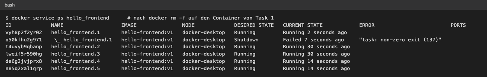
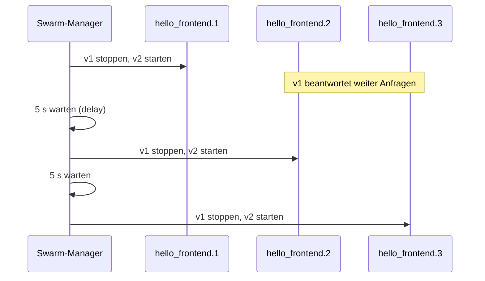

# Lab 4.4: Docker Swarm

**Leitfragen:**

<details>
<summary>Zehn Container auf drei Servern, ein Server fällt nachts aus: was muss passieren, und wer macht es?</summary>

Die ausgefallenen Container müssen auf den beiden anderen Servern neu starten, und Anfragen dürfen nur noch dorthin gehen. Das übernimmt ein Orchestrierer wie Docker Swarm automatisch, ohne dass jemand eingreift.

</details>

<details>
<summary>Wie spielt man eine neue Version ein, ohne dass Nutzer es merken?</summary>

Schrittweise: einen Container nach dem anderen durch die neue Version ersetzen, während die übrigen weiter antworten (Rolling Update). Fehlt etwas, geht es mit einem Befehl zurück.

</details>

- Bisher lief jeder Container auf genau einem Rechner, gestartet mit `docker run` oder `docker compose`. Stürzt ein Container ab oder fällt der Rechner aus, merkt das niemand, bis jemand nachsieht.
- Orchestrierung heißt: Statt Einzelbefehlen wird ein **gewünschter Zustand** beschrieben („drei Frontends mit `v1`"), und das System hält ihn selbst. Docker Swarm ist der Orchestrierer, der in der Docker Engine eingebaut ist; Tag 2 zeigt dasselbe Prinzip mit Kubernetes.

## Begriffe

| Begriff | Bedeutung |
| --- | --- |
| Orchestrierung | automatisierte Verwaltung vieler Container auf vielen Rechnern: starten, verteilen, skalieren, ersetzen, aktualisieren |
| Cluster | Gruppe von Rechnern, die gemeinsam als ein System arbeiten |
| Node | ein Rechner mit Docker im Swarm |
| Manager | Node, der den gewünschten Zustand speichert und entscheidet, welche Container wo laufen |
| Worker | Node, der die zugewiesenen Container ausführt; Manager arbeiten standardmäßig auch als Worker |
| Service | Beschreibung eines Dienstes im Swarm: Image, Anzahl Kopien, Ports, Update-Regeln; wie eine Stellenbeschreibung „wir brauchen drei Leute" |
| Task | ein einzelner Container, den der Swarm für einen Service startet; `replicas: 3` = drei Tasks |
| Stack | Gruppe von Services aus einer Compose-Datei, gestartet mit `docker stack deploy` |
| Gewünschter Zustand | was laufen soll; der Manager vergleicht ständig mit dem tatsächlichen Zustand und gleicht an |
| Rolling Update | Tasks werden nacheinander durch Tasks mit neuer Version ersetzt |

## Swarm: Manager, Worker, Service, Task


_Quelle: Docker Inc., „How nodes work" (https://docs.docker.com/engine/swarm/how-swarm-mode-works/nodes/), abgerufen am 24.11.2026._

- Manager speichern den Zustand des Clusters gemeinsam (Raft-Verfahren: die Mehrheit entscheidet). Fällt ein Manager aus, arbeiten die anderen weiter.
- Worker führen nur aus. Ein Docker-Desktop-Rechner wird mit `docker swarm init` zu einem Swarm aus einem Node, der Manager und Worker zugleich ist.


_Quelle: Docker Inc., „How services work" (https://docs.docker.com/engine/swarm/how-swarm-mode-works/services/), abgerufen am 24.11.2026._

Service → Tasks → Container: Der Manager plant die Tasks auf Nodes ein, jeder Task startet einen Container. Stirbt ein Container, endet sein Task, und der Manager plant einen neuen (Selbstheilung).

## Die Compose-Datei als Stack

Swarm liest dieselbe Compose-Syntax wie in Modul 3. `project/examples/m04-networking/l04-swarm/stack.yml`:

```yaml
services:
  backend:
    image: hello-backend:v1
    deploy:
      replicas: 2                         # zwei Backend-Tasks
    healthcheck:                          # wie in Lab 3.2
      test: ["CMD", "wget", "-qO-", "http://127.0.0.1/healthz"]
      interval: 5s
      timeout: 2s
      retries: 3
      start_period: 5s

  frontend:
    image: hello-frontend:v1
    environment:
      BACKEND_URL: http://backend         # Dienstname: im Swarm eine feste Adresse vor allen Backend-Tasks
    ports:
      - "8080:80"                         # Port 8080 auf jedem Node
    deploy:
      replicas: 3                         # gewünschter Zustand: drei Frontend-Tasks
      update_config:
        parallelism: 1                    # Rolling Update: ein Task nach dem anderen
        delay: 5s                         # 5 Sekunden Pause zwischen zwei Tasks
```

| Unterschied zu `docker compose` | Bedeutung |
| --- | --- |
| kein `build:` | Swarm baut keine Images; sie müssen vorhanden sein oder aus einer Registry kommen (Lab 2.3); im Cluster mit mehreren Nodes immer aus einer Registry |
| `deploy:` wirkt vollständig | Replikas, `update_config`, `rollback_config`, Grenzen |
| kein `depends_on` | Swarm startet Services ohne Reihenfolge; bis ein Backend-Task läuft, zeigt das Frontend „Backend nicht erreichbar" |
| Netzwerk | `docker stack deploy` legt das Overlay-Netzwerk `hello_default` an, das über alle Nodes reicht |
| Namen | Services heißen `<stack>_<dienst>`, z. B. `hello_frontend`; Tasks `hello_frontend.1` … |

## Lastverteilung: Routing Mesh


_Quelle: Docker Inc., „Use Swarm mode routing mesh" (https://docs.docker.com/engine/swarm/ingress/), abgerufen am 24.11.2026._

- Ein veröffentlichter Port (`8080`) gilt auf jedem Node; Swarm leitet jede Anfrage an einen beliebigen Task weiter, auch auf einem anderen Node.
- Intern verteilt Swarm Anfragen an einen Dienstnamen (`http://backend`) auf alle Tasks dieses Service.

Im Test wechselten die Antworten der Reihe nach zwischen den drei Frontends:

```text
$ for i in 1 2 3 4 5 6; do curl -s http://localhost:8080 | grep Frontend; done
  <p><b>Frontend:</b> 7aa654c66bc9 (10.0.1.9)</p>
  <p><b>Frontend:</b> fabbd97d444a (10.0.1.8)</p>
  <p><b>Frontend:</b> f1e2f06d9141 (10.0.1.7)</p>
  <p><b>Frontend:</b> 7aa654c66bc9 (10.0.1.9)</p>
  <p><b>Frontend:</b> fabbd97d444a (10.0.1.8)</p>
  <p><b>Frontend:</b> f1e2f06d9141 (10.0.1.7)</p>
```

## Selbstheilung und Rolling Update

Wird ein Task-Container gelöscht, weicht der tatsächliche vom gewünschten Zustand ab, und der Manager startet innerhalb weniger Sekunden einen Ersatz. Die Zeile mit `\_` ist der alte, beendete Task:



_Quelle: eigener Screenshot (Ausgabe aus dem Testlauf der Demo, Docker Desktop als Ein-Node-Swarm), 24.11.2026._



- `docker service update --image hello-frontend:v2 hello_frontend` ersetzt die Tasks nach `update_config` einzeln; während des Updates antworten `v1` und `v2` gemischt.
- `docker service rollback hello_frontend` stellt die vorige Service-Definition wieder her.
- Ein späteres `docker stack deploy` mit unveränderter `stack.yml` setzt das Image wieder auf den Stand der Datei; dauerhafte Änderungen gehören deshalb in die Datei.

## Swarm und Kubernetes

| | Docker Swarm | Kubernetes (Tag 2) |
| --- | --- | --- |
| Einrichtung | in Docker eingebaut, `docker swarm init` | eigenes System; lokal z. B. in Docker Desktop |
| Beschreibung | Compose-Datei, `docker stack deploy` | YAML-Manifeste, `kubectl apply` |
| kleinste Einheit | Task (genau ein Container) | Pod (ein oder mehrere Container) |
| Skalieren | `docker service scale` | `kubectl scale`, automatisch nach Last (HPA) |
| Updates | Rolling Update, `service rollback` | Rolling Update, `rollout undo` |
| Verbreitung, Stand 24.11.2026 | in Docker Engine 29 enthalten, wenig Weiterentwicklung; Mirantis sagt Support bis 2030 zu | Standard für Orchestrierung, alle großen Cloud-Anbieter |

Quellen: Docker Docs, „Swarm mode" (https://docs.docker.com/engine/swarm/), abgerufen am 24.11.2026; Mirantis, „Mirantis guarantees long-term support for Swarm", 01.07.2025 (https://www.mirantis.com/blog/mirantis-guarantees-long-term-support-for-swarm/), abgerufen am 24.11.2026.

## Befehle zum Nachmachen

Voraussetzungen: Hello-Images aus Lab 2.2 vorhanden (`bash build-images.sh` im Ordner `project/`), Port 8080 frei (`docker compose down` im Ordner `playground`). Befehle im Ordner `project/examples/m04-networking/l04-swarm`. Getestet am 24.11.2026 mit Docker Desktop (Engine 29.9.3).

```bash
docker swarm init                                   # Docker Desktop wird zum Ein-Node-Swarm (Manager)
docker node ls                                      # ein Node, MANAGER STATUS: Leader

docker stack deploy -c stack.yml hello              # Stack "hello" aus der Compose-Datei starten
docker service ls                                   # hello_backend 2/2, hello_frontend 3/3, *:8080->80/tcp
for i in 1 2 3 4 5 6; do curl -s http://localhost:8080 | grep Frontend; done   # wechselnde IPs

docker service scale hello_frontend=5               # gewünschter Zustand: fünf Frontends
docker service ps hello_frontend                    # Tasks hello_frontend.1 … .5

docker ps --filter name=hello_frontend.1 -q         # Container-ID von Task 1
docker rm -f <container-id>                         # Container "abstürzen" lassen
docker service ps hello_frontend                    # neuer Task .1 läuft, alter mit Failed (137)

docker service update --image hello-frontend:v2 hello_frontend   # Rolling Update, Task für Task
for i in 1 2 3 4 5; do curl -s http://localhost:8080 | grep h1; done          # Hello-App v2
docker service rollback hello_frontend              # optional: zurück auf v1

docker stack rm hello                               # Stack mit allen Services entfernen
docker swarm leave --force                          # Swarm-Modus beenden (wichtig vor Tag 2)
```

Ausgaben im Test:

```text
$ docker stack deploy -c stack.yml hello
Since --detach=false was not specified, tasks will be created in the background.
In a future release, --detach=false will become the default.
Creating network hello_default
Creating service hello_backend
Creating service hello_frontend

$ docker service ls
ID             NAME             MODE         REPLICAS   IMAGE               PORTS
8z4bvapmko72   hello_backend    replicated   2/2        hello-backend:v1
eoz5o1ersa36   hello_frontend   replicated   3/3        hello-frontend:v1   *:8080->80/tcp

$ docker service update --image hello-frontend:v2 hello_frontend
…
verify: Service hello_frontend converged
```

Bei lokalen Images ohne Registry meldet Swarm unter Umständen `image … could not be accessed on a registry to record its digest`; auf einem einzelnen Node hat das keine Folgen.

## Typische Fehler

| Symptom | Ursache | Lösung |
| --- | --- | --- |
| `this node is not a swarm manager` | Swarm nicht initialisiert | `docker swarm init` |
| `This node is already part of a swarm` | Swarm läuft schon | weiterarbeiten oder `docker swarm leave --force` |
| Task bleibt `Pending`, Fehler zu Port 8080 | Compose-Fassung der Hello-App läuft noch | im Ordner `playground`: `docker compose down` |
| Task `Rejected`, `No such image: hello-frontend:v1` | Image fehlt auf dem Node | `bash build-images.sh` im Ordner `project/` |
| IP wechselt im Browser nicht | Browser hält die Verbindung offen | `curl` in einer Schleife nutzen |
| Kubernetes an Tag 2 verhält sich merkwürdig | Swarm-Modus noch aktiv | `docker swarm leave --force` |

## Fazit

- Orchestrierung beschreibt einen gewünschten Zustand; Swarm hält ihn mit Managern, Workern, Services und Tasks.
- Eine Compose-Datei wird mit `docker stack deploy` zum Stack; `deploy:` legt Replikas und Update-Regeln fest, das Routing Mesh verteilt Anfragen auf alle Tasks.
- Gelöschte Tasks ersetzt der Manager selbst, `service update` tauscht Versionen schrittweise aus; Kubernetes an Tag 2 arbeitet nach demselben Prinzip mit mehr Möglichkeiten.

Die Demo zeigt die Hello-App als Stack mit fünf Frontends, einem ersetzten Task und einem Rolling Update auf `v2`.
