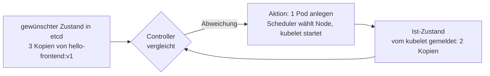

# Lab 5.1: Warum Kubernetes?

**Leitfragen:**

Was konnte Swarm gestern, und was fehlt für eine große Firma mit vielen Teams?

Swarm hielt fünf Kopien am Leben, ersetzte gestoppte Tasks und rollte `v2` schrittweise aus. Für viele Teams fehlen getrennte Bereiche mit eigenen Rechten, automatisches Skalieren nach Last, ein großes Ökosystem an Zusatzsoftware und Angebote aller Cloud-Anbieter; das bietet Kubernetes.

Wo muss der gewünschte Zustand gespeichert sein, damit er einen Serverausfall übersteht?

Nicht auf dem Server, der ausfallen kann, sondern in einer eigenen, ausfallsicheren Datenbank. Kubernetes speichert ihn in etcd in der Control Plane, in Produktion auf drei oder fünf Servern verteilt.

- Docker startet Container auf einem Rechner. Für viele Container auf vielen Servern braucht es einen Orchestrator, der sie verteilt, überwacht und ersetzt.
- Kubernetes ist dieser Orchestrator und seit Jahren der Standard dafür; das Prinzip ist dasselbe wie in der Swarm-Demo aus Lab 4.4: gewünschten Zustand beschreiben, das System hält ihn.

## Begriffe

| Begriff | Bedeutung |
| --- | --- |
| Orchestrierung | automatisches Verteilen, Starten, Überwachen und Ersetzen vieler Container auf vielen Servern; wie ein Dirigent, der nicht selbst spielt, aber das Orchester steuert |
| Cluster | Gruppe von Servern, die Kubernetes gemeinsam verwaltet |
| Node | ein Server (physisch oder virtuell) im Cluster |
| gewünschter Zustand (Soll) | Beschreibung, was laufen soll, z. B. „3 Kopien von `hello-frontend:v1`" |
| Ist-Zustand | was gerade tatsächlich läuft; Kubernetes vergleicht ihn ständig mit dem Soll |
| Replika | eine von mehreren gleichen Kopien einer Anwendung (wie die fünf Tasks in der Swarm-Demo) |
| Self-Healing | fällt eine Kopie aus, startet Kubernetes selbstständig eine neue |
| Rolling Update | Kopien nacheinander auf eine neue Version umstellen, ohne Ausfall |
| Pod | kleinste Einheit in Kubernetes: Hülle um einen oder mehrere Container mit gemeinsamer IP (ausführlich in Lab 7.1) |
| Control Plane | Steuerzentrale des Clusters: nimmt Aufträge an, speichert den Zustand, entscheidet |
| Worker Node | Server, auf dem die Container der Anwendungen laufen |
| CNCF | Cloud Native Computing Foundation: Stiftung unter dem Dach der Linux Foundation, der Kubernetes gehört |

## Von der Swarm-Demo zu Kubernetes

Die Swarm-Demo aus Lab 4.4 zeigte die drei Kernideen der Orchestrierung. Kubernetes nutzt dieselben Ideen, mit anderen Namen und mehr Werkzeugen drumherum:

| Swarm-Demo (Lab 4.4) | Kubernetes | im Kurs |
| --- | --- | --- |
| `docker stack deploy -c stack.yml` | Manifeste mit `kubectl apply -f` | Lab 5.3 |
| Service mit `replicas: 5` | Deployment mit `replicas: 5` | Modul 8 |
| gestoppter Task wird ersetzt | Self-Healing durch Controller | Lab 8.1 |
| Rolling Update auf `hello-frontend:v2` | Rolling Update, Rollback per Befehl | Lab 8.2 |
| Service-Name als Adresse | Service mit DNS-Namen | Lab 7.2 |
| – | Namespaces und Rechte je Team, Autoscaling, Helm-Charts, Angebote aller Clouds | Lab 5.3, 8.5, Modul 6 |

## Kubernetes auf einen Blick

_Quelle: The Kubernetes Authors, „Running Multiple Instances of Your App" (https://kubernetes.io/docs/tutorials/kubernetes-basics/scale/scale-intro/), CC BY 4.0, abgerufen am 24.11.2026._

Vier Kopien einer Anwendung laufen auf drei Nodes; eine gemeinsame Adresse verteilt die Anfragen. Die Begriffe im Bild (Deployment, Service) folgen in Modul 7 und 8.

### Definition und Vergleich mit einer Hafenleitstelle

- Kubernetes ist eine Open-Source-Plattform, die Container auf einem Cluster von Servern betreibt: Es startet sie nach einer Beschreibung des gewünschten Zustands, verteilt sie auf die Nodes, ersetzt ausgefallene Kopien, skaliert und rollt neue Versionen aus.
- Der Name ist griechisch für „Steuermann"; die Abkürzung **K8s** steht für K, acht Buchstaben, s.
- Vergleich: Container aus Lab 1.1 sind die Normkisten, Kubernetes ist die Hafenleitstelle. Sie belädt kein Schiff selbst, entscheidet aber, welche Kiste auf welches Schiff kommt, bemerkt verlorene Kisten und lässt Ersatz verladen.

### Geschichte von Kubernetes

| Datum | Schritt |
| --- | --- |
| seit Mitte der 2000er | Google betreibt intern das System **Borg**, das alle Google-Dienste in Containern auf riesigen Clustern verteilt ([Borg-Blogpost](https://kubernetes.io/blog/2015/04/borg-predecessor-to-kubernetes/)) |
| 06.06.2014 | erster Commit von Kubernetes auf GitHub; Google-Ingenieure übertragen die Ideen von Borg in ein offenes Projekt |
| 21.07.2015 | Version 1.0; Google übergibt Kubernetes an die neu gegründete CNCF |
| seit 2015 | drei Releases pro Jahr, jedes rund 14 Monate gepflegt |
| 26.08.2026 | Kubernetes 1.37; unterstützt sind 1.37, 1.36 und 1.35 (Stand: 24.11.2026, prüfen) |

Quellen: [10 Years of Kubernetes](https://kubernetes.io/blog/2024/06/06/10-years-of-kubernetes/), [kubernetes.io/releases](https://kubernetes.io/releases/), abgerufen am 24.11.2026.

### Verbreitung 2025/2026

_Quelle: CNCF, „Annual Cloud Native Survey 2025" (https://www.cncf.io/announcements/2026/01/20/kubernetes-established-as-the-de-facto-operating-system-for-ai-as-production-use-hits-82-in-2025-cncf-annual-cloud-native-survey/), veröffentlicht am 20.01.2026, abgerufen am 24.11.2026._

82 % der Organisationen, die Container nutzen, betreiben Kubernetes in Produktion (2023: 66 %).

### Bekannte Nutzer und Einsatzfälle

- Alle großen Clouds bieten Kubernetes als Dienst an: Azure Kubernetes Service (AKS), Amazon EKS, Google Kubernetes Engine (GKE).
- Fallstudien von Spotify, Adidas, CERN und vielen weiteren: [cncf.io/case-studies](https://www.cncf.io/case-studies/).
- Einsatzfälle: Web-Anwendungen und APIs, Microservices (viele kleine Dienste wie Anmeldung, Warenkorb, Suche), Batch-Jobs, interne Plattformen für Entwicklungsteams, zunehmend KI-Modelle.

## Architektur eines Clusters

_Quelle: The Kubernetes Authors, „Kubernetes Components" (https://kubernetes.io/docs/concepts/overview/components/), CC BY 4.0, abgerufen am 24.11.2026._

| Teil | Komponente | Aufgabe |
| --- | --- | --- |
| Control Plane | API-Server (`kube-apiserver`) | einzige Tür ins Cluster: nimmt alle Aufträge an, prüft sie, speichert sie in etcd |
| Control Plane | etcd | ausfallsichere Datenbank mit gewünschtem und aktuellem Zustand |
| Control Plane | Scheduler (`kube-scheduler`) | wählt für jeden neuen Pod einen Node mit genug freier CPU und freiem Speicher |
| Control Plane | Controller-Manager | führt die Regelkreise aus, die Ist an Soll angleichen |
| jeder Node | kubelet | startet und überwacht die Container, die diesem Node zugeteilt sind |
| jeder Node | kube-proxy | richtet Netzwerkregeln für feste Service-Adressen ein (Lab 7.2) |
| jeder Node | Container-Runtime | startet die Container tatsächlich, meist containerd |

Alle Komponenten und Werkzeuge (`kubectl`, Dashboard) sprechen nur mit dem API-Server. Im Übungscluster auf dem Laptop liegen Control Plane und Worker auf demselben Node.

## Regelkreis aus Soll- und Ist-Zustand

- Kubernetes arbeitet in einer Schleife: Soll lesen, Ist beobachten, Unterschied beseitigen. Fällt ein Worker Node aus, bleibt das Soll in etcd erhalten, und die Controller starten Ersatz auf anderen Nodes.
- Dieses Prinzip trägt durch den ganzen Tag: Jedes Objekt, ob Pod, Service oder Deployment, ist ein beschriebener Sollzustand.

## Wann Kubernetes zu groß ist

| Alternative | passt, wenn … |
| --- | --- |
| Docker Compose (Modul 3) | eine Anwendung auf einem Server, Entwicklung |
| Docker Swarm (Lab 4.4) | kleine Cluster, wenig Lernaufwand |
| verwaltete Container-Dienste (Azure Container Apps, AWS ECS/Fargate, Google Cloud Run) | wenige Dienste, kein eigenes Plattform-Team |

Kubernetes lohnt sich bei vielen Diensten, mehreren Teams, Hochverfügbarkeit und häufigen Releases.

## Fazit

- Orchestrierung heißt: viele Container auf vielen Servern automatisch verteilen, überwachen, ersetzen, skalieren und aktualisieren.
- Kubernetes stammt aus Googles Borg, gehört seit 2015 der CNCF und ist heute der Standard (82 % der Container-Nutzer in Produktion).
- Control Plane (API-Server, etcd, Scheduler, Controller-Manager) entscheidet; Nodes (kubelet, kube-proxy, Runtime) führen aus.
- Der Regelkreis aus Soll und Ist ist dieselbe Idee wie in der Swarm-Demo, nur mit gespeichertem Soll in etcd.

Dieses Lab hat keine eigene Übung; die Komponenten aus dem Architekturbild tauchen im eigenen Cluster als Pods wieder auf (Lab 5.2).
