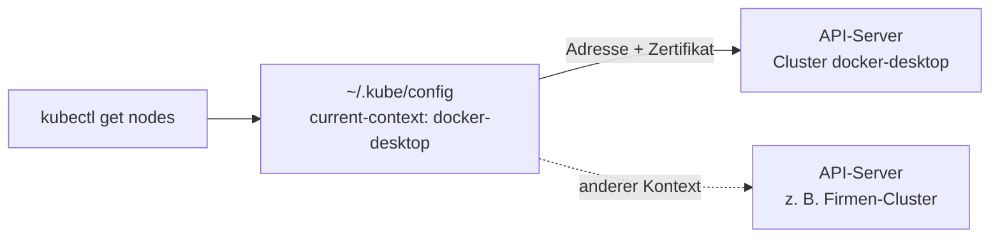

# Lab 5.2: Lokales Cluster und kubectl

**Leitfragen:**

<details>
<summary>Wie kann ein Cluster aus mehreren Servern auf einem einzigen Laptop entstehen?</summary>

Indem die „Server" selbst nur Container oder kleine virtuelle Maschinen sind. Docker Desktop, kind und minikube starten die Kubernetes-Komponenten in Containern auf dem Laptop; für Kubernetes sieht das wie ein echter Node aus.

</details>

<details>
<summary>Woher weiß ein Kommandozeilen-Tool, mit welchem Server es sprechen soll?</summary>

Aus einer Konfigurationsdatei mit Adresse, Zugangsdaten und einem ausgewählten Eintrag. Bei Kubernetes ist das die kubeconfig `~/.kube/config` mit ihrem aktuellen Kontext.

</details>

- Zum Lernen reicht ein Cluster mit einem Node auf dem eigenen Rechner; die Befehle sind dieselben wie in der Cloud.
- `kubectl` spricht mit dem API-Server des Clusters (Lab 5.1); welcher Cluster das ist, steht in der kubeconfig.

## Begriffe

| Begriff | Bedeutung |
| --- | --- |
| lokales Cluster | Kubernetes auf dem eigenen Rechner, meist mit einem Node; zum Lernen und Testen |
| verwaltetes Cluster | Kubernetes, das ein Cloud-Anbieter betreibt (AKS, EKS, GKE); nur die Anwendungen sind eigene Aufgabe |
| `kubectl` | Kommandozeilen-Werkzeug, das Befehle als HTTPS-Anfragen an den API-Server schickt; das Gegenstück zur `docker`-CLI |
| kubeconfig | Datei `~/.kube/config` mit Clustern, Zugangsdaten und Kontexten |
| Kontext | benannte Kombination aus Cluster und Benutzer; der aktuelle Kontext bestimmt, wohin `kubectl` spricht |
| Cluster-Typ Kubeadm | Variante in Docker Desktop: ein Node `docker-desktop`, der die Images von Docker mitbenutzt |
| Status `Ready` | der Node ist gesund und kann Container ausführen |

## Optionen für ein Übungscluster

| Werkzeug | Aufbau | Stärken | Schwächen |
| --- | --- | --- | --- |
| **Docker Desktop, Kubeadm** (Kurs) | ein Node `docker-desktop` in der Docker-VM | ein Klick, Hello-Images aus Tag 1 sofort nutzbar | Version von Docker Desktop festgelegt; Lizenz für große Firmen |
| Docker Desktop, kind | mehrere Nodes als Container | Version wählbar | eigene Images nur mit containerd-Image-Store |
| minikube | ein oder mehrere Nodes in Container oder VM | viele Add-ons | Images per `minikube image load` laden |
| kind | Nodes als Container („Kubernetes in Docker") | schnell, beliebt in CI-Pipelines | Images per `kind load docker-image` laden |
| AKS, EKS, GKE | verwaltete Cluster in der Cloud | produktionsreif, mehrere echte Server | kostet Geld, braucht Cloud-Konto |

Im Kurs gilt Docker Desktop mit Cluster-Typ **Kubeadm** ([Setup](../../00-setup-and-installation.md#kubernetes-in-docker-desktop-einschalten)); minikube und kind sind der [Fallback](../../00-setup-and-installation.md#fallback-minikube-oder-kind).


_Quelle: kind-Projekt, „Initial design" (https://kind.sigs.k8s.io/docs/design/initial/), Kubernetes SIG Testing, Apache-2.0, abgerufen am 24.11.2026._

Das Bild zeigt, wie ein ganzer Node in einen Container passt: Ein Container spielt den Server und enthält kubelet, Container-Runtime und alle Komponenten aus Lab 5.1. Docker Desktop arbeitet nach demselben Prinzip; die Runtime im Bild ist älter, heute meist containerd.


_Quelle: The Kubernetes Authors, „Using Minikube to Create a Cluster" (https://kubernetes.io/docs/tutorials/kubernetes-basics/create-cluster/cluster-intro/), CC BY 4.0, abgerufen am 24.11.2026._

Ein echtes Cluster hat eine Control Plane und mehrere Nodes; auf dem Laptop fällt beides in den einen Node `docker-desktop`.

## kubectl, kubeconfig und Kontext



Die kubeconfig hat drei Listen und einen Zeiger (gekürzt, Zertifikate ausgeblendet):

```yaml
apiVersion: v1
kind: Config
clusters:                          # WOHIN: Adresse des API-Servers
- name: docker-desktop
  cluster:
    server: https://kubernetes.docker.internal:6443   # Docker Desktop; der Name zeigt auf den eigenen Rechner
    certificate-authority-data: DATA+OMITTED
users:                             # WER: Zugangsdaten (hier ein Zertifikat)
- name: docker-desktop
  user:
    client-certificate-data: DATA+OMITTED
    client-key-data: DATA+OMITTED
contexts:                          # Paar aus Cluster + User
- name: docker-desktop
  context:
    cluster: docker-desktop
    user: docker-desktop
current-context: docker-desktop    # dieser Kontext gilt für jeden kubectl-Befehl
```

| Befehl | Wirkung |
| --- | --- |
| `kubectl version` | Version von `kubectl` (Client) und Cluster (Server) |
| `kubectl get nodes` | Nodes mit Status; `-o wide` (breit) ergänzt IP, Betriebssystem, Container-Runtime |
| `kubectl config get-contexts` | alle Kontexte; `*` markiert den aktuellen |
| `kubectl config current-context` | nur den Namen des aktuellen Kontexts |
| `kubectl config use-context docker-desktop` | auf einen anderen Kontext wechseln |
| `kubectl get pods -n kube-system` | Pods der Systemkomponenten; `-n` wählt den Bereich (Namespace, Lab 5.3), in dem sie liegen |

Die kubeconfig enthält Zugangsdaten: nicht teilen, nicht in Repositories ablegen. Wer mehrere Cluster nutzt (lokal und Firma), prüft vor jedem ändernden Befehl den Kontext.

## Version von Client und Cluster

```text
Client Version: v1.37.x        # kubectl auf dem Rechner
Kustomize Version: v5.x.x      # eingebautes Zusatzwerkzeug, im Kurs nicht gebraucht
Server Version: v1.37.x        # Kubernetes im Cluster
```

`kubectl` darf höchstens eine Minor-Version vom Cluster abweichen. Docker Desktop bringt ein passendes `kubectl` mit; ein älteres aus einer anderen Installation kann es überdecken (`which kubectl`). Unterstützt sind Kubernetes 1.35–1.37, Stand: 24.11.2026 ([kubernetes.io/releases](https://kubernetes.io/releases/)).

## Systemkomponenten als Pods

Die Komponenten aus Lab 5.1 laufen im Docker-Desktop-Cluster selbst als Pods:

| Pod | Komponente |
| --- | --- |
| `kube-apiserver-docker-desktop` | API-Server |
| `etcd-docker-desktop` | etcd |
| `kube-scheduler-docker-desktop` | Scheduler |
| `kube-controller-manager-docker-desktop` | Controller-Manager |
| `kube-proxy-…` | kube-proxy (einer je Node) |
| `coredns-…` (zwei) | Namensauflösung im Cluster (Lab 7.2) |
| `storage-provisioner`, `vpnkit-controller` | Hilfsdienste von Docker Desktop (Speicher, Netzwerk) |

Das kubelet fehlt in der Liste: Es läuft als Programm direkt auf dem Node und startet die anderen. Namen der Hilfs-Pods können je nach Docker-Desktop-Version abweichen.

## Cluster anhalten und zurücksetzen

| Ziel | Docker Desktop (Kubeadm) |
| --- | --- |
| Zustand prüfen | Statusleiste `Kubernetes running`, `kubectl get nodes` |
| vorübergehend anhalten | Docker Desktop beenden; beim nächsten Start läuft das Cluster wieder |
| leeren Ausgangszustand herstellen | **Kubernetes** > **Reset cluster** (alle Objekte gehen verloren) |

Bedienung Stand: 24.11.2026, prüfen; Quelle: [Explore the Kubernetes view](https://docs.docker.com/desktop/use-desktop/kubernetes/).

## Typische Fehler

| Symptom | Ursache | Lösung |
| --- | --- | --- |
| `The connection to the server localhost:8080 was refused` | keine kubeconfig oder leerer Kontext | Kubernetes in Docker Desktop erstellen; `kubectl config use-context docker-desktop` |
| `Unable to connect to the server: dial tcp 127.0.0.1:6443: connect: connection refused` | Cluster gestoppt oder Docker Desktop beendet | Docker Desktop starten, `Kubernetes running` abwarten |
| Node `NotReady` | Cluster startet noch | 1–2 Minuten warten; sonst **Reset cluster** |
| falsches Cluster antwortet (anderer Node-Name) | anderer Kontext aktiv, z. B. aus der Firma | `kubectl config get-contexts`, dann `use-context docker-desktop` |
| `No resources found in default namespace.` | `-n kube-system` vergessen | Befehl mit `-n kube-system` wiederholen |
| `WARNING: version difference between client … and server … exceeds the supported minor version skew` | altes `kubectl` im Suchpfad | `which kubectl`, das kubectl von Docker Desktop nutzen |

## Fazit

- Docker Desktop (Kubeadm) liefert ein Ein-Node-Cluster `docker-desktop`, das die Hello-Images aus Tag 1 direkt nutzt.
- `kubectl` spricht per HTTPS mit dem API-Server; Adresse und Zugangsdaten stehen in `~/.kube/config`, der aktuelle Kontext wählt das Cluster.
- Die Komponenten der Control Plane sind im lokalen Cluster als Pods sichtbar.

In der Übung meldet `kubectl get nodes` den Node `docker-desktop` als `Ready`, und die Komponenten aus Lab 5.1 erscheinen als Pods.
