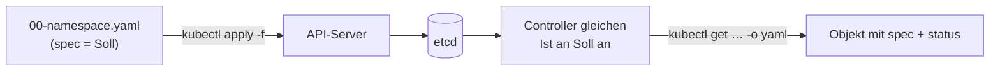

# Lab 5.3: Ressourcen und Manifeste

**Leitfragen:**

<details>
<summary>Was ist leichter nachzuvollziehen: eine Liste von Befehlen oder eine Beschreibung des Ziels?</summary>

Die Beschreibung des Ziels: Sie zeigt auf einen Blick, was laufen soll, lässt sich beliebig oft anwenden und in einer Datei ablegen. Bei einer Befehlsliste hängt das Ergebnis davon ab, was vorher schon da war (wie `docker run` gegenüber `compose.yml` an Tag 1).

</details>

<details>
<summary>Wie lassen sich Dinge von zwei Teams auf demselben Server auseinanderhalten?</summary>

Mit getrennten Bereichen, so wie Ordner im Dateisystem: gleiche Namen sind in verschiedenen Bereichen erlaubt, Rechte und Grenzen gelten je Bereich. In Kubernetes heißen diese Bereiche Namespaces.

</details>

- Alles, was Kubernetes verwaltet, ist eine Ressource: ein Objekt im API-Server mit Art, Name, gewünschtem und tatsächlichem Zustand.
- Ressourcen werden als YAML-Datei beschrieben (Manifest) und mit `kubectl apply -f` an das Cluster geschickt; ab diesem Lab liegen alle Objekte der Hello-App im Namespace `hello`.

## Begriffe

| Begriff | Bedeutung |
| --- | --- |
| Ressource (API-Objekt) | ein Eintrag im API-Server, z. B. ein Namespace, ein Pod oder ein Service; gespeichert in etcd (Lab 5.1) |
| Ressourcentyp (`kind`) | Art des Objekts, z. B. `Namespace`, `Pod`, `Service`; `kubectl api-resources` listet alle |
| Manifest | YAML-Datei, die ein oder mehrere Objekte beschreibt; wie `compose.yml`, nur für Kubernetes |
| imperativ | Befehl sagt, was zu tun ist: „erstelle X" (`kubectl create …`) |
| deklarativ | Datei sagt, wie es sein soll; Kubernetes gleicht an (`kubectl apply -f …`) |
| `spec` | gewünschter Zustand (schreibt der Mensch) |
| `status` | tatsächlicher Zustand (schreibt Kubernetes) |
| Namespace | benannter Bereich im Cluster, wie ein Ordner; Namen müssen nur innerhalb eines Namespace eindeutig sein |
| Dry-Run | Probelauf: der Befehl wird geprüft, im Cluster ändert sich nichts |

## Ressource heißt API-Objekt, nicht CPU oder Speicher

Das Wort „Ressource" hat in Kubernetes zwei Bedeutungen. Dieses Lab meint immer die erste.

| | Ressource (API-Objekt) | Rechenressource |
| --- | --- | --- |
| was | Objekt im API-Server: Namespace, Pod, Service, Deployment … | CPU und Arbeitsspeicher, die ein Container verbraucht |
| Beispiel | `kind: Namespace`, Name `hello` | `cpu: 100m`, `memory: 128Mi` |
| wo sichtbar | `kubectl api-resources`, `kubectl get <typ>` | `kubectl top`, Feld `resources:` im Container |
| im Kurs | ab diesem Lab | Lab 6.1 (Messwerte) und Lab 8.5 (Requests, Limits) |

## Aufbau jedes Objekts


_Quelle: The Kubernetes Authors, „Kubernetes Components" (https://kubernetes.io/docs/concepts/overview/components/), CC BY 4.0, abgerufen am 24.11.2026._

Jede Ressource landet über den API-Server (im Bild `api`) in etcd. Jedes Manifest hat dieselben Felder auf oberster Ebene; das kleinste Beispiel ist der Namespace der Hello-App, `project/examples/m05-kubernetes-basics/l03-resources/00-namespace.yaml`:

```yaml
apiVersion: v1          # API-Version des Ressourcentyps; Namespace gehört zur Kern-API "v1"
kind: Namespace         # Ressourcentyp, wie in kubectl api-resources
metadata:
  name: hello           # Name; bei Namespaces clusterweit eindeutig
# spec: ...             # gewünschter Zustand; ein Namespace braucht keinen eigenen
```

Nach dem Anwenden ergänzt Kubernetes Felder; `kubectl get namespace hello -o yaml` zeigt das gespeicherte Objekt:

```yaml
apiVersion: v1
kind: Namespace
metadata:
  creationTimestamp: "2026-11-24T09:41:07Z"   # von Kubernetes gesetzt
  labels:
    kubernetes.io/metadata.name: hello        # automatisch vergebenes Etikett
  name: hello
  resourceVersion: "4711"                     # interne Versionsnummer, ignorierbar
  uid: 6f1c2a7e-…                             # eindeutige ID, ignorierbar
spec:
  finalizers:
  - kubernetes                                # beim Löschen erst den Inhalt entfernen
status:
  phase: Active                               # tatsächlicher Zustand, von Kubernetes geschrieben
```

| Feld | wer schreibt | Inhalt |
| --- | --- | --- |
| `apiVersion`, `kind` | Mensch | welcher Ressourcentyp in welcher API-Version |
| `metadata` | Mensch (Name, Labels), Kubernetes (ID, Zeitstempel) | Name, Namespace, Etiketten |
| `spec` | Mensch | gewünschter Zustand (Soll) |
| `status` | Kubernetes | tatsächlicher Zustand (Ist); der Regelkreis aus Lab 5.1 gleicht `status` an `spec` an |

YAML-Regeln wie in `compose.yml` (Modul 3): Einrückung mit Leerzeichen, nie Tabulatoren; Listen mit `- `; `---` trennt mehrere Objekte in einer Datei.

## Ressourcentypen finden und erklären lassen

```bash
kubectl api-resources
```

```text
NAME          SHORTNAMES   APIVERSION   NAMESPACED   KIND
namespaces    ns           v1           false        Namespace
nodes         no           v1           false        Node
pods          po           v1           true         Pod
services      svc          v1           true         Service
deployments   deploy       apps/v1      true         Deployment
…
```

| Spalte | Bedeutung |
| --- | --- |
| `NAME` / `SHORTNAMES` | Name für `kubectl get`; Kurzname spart Tipparbeit (`kubectl get ns`) |
| `APIVERSION` | Wert für `apiVersion:` im Manifest |
| `NAMESPACED` | `true`: liegt in einem Namespace; `false`: gilt clusterweit |
| `KIND` | Wert für `kind:` im Manifest |

`kubectl explain namespace` zeigt die Doku eines Typs im Terminal; mit Punkten geht es in die Tiefe, z. B. `kubectl explain namespace.status.phase`.

## Imperativ und deklarativ

| | imperativ | deklarativ |
| --- | --- | --- |
| Beispiel | `kubectl create namespace hello` | `kubectl apply -f 00-namespace.yaml` |
| beschreibt | einen Schritt | den Zielzustand |
| zweimal ausführen | Fehler `AlreadyExists` | `unchanged`, kein Fehler |
| nachvollziehbar | nur über den Shell-Verlauf | Datei liegt im Projekt |
| typisch für | schnelles Ausprobieren, Vorlagen erzeugen | alles, was bleiben soll; im Kurs der Standard |



| Befehl | Wirkung |
| --- | --- |
| `kubectl create namespace hello --dry-run=client -o yaml` | Manifest als Vorlage erzeugen, ohne etwas anzulegen |
| `… > playground/k8s/00-namespace.yaml` | dieselbe Ausgabe als Datei speichern (`>` leitet um) |
| `kubectl apply -f playground/k8s/00-namespace.yaml` | Datei anwenden: anlegen oder angleichen |
| `kubectl apply -f playground/k8s/` | alle Manifeste eines Ordners, alphabetisch; deshalb `00-` vorn |
| `kubectl delete -f playground/k8s/00-namespace.yaml` | die beschriebenen Objekte löschen |

## Namespaces als Ordner im Cluster


_Quelle: Microsoft Learn, „Kubernetes core concepts for Azure Kubernetes Service" (https://learn.microsoft.com/en-us/azure/aks/concepts-clusters-workloads), CC BY 4.0, abgerufen am 24.11.2026._

| Namespace | Inhalt |
| --- | --- |
| `default` | Ziel aller Befehle ohne Namespace-Angabe |
| `kube-system` | Systemkomponenten (Lab 5.2) |
| `kube-public`, `kube-node-lease` | interne Daten des Clusters, im Kurs nicht gebraucht |
| `hello` | Hello-App ab diesem Lab |

```bash
kubectl get pods -A                                       # -A: alle Namespaces
kubectl config set-context --current --namespace=hello    # Standard-Namespace im Kontext setzen
kubectl config view --minify | grep namespace:            # prüfen: namespace: hello
```

Der Standard-Namespace steht im aktuellen Kontext der kubeconfig (Lab 5.2); jeder Befehl ohne `-n` gilt danach für `hello`.

## Typische Fehler

| Symptom | Ursache | Lösung |
| --- | --- | --- |
| `error converting YAML to JSON: yaml: line 3: mapping values are not allowed in this context` | Einrückung falsch oder Leerzeichen nach `:` fehlt | Einrückung mit 2 Leerzeichen; VS Code markiert die Stelle |
| `Error from server (AlreadyExists): namespaces "hello" already exists` | `kubectl create` ein zweites Mal ausgeführt | deklarativ arbeiten: `kubectl apply -f …` |
| `error: the path "playground/k8s/00-namespace.yaml" does not exist` | Terminal steht nicht im Ordner `project/` oder `playground/k8s/` fehlt | `cd` in `project/`, `mkdir -p playground/k8s` |
| `bash: playground/k8s/00-namespace.yaml: No such file or directory` beim Umleiten mit `>` | Ordner `playground/k8s/` existiert noch nicht | `mkdir -p playground/k8s` |
| `No resources found in hello namespace.` | Namespace richtig gesetzt, aber noch leer | erwartet; die Pods folgen in Lab 7.1 |

## Fazit

- Eine Ressource ist ein Objekt im API-Server mit `apiVersion`, `kind`, `metadata`, `spec` (Soll) und `status` (Ist); CPU und Speicher heißen im Kurs Rechenressourcen.
- `kubectl api-resources` listet alle Typen, `kubectl explain` erklärt jedes Feld.
- Deklarativ arbeiten: Zielzustand als Manifest, `kubectl apply -f` beliebig oft; `create --dry-run=client -o yaml` erzeugt Vorlagen.
- Namespaces trennen Objekte wie Ordner; der Standard-Namespace steht im Kontext.

In der Übung entsteht das erste Manifest der Hello-App: der Namespace `hello`, angewendet und als Standard gesetzt.
