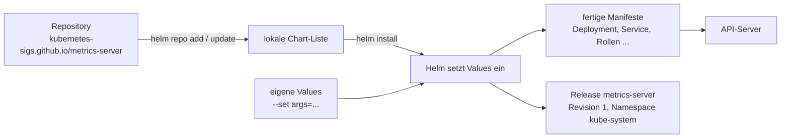
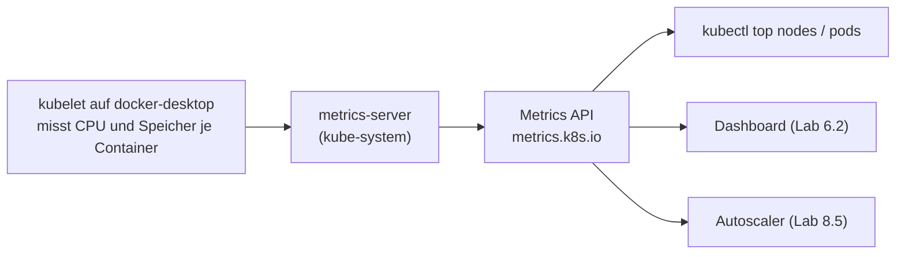

# Lab 6.1: Helm: Software im Cluster installieren

**Leitfragen:**

<details>
<summary>Wie installiert man auf einem Laptop eine Software mit allen Abhängigkeiten in einem Schritt?</summary>

Mit einem Paketmanager: `brew install`, `winget install` oder `apt install` holen ein fertiges Paket aus einer Quelle, legen alle Teile an und merken sich die installierte Version. Helm macht dasselbe für Software im Kubernetes-Cluster.

</details>

<details>
<summary>Woher soll ein Cluster wissen, wie viel CPU ein Programm gerade braucht?</summary>

Jemand muss es messen. Das kubelet auf jedem Node kennt den Verbrauch seiner Container; der Zusatzdienst metrics-server sammelt diese Werte ein und stellt sie `kubectl top` und später dem Autoscaler (Lab 8.5) bereit.

</details>

- Fertige Software für Kubernetes besteht aus vielen Ressourcen (Lab 5.3): der metrics-server aus neun, das Dashboard aus 23. Helm installiert sie als ein Paket mit einem Befehl.
- In diesem Lab installiert Helm den metrics-server; danach zeigt `kubectl top` CPU- und Speicherverbrauch.

## Begriffe

| Begriff | Bedeutung |
| --- | --- |
| Helm | Paketmanager für Kubernetes, ein Kommandozeilen-Werkzeug (`helm`) wie `brew` oder `winget`, nur für das Cluster |
| Chart | Helm-Paket: Vorlagen für Kubernetes-Manifeste plus Standardwerte; vergleichbar mit einem Image aus Tag 1 |
| Release | eine installierte Kopie eines Charts mit eigenem Namen je Namespace; vergleichbar mit einem Container aus einem Image |
| Revision | Versionsnummer eines Releases; Installation = 1, jede Änderung zählt hoch |
| Repository | Webadresse mit einer Liste von Charts (`index.yaml`); vergleichbar mit einer Registry aus Lab 2.3 |
| Values | Einstellungen eines Charts; Standard in `values.yaml`, eigene per `--set` oder `-f datei.yaml` |
| OCI-Registry | Registry für Images (z. B. Docker Hub, `ghcr.io`), die auch Charts speichert; Adresse beginnt mit `oci://` |
| metrics-server | Zusatzdienst, der CPU- und Speicherverbrauch aller Pods und Nodes beim kubelet abfragt und bereitstellt |
| `kubectl top` | zeigt den aktuellen CPU- und Speicherverbrauch von Nodes und Pods |

## Helm auf einen Blick



| Datum | Ereignis |
| --- | --- |
| 11/2015 | erste Helm-Version auf der ersten KubeCon |
| 06/2018 | Helm wird Projekt der CNCF |
| 13.11.2019 | Helm 3: kein Server-Teil mehr im Cluster, Rechte kommen aus der kubeconfig |
| 12.11.2025 | Helm 4.0; aktuell 4.3.2, Helm 3 bekommt nur noch Sicherheitsfixes bis 10.02.2027 |

Quellen: [Helm 3 released](https://helm.sh/blog/helm-3-released), [Helm 4 Released](https://helm.sh/blog/helm-4-released), [Helm 3 End of Life](https://helm.sh/blog/helm-v3-end-of-life), abgerufen am 24.11.2026. Charts für Helm 3 laufen unverändert mit Helm 4; Helm 4 lädt Charts außer aus Repositories auch direkt aus OCI-Registries (`helm install <name> oci://…`, ohne `helm repo add`).

## Charts finden auf Artifact Hub


_Quelle: Artifact Hub, Screenshots im README (https://github.com/artifacthub/hub), Apache-2.0, abgerufen am 24.11.2026._

[artifacthub.io](https://artifacthub.io) ist die Suchseite für Charts aus vielen Quellen. Jede Chart-Seite zeigt die Befehle `helm repo add` und `helm install`, die App- und Chart-Versionen und den Herausgeber. Vor dem Einsatz eines fremden Charts prüfen: Herausgeber (Projekt selbst?), letzte Version, feste Versionsnummer mit `--version`.

## Werte eines Charts


_Quelle: Artifact Hub, Screenshots im README (https://github.com/artifacthub/hub), Apache-2.0, abgerufen am 24.11.2026._

Jedes Chart bringt Standardwerte mit; `helm show values <chart>` zeigt sie im Terminal, Artifact Hub unter **Default Values**. Eigene Werte überschreiben sie:

| Weg | Beispiel |
| --- | --- |
| `--set` auf der Kommandozeile | `--set 'args={--kubelet-insecure-tls}'` (geschweifte Klammern = Liste) |
| Datei mit `-f` | `-f examples/m06-helm-tools/l01-helm/metrics-server-values.yaml` |

```yaml
# examples/m06-helm-tools/l01-helm/metrics-server-values.yaml
args:
  - --kubelet-insecure-tls    # Zertifikat des kubelet nicht prüfen (nur Übungscluster)
```

Reihenfolge: Standardwerte → `-f`-Dateien → `--set`; das Letzte gewinnt. Die einfachen Anführungszeichen um `'args={…}'` verhindern, dass die Shell die Klammern selbst deutet.

## Wichtige Helm-Befehle

| Befehl | Wirkung |
| --- | --- |
| `helm version --short` | Helm-Version, muss mit `v4.` beginnen |
| `helm repo add <name> <url>` | Repository unter einem Kurznamen eintragen |
| `helm repo update` | Chart-Listen aller Repositories neu laden |
| `helm search repo <wort>` | Charts in den eingetragenen Repositories suchen, mit Chart- und App-Version |
| `helm show values <chart> --version <v>` | Standardwerte mit Kommentaren |
| `helm install <release> <chart> --version <v> -n <ns>` | Release in einem Namespace installieren |
| `… -n <ns> --create-namespace` | Namespace dabei anlegen, falls er fehlt (Lab 6.2) |
| `helm list -A` | alle Releases in allen Namespaces mit Revision, Status, Chart- und App-Version |
| `helm get values <release> -n <ns>` | die selbst gesetzten Werte eines Releases |
| `helm uninstall <release> -n <ns>` | alle Objekte des Releases entfernen |

Helm speichert jede Revision als eigenes Objekt im Namespace des Releases (`sh.helm.release.v1.metrics-server.v1`); daraus liest `helm list` den Stand.

## metrics-server und was er misst



- Der metrics-server hält nur aktuelle Werte (alle 15 Sekunden neu), keine Historie; für Verlaufsgrafiken gibt es Monitoring-Systeme wie Prometheus.
- Einheiten: CPU in Millicores (`250m` = ein Viertel eines Kerns), Speicher in `Mi` (Mebibyte).
- Er prüft standardmäßig das Zertifikat jedes kubelet. Auf Docker Desktop ist es nicht von der Cluster-Zertifizierungsstelle unterschrieben, daher der Wert `--kubelet-insecure-tls`; die README nennt ihn „for testing purposes only" ([metrics-server](https://github.com/kubernetes-sigs/metrics-server), Chart 3.14.0 mit App 0.9.0, Stand: 24.11.2026; auf Docker Desktop prüfen).
- In Cloud-Clustern (AKS, EKS, GKE) ist der metrics-server meist vorinstalliert.

## Typische Fehler

| Symptom | Ursache | Lösung |
| --- | --- | --- |
| `helm: command not found` oder `v3.…` | Helm fehlt oder ist alt | Helm 4 installieren ([Setup](../../00-setup-and-installation.md#helm-4)), Terminal neu öffnen |
| `Error: repo metrics-server not found` | `helm repo add` fehlt oder Tippfehler im Kurznamen | `helm repo list` prüfen, Repository eintragen |
| `Error: INSTALLATION FAILED: cannot re-use a name that is still in use` | Release `metrics-server` existiert schon | `helm list -A` prüfen; Änderungen mit `helm upgrade` statt `install` |
| `error: Metrics API not available` | metrics-server startet noch | eine Minute warten, dann erneut `kubectl top nodes` |
| Pod `metrics-server-…` bleibt `0/1`, Log zeigt `x509: cannot validate certificate` | `--kubelet-insecure-tls` fehlt | `helm upgrade metrics-server metrics-server/metrics-server --version 3.14.0 -n kube-system --set 'args={--kubelet-insecure-tls}'` |
| Release fehlt in `helm list` | anderer Namespace | `helm list -A` (alle Namespaces) |

## Fazit

- Helm installiert Software als Paket (Chart); eine Installation heißt Release und zählt Revisionen.
- Charts kommen aus Repositories (`helm repo add`) oder OCI-Registries; Herausgeber und Version vorher prüfen, immer `--version` setzen.
- Values steuern das Chart: Standard im Chart, eigene per `--set` oder `-f`.
- Der metrics-server liefert aktuelle CPU- und Speicherwerte für `kubectl top`, das Dashboard und den Autoscaler.

In der Übung installiert Helm den metrics-server, und `kubectl top` zeigt den Verbrauch des Clusters.
