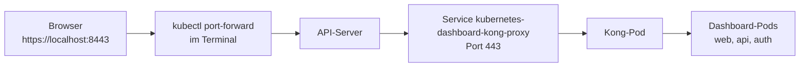

# Lab 6.2: Kubernetes Dashboard und Port-Forward

**Leitfragen:**

<details>
<summary>Wie kommt ein Browser auf dem Laptop an ein Programm, das im Cluster läuft, ohne es für alle zu öffnen?</summary>

Über einen privaten Tunnel: `kubectl port-forward` öffnet einen Port nur auf dem eigenen Rechner und leitet ihn durch den API-Server zum Programm im Cluster. Wer keinen Zugang zum Cluster hat, kommt nicht durch.

</details>

<details>
<summary>Wer sollte eine Oberfläche benutzen dürfen, mit der sich alles im Cluster löschen lässt?</summary>

Nur wenige Personen mit Admin-Aufgaben, und auch die nur mit dem nötigen Recht. Das Dashboard verlangt deshalb eine Anmeldung per Token; im Kurs ist es ein Admin-Token, und das ist ausschließlich im eigenen Übungscluster vertretbar.

</details>

- Das Kubernetes Dashboard zeigt die Ressourcen des Clusters im Browser: Nodes, Namespaces, Pods, Services, mit CPU- und Speicherwerten aus dem metrics-server (Lab 6.1).
- Installiert wird es mit Helm, erreichbar ist es über `kubectl port-forward`, angemeldet wird mit einem Token. Das Projekt ist seit 21.01.2026 archiviert; der Nachfolger heißt Headlamp.

## Begriffe

| Begriff | Bedeutung |
| --- | --- |
| Kubernetes Dashboard | Weboberfläche für Kubernetes; zeigt und ändert Ressourcen per Klick |
| `kubectl port-forward` | Tunnel von einem Port des eigenen Rechners durch den API-Server zu einem Pod; läuft, solange der Befehl läuft |
| Service | feste Adresse vor einem oder mehreren Pods (ausführlich in Lab 7.2); hier `kubernetes-dashboard-kong-proxy` |
| Kong | Proxy im Dashboard-Chart: nimmt alle Anfragen an und verteilt sie an die Teile des Dashboards |
| ServiceAccount | Zugangskonto für Programme statt für Menschen; im Kurs `admin-user` (Rechte-Details nicht Teil des Kurses) |
| ClusterRoleBinding | Zuordnung von Rechten an ein Konto; hier die eingebaute Rolle `cluster-admin` = alle Rechte |
| Token | zeitlich begrenzter Zugangsschlüssel eines Kontos, eine lange Zeichenkette; wie ein Tagesausweis am Empfang |
| selbstsigniertes Zertifikat | Zertifikat ohne bekannte Zertifizierungsstelle; der Browser warnt, die Verbindung ist trotzdem verschlüsselt |
| Headlamp | Nachfolger des Dashboards aus der Kubernetes SIG UI, als Desktop-App oder im Cluster |

## Dashboard als grafische Ansicht der Ressourcen


_Quelle: Kubernetes Dashboard, README (https://github.com/kubernetes-retired/dashboard), The Kubernetes Authors, Apache-2.0, abgerufen am 24.11.2026._

| Bereich links | zeigt | entspricht |
| --- | --- | --- |
| Namespace-Auswahl oben | Filter auf einen Namespace oder alle | `-n …` / `-A` |
| **Workloads** > **Pods** | Pods mit Status, Neustarts, CPU, Speicher | `kubectl get pods`, `kubectl top pods` |
| **Service** > **Services** | Services mit Typ und Ports | `kubectl get services` (Lab 7.2) |
| **Cluster** > **Nodes**, **Namespaces** | Nodes mit Auslastung, Namespaces | `kubectl get nodes`, `kubectl get ns` |
| Stift-Symbol oben rechts | YAML des Objekts bearbeiten | `kubectl edit` |

Das Dashboard spricht wie `kubectl` nur mit dem API-Server (Lab 5.1) und zeigt deshalb denselben Stand. Änderungen per Klick umgehen aber die Manifeste im Projekt; im Kurs wird immer die Datei geändert und mit `kubectl apply` angewendet.

## Installation per Helm

```bash
helm repo add kubernetes-dashboard https://kubernetes-retired.github.io/dashboard/
helm repo update
helm install kubernetes-dashboard kubernetes-dashboard/kubernetes-dashboard \
  --version 7.14.0 -n kubernetes-dashboard --create-namespace
```

- Seit Version 7 gibt es das Dashboard nur noch als Helm-Chart; es besteht aus fünf Teilen (`api`, `auth`, `web`, `metrics-scraper`, `kong`), je ein Pod.
- Das Repository liegt seit der Archivierung unter `kubernetes-retired.github.io`; die alte Adresse `kubernetes.github.io/dashboard` liefert keine Chart-Liste mehr (Stand: 24.11.2026, geprüft; vor Kursbeginn erneut prüfen).
- `--create-namespace` legt den Namespace `kubernetes-dashboard` mit an.

## Zugang per Port-Forward



```bash
kubectl -n kubernetes-dashboard port-forward svc/kubernetes-dashboard-kong-proxy 8443:443
```

```text
Forwarding from 127.0.0.1:8443 -> 8443
Forwarding from [::1]:8443 -> 8443
```

| Teil | Bedeutung |
| --- | --- |
| `svc/kubernetes-dashboard-kong-proxy` | Ziel: der Service vor dem Kong-Pod (`svc` = Kurzname für Service) |
| `8443:443` | lokaler Port 8443 → Service-Port 443 |
| `127.0.0.1` | nur der eigene Rechner kann den Port nutzen; nichts wird im Netz veröffentlicht |

Der Befehl blockiert das Terminal; mit **Strg+C** endet der Tunnel und das Dashboard ist nicht mehr erreichbar. Kong liefert HTTPS mit einem selbstsignierten Zertifikat: Der Browser warnt („Verbindung ist nicht privat"); im eigenen Übungscluster über **Erweitert** > **Weiter zu localhost** bestätigen.

## Anmeldung per Token


_Quelle: Kubernetes Dashboard, Dokumentation (https://github.com/kubernetes-retired/dashboard/tree/master/docs), The Kubernetes Authors, Apache-2.0, abgerufen am 24.11.2026._

Das vorbereitete Manifest `project/examples/m06-helm-tools/l02-dashboard/dashboard-admin.yaml` legt ein Zugangskonto mit allen Rechten an:

```yaml
apiVersion: v1
kind: ServiceAccount            # Zugangskonto für Programme
metadata:
  name: admin-user
  namespace: kubernetes-dashboard
---
apiVersion: rbac.authorization.k8s.io/v1
kind: ClusterRoleBinding        # gibt dem Konto Rechte im ganzen Cluster
metadata:
  name: admin-user
roleRef:
  apiGroup: rbac.authorization.k8s.io
  kind: ClusterRole
  name: cluster-admin           # eingebaute Rolle: darf alles
subjects:
  - kind: ServiceAccount
    name: admin-user
    namespace: kubernetes-dashboard
```

```bash
kubectl apply -f examples/m06-helm-tools/l02-dashboard/dashboard-admin.yaml
kubectl -n kubernetes-dashboard create token admin-user
```

```text
eyJhbGciOiJSUzI1NiIsImtpZCI6Ik…   (eine lange Zeile)
```

- Den Token komplett in das Feld **Bearer token** kopieren, dann **Sign in**. Der Token ist zeitlich begrenzt (typisch eine Stunde); danach einfach neu erzeugen.
- Ein Token mit `cluster-admin` darf alles löschen. Er gehört nur in das eigene Übungscluster, nie in ein Firmen-Cluster, nie in Dateien oder Chats. Im Betrieb bekommt jede Person ein Konto mit genau den nötigen Rechten.

## Dashboard archiviert, Nachfolger Headlamp

- Am 21.01.2026 wurde das Dashboard-Repository archiviert (`kubernetes-retired/dashboard`): keine neuen Versionen, keine Sicherheitsupdates. Die README verweist auf Headlamp.
- Charts und Images (`kubernetesui/dashboard-*`, Chart 7.14.0) sind weiter abrufbar; für den lokalen Kurs reicht das. Für Firmen-Cluster gilt: nicht mehr neu einsetzen.
- Headlamp (Kubernetes SIG UI) läuft als Desktop-App mit der vorhandenen kubeconfig (Lab 5.2) und braucht weder Token noch Port-Forward.


_Quelle: The Kubernetes Authors, „From Kubernetes Dashboard to Headlamp" (https://kubernetes.io/blog/2026/06/01/dashboard-to-headlamp/), CC BY 4.0, abgerufen am 24.11.2026._

Quellen: [kubernetes-retired/dashboard](https://github.com/kubernetes-retired/dashboard), [From Kubernetes Dashboard to Headlamp](https://kubernetes.io/blog/2026/06/01/dashboard-to-headlamp/), Stand: 24.11.2026.

## Typische Fehler

| Symptom | Ursache | Lösung |
| --- | --- | --- |
| `Error: looks like "https://kubernetes.github.io/dashboard/" is not a valid chart repository` | alte Repository-Adresse | `https://kubernetes-retired.github.io/dashboard/` verwenden |
| Pods `kubernetes-dashboard-…` bleiben `ContainerCreating` | Images werden noch geladen | 1–2 Minuten warten; vorab `bash pull-images.sh k8s` |
| `error: unable to forward port because pod is not running` | Kong-Pod noch nicht bereit | `kubectl get pods -n kubernetes-dashboard` abwarten, bis alle `Running` |
| `unable to listen on port 8443` | Port belegt, z. B. zweites Port-Forward | anderes Terminal schließen oder `8444:443` und `https://localhost:8444` |
| Browser: `ERR_EMPTY_RESPONSE` oder Fehler bei `http://localhost:8443` | `http` statt `https` | `https://localhost:8443` |
| Anmeldung scheitert mit `Unauthorized (401)` | Token unvollständig kopiert oder abgelaufen | Token neu erzeugen, komplett ohne Zeilenumbruch einfügen |
| Seiten bleiben leer, Meldung `forbidden` | `dashboard-admin.yaml` nicht angewendet | Manifest anwenden, neuen Token erzeugen |
| Pods ohne CPU- und Speicherwerte | metrics-server aus Lab 6.1 fehlt oder startet noch | `kubectl top nodes` prüfen |

## Fazit

- Das Dashboard zeigt dieselben Ressourcen wie `kubectl`, grafisch und mit Messwerten aus dem metrics-server.
- `kubectl port-forward` öffnet einen privaten Tunnel vom Laptop in das Cluster; nichts wird veröffentlicht, Ende mit Strg+C.
- Anmeldung per Token eines ServiceAccounts; ein Admin-Token gehört nur in das eigene Übungscluster.
- Das Dashboard ist seit 21.01.2026 archiviert; Nachfolger ist Headlamp.

In der Übung wird das Dashboard per Helm installiert, über Port-Forward geöffnet und zeigt die Systemkomponenten in `kube-system`.
