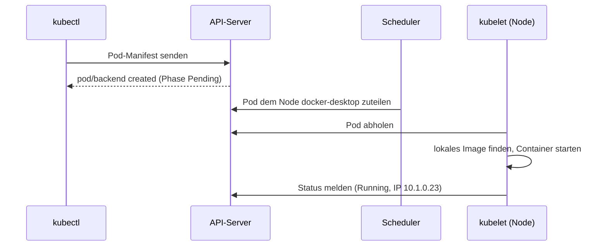

# Lab 7.1: Pods

**Leitfragen:**

<details>
<summary>Container gibt es schon: warum bräuchte ein Orchestrator eine eigene Einheit darum?</summary>

Manche Prozesse gehören so eng zusammen, dass sie immer gemeinsam starten, dieselbe Netzwerkadresse und dieselben Dateien nutzen sollen. Kubernetes plant deshalb nicht einzelne Container ein, sondern eine Hülle um einen oder mehrere Container: den Pod.

</details>

<details>
<summary>Hunderte Programme im Cluster: wie findet man alle, die zum selben Produkt gehören?</summary>

Namen allein reichen nicht, sie folgen keinem festen Schema. Jedes Objekt bekommt Etiketten aus Schlüssel und Wert (Labels) wie `app=hello-frontend`, und eine Abfrage filtert danach.

</details>

- Ein Pod ist die kleinste Einheit, die Kubernetes startet: ein oder mehrere Container mit gemeinsamer IP-Adresse.
- Die Hello-Images aus Tag 1 laufen ab jetzt als zwei Pods `backend` und `frontend` im Namespace `hello`, mit Labels zum Wiederfinden.

## Begriffe

| Begriff | Bedeutung |
| --- | --- |
| Pod | Hülle um einen oder mehrere Container, die zusammen auf einem Node laufen; wie eine Wohnung, in der die Container als Mitbewohner Adresse und Vorräte teilen |
| Pod-IP | IP-Adresse, die jeder Pod beim Start bekommt; gilt nur im Cluster-Netz und ändert sich mit jedem neuen Pod |
| `env` | Liste von Umgebungsvariablen im Manifest, wie `docker run -e` aus Lab 2.2 |
| `imagePullPolicy` | Regel, wann der Node ein Image aus einer Registry lädt: immer, nur wenn es fehlt, oder nie |
| Label | Schlüssel-Wert-Paar in `metadata.labels`, z. B. `tier: frontend`; wie ein Etikett auf einem Ordner |
| Selektor | Bedingung über Labels, z. B. `-l tier=frontend`; liefert alle Objekte, deren Labels passen |
| Phase | grober Lebensabschnitt eines Pods: `Pending`, `Running`, `Succeeded`, `Failed` |
| Event | kurze Meldung des Clusters zu einem Objekt („zugeteilt", „gestartet"); `kubectl describe` zeigt sie unten an |
| flüchtig | ein Pod wird nie repariert, nur ersetzt; der Ersatz hat eine neue IP |

## Pod als kleinste Einheit


_Quelle: The Kubernetes Authors, „Viewing Pods and Nodes" (https://kubernetes.io/docs/tutorials/kubernetes-basics/explore/explore-intro/), CC BY 4.0, abgerufen am 24.11.2026._

Jeder Kreis ist ein Pod mit eigener IP-Adresse. Darin laufen ein oder mehrere Container (Würfel) und optional gemeinsamer Speicher (Zylinder, Modul 9).

| | Container (Tag 1) | Pod |
| --- | --- | --- |
| was | laufender Prozess aus einem Image | Hülle um 1..n Container |
| Netzwerk | eigene IP im Docker-Netz | eine IP für alle Container im Pod |
| wer startet | `docker run` / Compose | Kubernetes, auf einem Node, den der Scheduler wählt |
| im Alltag | ein Dienst je Container | meist genau ein Container je Pod |

## Pod-Manifest mit Labels und env

Arbeitsdateien `playground/k8s/10-backend-pod.yaml` und `playground/k8s/30-frontend-pod.yaml`; fertig in `project/examples/m07-pods-services/l01-pods/`:

```yaml
apiVersion: v1                      # Pods gehören zur Kern-API (Lab 5.3)
kind: Pod
metadata:
  name: frontend                    # Name des Pods, eindeutig im Namespace
  labels:                           # Etiketten zum Wiederfinden und Auswählen
    app: hello-frontend             # Anwendung bzw. Dienst
    tier: frontend                  # Schicht
    version: v1                     # laufende Version
spec:
  containers:                       # Liste der Container im Pod, hier genau einer
    - name: frontend                # Name des Containers
      image: hello-frontend:v1      # lokal gebautes Image aus Lab 2.2
      imagePullPolicy: Never        # nur das lokale Image nutzen
      ports:
        - containerPort: 80         # dokumentiert den Port, auf dem Flask lauscht
      env:                          # wie docker run -e BACKEND_URL=...
        - name: BACKEND_URL
          value: "http://10.1.0.23" # Pod-IP des Backends, von Hand eingetragen
```

| Feld | Bedeutung |
| --- | --- |
| `metadata.labels` | Etiketten am Pod, nicht am Container; Werte sind Text ohne Leerzeichen |
| `spec.containers[].image` | Image wie bei `docker run` |
| `spec.containers[].env` | Umgebungsvariablen; Werte immer als Text, Zahlen in Anführungszeichen |
| `spec.containers[].ports[].containerPort` | Information für Mensch und Werkzeuge; geöffnet wird der Port vom Programm selbst |

Ein Namespace steht nicht im Manifest: `kubectl apply` legt den Pod im Standard-Namespace des Kontexts an, seit Lab 5.3 also in `hello`.

## imagePullPolicy und lokale Images

| Wert | Verhalten | Standard, wenn nicht gesetzt |
| --- | --- | --- |
| `Always` | lädt bei jedem Start aus der Registry | bei Tag `:latest` oder ohne Tag |
| `IfNotPresent` | lädt nur, wenn das Image auf dem Node fehlt | bei jedem anderen Tag, z. B. `:v1` |
| `Never` | lädt nie; fehlt das Image, startet der Pod nicht (`ErrImageNeverPull`) | – |

Die Images `hello-*` liegen in keiner öffentlichen Registry, nur lokal aus Lab 2.2. Der Docker-Desktop-Cluster (Kubeadm) sieht die lokalen Docker-Images; `Never` verhindert, dass er sie bei Docker Hub sucht.

## Labels und Selektoren


_Quelle: The Kubernetes Authors, „Using a Service to Expose Your App" (https://kubernetes.io/docs/tutorials/kubernetes-basics/expose/expose-intro/), CC BY 4.0, abgerufen am 24.11.2026._

Der Selektor `app=A` erfasst genau die Pods mit `app: A`, egal wie sie heißen und welche IP sie haben. Services (Lab 7.2) und Deployments (Modul 8) finden ihre Pods auf genau diesem Weg.

| Label | Werte in der Hello-App | wofür |
| --- | --- | --- |
| `app` | `hello-backend`, `hello-frontend` | einen Dienst finden; Grundlage der Selektoren ab Lab 7.2 |
| `tier` | `backend`, `frontend` | eine Schicht auswählen |
| `version` | `v1`, `v2` | sehen, welche Version läuft; nicht Teil von Selektoren |

| Befehl | zeigt |
| --- | --- |
| `kubectl get pods --show-labels` | alle Pods mit allen Labels |
| `kubectl get pods -L app,version` | je Label eine eigene Spalte |
| `kubectl get pods -l app=hello-backend` | nur Pods mit diesem Label |
| `kubectl get pods -l tier=frontend,version=v1` | beide Bedingungen (UND) |
| `kubectl get pods -l tier!=frontend` | alle ohne `tier=frontend` |

## Vom Manifest zum laufenden Pod



| Phase | Bedeutung |
| --- | --- |
| `Pending` | angenommen, aber noch nicht alle Container laufen (Image fehlt, Start läuft) |
| `Running` | dem Node zugeteilt, mindestens ein Container läuft |
| `Succeeded` | alle Container haben sich erfolgreich beendet (einmalige Aufgaben, Lab 9.4) |
| `Failed` | alle Container beendet, mindestens einer mit Fehler |

Die Spalte `STATUS` von `kubectl get pods` zeigt oft einen genaueren Grund, z. B. `ContainerCreating` oder `ErrImageNeverPull`.

## Pods untersuchen und erreichen

| Befehl | zeigt / macht |
| --- | --- |
| `kubectl get pods -o wide` | Status, Neustarts, Pod-IP und Node |
| `kubectl describe pod frontend` | alle Details, Labels, `env`, unten die Events |
| `kubectl logs backend` | Ausgabe des Containers, wie `docker logs` |
| `kubectl exec frontend -- env` | Befehl im Container ausführen, wie `docker exec` |
| `kubectl port-forward pod/frontend 8080:80` | Tunnel `localhost:8080` → Pod-Port 80 (Lab 6.2); Ende mit **Strg+C** |
| `kubectl delete pod backend` | Pod löschen |

```text
$ kubectl get pods -o wide
NAME       READY   STATUS    RESTARTS   AGE   IP          NODE             NOMINATED NODE   READINESS GATES
backend    1/1     Running   0          40s   10.1.0.23   docker-desktop   <none>           <none>
frontend   1/1     Running   0          12s   10.1.0.24   docker-desktop   <none>           <none>
```

Wichtig sind `READY` (bereite Container / alle Container), `STATUS`, `RESTARTS` und `IP`; die letzten beiden Spalten sind ohne Belang. Das Dashboard (Lab 6.2) zeigt dieselben Pods unter **Workloads** > **Pods**:

 Pods im Namespace kube-system: oben Diagramme für CPU- und Speicherverbrauch, darunter die Pod-Liste mit Name, Node, Status Running, Restarts, Alter, CPU und Speicher" width="620">

_Quelle: The Kubernetes Authors, „Web UI (Dashboard)", japanische Fassung der Doku (https://kubernetes.io/ja/docs/tasks/access-application-cluster/web-ui-dashboard/), CC BY 4.0, abgerufen am 24.11.2026. Abgebildet ist eine ältere Dashboard-Version; Aufbau und Spalten sind gleich geblieben._

## Pods sind flüchtig

- Ein gelöschter oder abgestürzter Pod kommt nicht von selbst zurück; ein neu angelegter Pod gleichen Namens bekommt in der Regel eine neue IP.
- Das Frontend kennt das Backend nur über die eingetragene IP. Nach dem Neuanlegen des Backends zeigt die Seite `Backend nicht erreichbar (http://10.1.0.23): ConnectTimeout` (oder `ConnectionError`).
- `env` eines laufenden Pods lässt sich nicht ändern. Für eine neue `BACKEND_URL` heißt es: Pod löschen, Datei ändern, neu anwenden.

Feste Namen statt IPs liefert der Service in Lab 7.2; automatischen Ersatz für gelöschte Pods liefern ReplicaSets und Deployments in Modul 8.

## Typische Fehler

| Symptom | Ursache | Lösung |
| --- | --- | --- |
| `STATUS` `ErrImageNeverPull` | Image `hello-*` fehlt lokal oder Tippfehler im Tag | `docker images` prüfen, sonst `bash build-images.sh` im Ordner `project/` |
| Pod landet im Namespace `default` | Kontext hat keinen Standard-Namespace | `kubectl config set-context --current --namespace=hello` (Lab 5.3) |
| `The Pod "frontend" is invalid: spec: Forbidden: pod updates may not change fields other than …` | `env` eines laufenden Pods geändert und erneut angewendet | `kubectl delete pod frontend`, dann `kubectl apply -f …` |
| `strict decoding error: unknown field "spec.containers[0].labels"` | Labels unter dem Container eingetragen | Labels nach `metadata.labels` des Pods verschieben |
| `unable to listen on port 8080` | Port 8080 auf dem Laptop belegt | anderes Port-Forward beenden oder `8081:80` nutzen |
| Seite zeigt `Backend nicht erreichbar` | IP in `BACKEND_URL` falsch oder veraltet | aktuelle IP mit `kubectl get pod backend -o wide` vergleichen |

## Fazit

- Ein Pod verpackt einen oder mehrere Container mit einer gemeinsamen IP; das Manifest beschreibt Image, `imagePullPolicy`, Port und `env`.
- Labels (`app`, `tier`, `version`) machen Pods auffindbar; `-l` filtert danach.
- `get -o wide`, `describe`, `logs` und `port-forward` reichen, um einen Pod zu prüfen und im Browser zu sehen.
- Pods sind flüchtig: ein neuer Pod hat eine neue IP; eine von Hand eingetragene Pod-IP ist nur eine Übergangslösung.

In der Übung laufen Backend und Frontend als Pods mit Labels, die Hello-Seite erscheint über Port-Forward, und ein neu angelegtes Backend zeigt das Problem fester Adressen.
