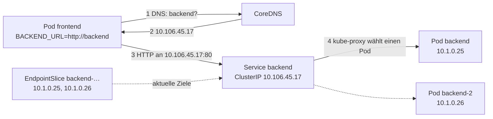

# Lab 7.2: Service für das Backend

**Leitfragen:**

<details>
<summary>Das Backend bekommt bei jedem Neustart eine neue IP: wie findet das Frontend es trotzdem?</summary>

Über einen festen Namen statt einer IP. Ein Service gibt einer Gruppe von Pods eine feste Adresse und einen DNS-Namen (`backend`); welche Pods gerade dahinterstehen, pflegt Kubernetes selbst. In Compose (Modul 3) war das der Dienstname.

</details>

<details>
<summary>Zwei Backend-Kopien: wer verteilt die Anfragen?</summary>

Nicht das Frontend. Auf jedem Node leitet kube-proxy (Lab 5.1) jede Verbindung an die Service-Adresse an einen der bereiten Pods weiter.

</details>

- Pods kommen und gehen, ihre IPs auch (Lab 7.1). Ein Service ist die feste Adresse davor.
- Ab diesem Lab erreicht das Frontend das Backend über `http://backend`, und die Seite zeigt Antworten von zwei Backend-Pods.

## Begriffe

| Begriff | Bedeutung |
| --- | --- |
| Service | Kubernetes-Objekt mit fester IP-Adresse und DNS-Namen für eine Gruppe von Pods; wie die zentrale Nummer einer Hotline, hinter der wechselnde Mitarbeitende abheben |
| ClusterIP | Standardtyp eines Service: eine feste, virtuelle IP, die nur innerhalb des Clusters erreichbar ist |
| Endpoint | eine konkrete Pod-Adresse (IP und Port), an die ein Service weiterleitet |
| EndpointSlice | Liste der aktuellen Endpoints eines Service; Kubernetes pflegt sie automatisch anhand des Selectors |
| DNS | Dienst, der Namen in IP-Adressen übersetzt; im Cluster übernimmt das CoreDNS (Pods `coredns-…` aus Lab 5.2) |
| FQDN | vollständiger DNS-Name, im Cluster `<service>.<namespace>.svc.cluster.local` |
| `port` / `targetPort` | Port, unter dem der Service erreichbar ist / Port im Container, an den er weiterleitet |

## Wechselnde Pod-IPs und feste Service-Adresse


_Quelle: Wikimedia Commons, „Pod-networking.png" (https://commons.wikimedia.org/wiki/File:Pod-networking.png), Marvin The Paranoid, CC BY-SA 4.0, abgerufen am 24.11.2026._

Container B fragt nicht Pod 2 oder Pod 3 direkt, sondern „Service X". Bei der Hello-App heißt dieser Service `backend`; die Antwort kommt von `backend` oder `backend-2`.

## Service-Manifest des Backends

Arbeitsdatei `playground/k8s/20-backend-service.yaml`, fertig in `project/examples/m07-pods-services/l02-clusterip/`:

```yaml
apiVersion: v1
kind: Service
metadata:
  name: backend               # wird zum DNS-Namen: http://backend
  labels:
    app: hello-backend
    tier: backend
spec:
  type: ClusterIP             # Standard; darf auch fehlen
  selector:                   # welche Pods dahinterstehen (Labels aus Lab 7.1)
    app: hello-backend
  ports:
    - port: 80                # Port des Service: http://backend:80
      targetPort: 80          # Port im Container (containerPort des Backends)
      protocol: TCP
```

| Feld | Wirkung |
| --- | --- |
| `metadata.name` | Name des Service und zugleich sein DNS-Name im Namespace |
| `spec.selector` | Labels, die ein Pod tragen muss; hier nur `app`, nie `version`, damit beide Versionen dahinterstehen können (Lab 8.3) |
| `spec.ports[].port` | Port, den Clients ansprechen; `http://backend` nutzt automatisch 80 |
| `spec.ports[].targetPort` | Port, auf dem die App im Container lauscht |

```text
$ kubectl get service backend
NAME      TYPE        CLUSTER-IP     EXTERNAL-IP   PORT(S)   AGE
backend   ClusterIP   10.106.45.17   <none>        80/TCP    8s
```

Die `CLUSTER-IP` bleibt fest, solange der Service existiert, egal wie oft Pods ersetzt werden.

## Vom Selector zur EndpointSlice


_Quelle: The Kubernetes Authors, „Using a Service to Expose Your App" (https://kubernetes.io/docs/tutorials/kubernetes-basics/expose/expose-intro/), CC BY 4.0, abgerufen am 24.11.2026._

Der Service sucht laufend alle Pods, deren Labels zum Selector passen, und schreibt ihre IPs in eine EndpointSlice. Für die Hello-App:



```text
$ kubectl get endpointslices -l kubernetes.io/service-name=backend
NAME            ADDRESSTYPE   PORTS   ENDPOINTS             AGE
backend-7xk2p   IPv4          80      10.1.0.25,10.1.0.26   12s
```

- Das Label `kubernetes.io/service-name` setzt Kubernetes selbst; es verbindet die EndpointSlice mit ihrem Service.
- Nur bereite Pods (`READY 1/1`) stehen in der Liste. Passt kein Pod zum Selector, zeigt `ENDPOINTS` `<unset>`.
- `kubectl describe service backend` zeigt dieselben Adressen in der Zeile `Endpoints:`. Die ältere Abfrage `kubectl get endpoints` ist seit Kubernetes 1.33 veraltet und gibt eine Warnung aus ([EndpointSlices](https://kubernetes.io/docs/concepts/services-networking/endpoint-slices/), Stand: 24.11.2026).

## DNS-Namen im Cluster

| Name | funktioniert von | Beispiel |
| --- | --- | --- |
| `backend` | Pods im selben Namespace `hello` | `http://backend` |
| `backend.hello` | Pods in jedem Namespace | `http://backend.hello` |
| `backend.hello.svc.cluster.local` | überall im Cluster (FQDN) | `http://backend.hello.svc.cluster.local` |

Der Laptop selbst kennt diese Namen nicht; sie gelten nur im Cluster. Zum Testen läuft der Befehl im Frontend-Container, dessen Alpine-Image `nslookup` und `wget` mitbringt:

```bash
kubectl exec frontend -- nslookup backend
kubectl exec frontend -- wget -qO- http://backend.hello.svc.cluster.local/api
```

```text
Server:		10.96.0.10
Address:	10.96.0.10:53

Name:	backend.hello.svc.cluster.local
Address: 10.106.45.17

{"ip":"10.1.0.26","pod":"backend-2","time":"10:14:52","version":"v1"}
```

Zusätzliche Zeilen wie `** server can't find backend.cluster.local: NXDOMAIN` sind normal: `nslookup` probiert alle Einträge der Suchliste durch.

## port und targetPort


Bei der Hello-App sind beide Werte 80. Lauscht eine App auf 8080, bleibt der Service unter Port 80 erreichbar und leitet mit `targetPort: 8080` weiter; Clients merken davon nichts.

## Lastverteilung durch kube-proxy

- kube-proxy richtet auf jedem Node Weiterleitungsregeln für alle Service-IPs ein; jede neue Verbindung geht an einen zufällig gewählten Endpoint, kein festes Reihum.
- Das Hello-Frontend öffnet für jeden Seitenaufruf eine neue Verbindung; deshalb wechselt beim Neuladen der Backend-Pod auf der Seite (`backend` / `backend-2`), mal öfter, mal seltener.
- Das Port-Forward aus Lab 7.1 geht dagegen fest an den einen Pod `frontend`.

## Typische Fehler

| Symptom | Ursache | Lösung |
| --- | --- | --- |
| Seite: `Backend nicht erreichbar (http://backend): ConnectionError`, EndpointSlice zeigt `<unset>` | Selector passt zu keinem Pod (Tippfehler wie `hello-backnd`) | `kubectl get pods --show-labels` mit `kubectl describe service backend` (Zeile `Selector:`) vergleichen, korrigieren, erneut anwenden |
| EndpointSlice hat IPs, Seite meldet trotzdem `ConnectionError` | `targetPort` passt nicht zum Port im Container | `targetPort: 80` |
| Seite zeigt weiter die alte Pod-IP in `BACKEND_URL` | Frontend-Pod nicht neu angelegt | `kubectl delete pod frontend`, dann `kubectl apply -f playground/k8s/30-frontend-pod.yaml` |
| Port-Forward beendet sich mit `lost connection to pod` | Frontend-Pod wurde gelöscht | Port-Forward neu starten |
| Seite zeigt immer denselben Backend-Pod | nur ein Pod bereit oder Browser-Cache | EndpointSlice prüfen; Seite mit Strg+F5 / Cmd+Shift+R neu laden |
| `Warning: v1 Endpoints is deprecated` | `kubectl get endpoints` benutzt | `kubectl get endpointslices -l kubernetes.io/service-name=backend` |

## Fazit

- Ein Service gibt Pods mit passenden Labels eine feste ClusterIP und einen DNS-Namen; im selben Namespace reicht `http://backend`.
- Die EndpointSlice zeigt, welche Pods gerade dahinterstehen; `<unset>` heißt fast immer: Selector passt nicht.
- kube-proxy verteilt jede neue Verbindung auf einen der bereiten Pods; `port` ist der Service-Port, `targetPort` der Container-Port.

In der Übung bekommt das Backend einen zweiten Pod und einen Service, und das Frontend findet es über den Namen `backend`.
