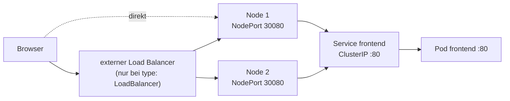

# Lab 7.3: NodePort für das Frontend

**Leitfragen:**

<details>
<summary>Ein Cluster hat fünf Server: an welchen davon schickt der Browser seine Anfrage?</summary>

An irgendeinen. Ein NodePort-Service öffnet denselben Port auf allen Nodes, und jeder Node leitet an einen passenden Pod weiter. Damit niemand eine Node-IP kennen muss, steht in der Cloud ein Load Balancer mit einer festen Adresse davor.

</details>

<details>
<summary>Wie viele öffentliche Adressen braucht eine Firma mit 30 Web-Anwendungen?</summary>

Mit einem eigenen Load Balancer je Anwendung: 30 Adressen, und in der Cloud kostet jede davon Geld. Eine gemeinsame Adresse, die nach Hostname und Pfad verteilt, reicht für alle (Lab 7.4).

</details>

- Eine ClusterIP (Lab 7.2) ist nur im Cluster erreichbar. Für Zugriffe von außen gibt es die Service-Typen `NodePort` und `LoadBalancer`.
- `kubectl port-forward` bleibt das Werkzeug für schnelle Tests vom eigenen Rechner, nicht für Nutzerinnen und Nutzer.

## Begriffe

| Begriff | Bedeutung |
| --- | --- |
| Node-IP | IP-Adresse eines Servers (Node) im Netz des Rechenzentrums oder Laptops |
| NodePort | Service-Typ, der auf jedem Node denselben Port aus dem Bereich 30000–32767 öffnet und an die Pods weiterleitet |
| LoadBalancer | Service-Typ, der zusätzlich einen externen Load Balancer mit eigener Adresse anfordert |
| externer Load Balancer | Gerät oder Cloud-Dienst vor dem Cluster, der Anfragen auf die Nodes verteilt; wie die Empfangstheke, die Besucher auf freie Schalter schickt |
| `EXTERNAL-IP` | Spalte in `kubectl get service`: Adresse des Load Balancers; `<pending>`, solange keiner bereitsteht |

## Service-Typen im Vergleich

| Typ | erreichbar von | Adresse | typischer Einsatz |
| --- | --- | --- | --- |
| `ClusterIP` (Standard) | nur im Cluster | `backend:80` | Dienste untereinander, z. B. Frontend → Backend |
| `NodePort` | allen, die einen Node erreichen | `<Node-IP>:30000–32767` | Tests, kleine Cluster im eigenen Rechenzentrum, eigener Load Balancer davor |
| `LoadBalancer` | Internet oder Firmennetz | eigene IP oder Hostname | eine Anwendung direkt veröffentlichen |
| Port-Forward (kein Service-Typ) | nur der eigene Rechner mit kubeconfig | `localhost:<port>` | schneller Test, Dashboard (Lab 6.2) |

Die drei Typen bauen aufeinander auf: Ein NodePort-Service hat auch eine ClusterIP, ein LoadBalancer-Service auch eine ClusterIP und einen NodePort; der Load Balancer schickt seine Anfragen an diesen NodePort (Quelle: [Service](https://kubernetes.io/docs/concepts/services-networking/service/), Stand: 24.11.2026).




_Quelle: Wikimedia Commons, „Kubernetes High-availability.png" (https://commons.wikimedia.org/wiki/File:Kubernetes_High-availability.png), Natlibfi-arlehiko, CC BY-SA 4.0, abgerufen am 24.11.2026._

Der externe Load Balancer kennt nur die Nodes. Auf jedem Node verteilt kube-proxy (Lab 7.2) weiter auf die Pods, auch auf Pods eines anderen Nodes.

## Frontend-Service als NodePort

Arbeitsdatei `playground/k8s/40-frontend-service.yaml`, fertig in `project/examples/m07-pods-services/l03-nodeport/`:

```yaml
apiVersion: v1
kind: Service
metadata:
  name: frontend
  labels:
    app: hello-frontend
    tier: frontend
spec:
  type: NodePort              # öffnet zusätzlich einen Port auf jedem Node
  selector:
    app: hello-frontend
  ports:
    - port: 80                # Port der ClusterIP: http://frontend:80 im Cluster
      targetPort: 80          # Port im Frontend-Container
      nodePort: 30080         # fester Port auf jedem Node; ohne Angabe wählt Kubernetes einen freien
      protocol: TCP
```

```text
$ kubectl get service frontend
NAME       TYPE       CLUSTER-IP      EXTERNAL-IP   PORT(S)        AGE
frontend   NodePort   10.104.12.200   <none>        80:30080/TCP   6s
```

| Teil | Bedeutung |
| --- | --- |
| `80:30080/TCP` | Service-Port 80 : NodePort 30080 |
| `EXTERNAL-IP <none>` | kein externer Load Balancer, nur der Port auf den Nodes |
| `nodePort` fest | gut merkbar, kollidiert aber leicht mit anderen Services; meist bleibt die automatische Vergabe |

## NodePort lokal und in der Cloud

| Umgebung | `type: NodePort` | `type: LoadBalancer` |
| --- | --- | --- |
| Docker Desktop (Kubeadm) | `http://localhost:30080`, weil Docker Desktop den Node-Port auf den Laptop weiterleitet (prüfen) | `EXTERNAL-IP localhost`, Service-Port direkt auf `localhost` |
| minikube / kind | `<Node-IP>:30080` (`minikube ip`), bei kind nur mit Port-Freigabe | `<pending>` ohne `minikube tunnel` bzw. Zusatz `cloud-provider-kind` |
| AKS, EKS, GKE | Node-IPs meist nicht öffentlich | echter Load Balancer mit öffentlicher IP, kostet je Stück |


_Quelle: The Kubernetes Authors, „DIY: Create Your Own Cloud with Kubernetes (Part 2)" (https://kubernetes.io/blog/2024/04/05/diy-create-your-own-cloud-with-kubernetes-part-2/), CC BY 4.0, abgerufen am 24.11.2026._

Das „Services plugin" im Bild ist bei Docker Desktop kube-proxy. Der Docker-Desktop-Cluster hat nur einen Node; der Weg ist derselbe.

## Port-Forward und NodePort im Vergleich

| | Port-Forward (Lab 7.1) | NodePort |
| --- | --- | --- |
| Zweck | schneller Test vom eigenen Rechner | Zugang für andere, ohne kubeconfig |
| Ziel | genau ein Pod | alle Pods hinter dem Service, verteilt |
| Lebensdauer | solange das Terminal läuft | solange der Service existiert |
| neuer Pod | Tunnel bricht ab, neu starten | Service findet den neuen Pod über den Selector |

## Typische Fehler

| Symptom | Ursache | Lösung |
| --- | --- | --- |
| `spec.ports[0].nodePort: Invalid value: 8080: provided port is not in the valid range` | `nodePort` außerhalb 30000–32767 | Wert aus dem Bereich wählen oder Zeile entfernen |
| `provided port is already allocated` | ein anderer Service nutzt 30080 | `kubectl get services -A` prüfen, anderen Port wählen |
| `localhost:30080` lädt nicht | Docker Desktop leitet den NodePort nicht weiter (Version, Provisioner) | `type: LoadBalancer` mit `port: 8080` und `http://localhost:8080`, oder `kubectl port-forward service/frontend 8080:80` |
| Seite lädt, zeigt `Backend nicht erreichbar` | Service `backend` aus Lab 7.2 fehlt | `kubectl apply -f playground/k8s/20-backend-service.yaml` |
| `ENDPOINTS <unset>` bei `kubectl get endpointslices -l kubernetes.io/service-name=frontend` | Selector passt nicht zum Frontend-Pod | `app: hello-frontend` prüfen (wie Lab 7.2) |

## Fazit

- `NodePort` öffnet einen Port 30000–32767 auf jedem Node; `LoadBalancer` setzt einen externen Load Balancer davor und enthält NodePort und ClusterIP.
- Docker Desktop leitet Ports des Ein-Node-Clusters auf `localhost`; in der Cloud kostet jeder Load Balancer eine eigene Adresse.
- `kubectl port-forward` ist ein Test-Tunnel zu genau einem Pod, kein Zugang für Nutzer.

In der Übung wird die Hello-Seite über den NodePort `30080` erreichbar, ganz ohne Port-Forward.
