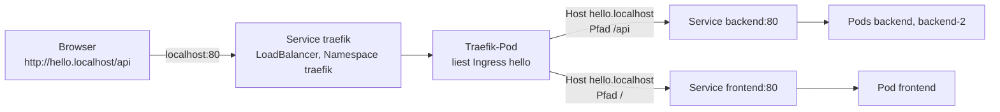

# Lab 7.4: Ingress: Routing nach Name und Pfad

**Leitfragen:**

<details>
<summary>30 Web-Anwendungen, eine öffentliche Adresse: wie kommt jede Anfrage zur richtigen Anwendung?</summary>

Über den Inhalt der HTTP-Anfrage: Jede Anfrage nennt den Hostnamen (`shop.example.com`) und einen Pfad (`/api`). Ein Eingangs-Proxy liest beides und leitet nach Regeln an den passenden Service weiter; eine Adresse und ein Load Balancer reichen für alle 30.

</details>

<details>
<summary>Wer soll Zertifikate und Domains verwalten: jede Anwendung selbst oder eine Stelle für alle?</summary>

Eine Stelle für alle: Der gemeinsame Eingang kennt Domains und Zertifikate, die Anwendungen bleiben schlicht HTTP-Dienste im Cluster. So muss nicht jedes Team HTTPS selbst einrichten und erneuern.

</details>

- Lab 7.3 brauchte für jede Anwendung einen eigenen Port oder Load Balancer. Ein Ingress verteilt HTTP-Anfragen nach Hostname und Pfad über eine gemeinsame Adresse.
- Ein Ingress ist nur eine Regel; ohne Ingress-Controller passiert nichts. In dieser Demo übernimmt Traefik die Rolle, installiert per Helm (Modul 6).

## Begriffe

| Begriff | Bedeutung |
| --- | --- |
| Hostname | Name in der Adresse, z. B. `hello.localhost`; der Browser schickt ihn in jeder Anfrage mit (HTTP-Header `Host`) |
| Pfad | Teil der Adresse nach dem Hostnamen, z. B. `/api` |
| Reverse Proxy | Programm, das Anfragen von außen annimmt und an interne Dienste weiterreicht; wie die Poststelle, die Briefe nach Abteilung verteilt |
| Ingress | Kubernetes-Ressource mit Routing-Regeln: Hostname + Pfad → Service und Port |
| Ingress-Controller | Reverse Proxy im Cluster, der Ingress-Objekte liest und umsetzt, z. B. Traefik |
| IngressClass | Name, über den ein Ingress „seinen" Controller wählt (`ingressClassName: traefik`) |
| Traefik | verbreiteter Open-Source-Reverse-Proxy und Ingress-Controller von Traefik Labs |
| Gateway API | Nachfolger von Ingress mit getrennten Objekten für Eingang (Gateway) und Routen (HTTPRoute) |

## Routing nach Hostname und Pfad


_Quelle: The Kubernetes Authors, „Ingress" (https://kubernetes.io/docs/concepts/services-networking/ingress/), CC BY 4.0, abgerufen am 24.11.2026._

Für die Hello-App sieht der Weg so aus:



- Der längste passende Pfad gewinnt: `/api` geht ans Backend, alles andere ans Frontend.
- Das Backend antwortet selbst unter `/api`; ein Umschreiben des Pfads ist nicht nötig.
- Die Services aus Lab 7.2 und 7.3 bleiben unverändert; der Ingress zeigt nur auf sie.

## Ingress-Manifest der Hello-App

`project/examples/m07-pods-services/l04-ingress/50-ingress.yaml`:

```yaml
apiVersion: networking.k8s.io/v1
kind: Ingress
metadata:
  name: hello
spec:
  ingressClassName: traefik         # welcher Ingress-Controller zuständig ist
  rules:
    - host: hello.localhost         # nur Anfragen an diesen Hostnamen
      http:
        paths:
          - path: /api              # alles, was mit /api beginnt
            pathType: Prefix
            backend:
              service:
                name: backend       # Service aus Lab 7.2
                port:
                  number: 80
          - path: /                 # alles andere
            pathType: Prefix
            backend:
              service:
                name: frontend      # Service aus Lab 7.3
                port:
                  number: 80
```

| Feld | Bedeutung |
| --- | --- |
| `ingressClassName` | wählt den Controller; ohne passenden Controller bleibt der Ingress wirkungslos |
| `rules[].host` | Hostname, für den die Regeln gelten; ohne `host` gelten sie für alle Namen |
| `paths[].pathType: Prefix` | Pfad und alles darunter (`/api`, `/api/x`); `Exact` nur genau diesen Pfad |
| `backend.service` | Ziel: Service-Name und -Port im selben Namespace |
| `tls` (hier nicht genutzt) | Zertifikat für HTTPS; der Controller übernimmt die Verschlüsselung für alle Anwendungen |

`*.localhost`-Namen lösen Chrome, Edge, Firefox und curl ohne Eintrag in der hosts-Datei auf den eigenen Rechner auf; Safari unter Umständen nicht (dann `curl -H "Host: hello.localhost" http://localhost/`).

## Ingress-Controller: Traefik und andere


_Quelle: Traefik Labs, Traefik-Dokumentation (https://doc.traefik.io/traefik/), MIT, abgerufen am 24.11.2026._

| Controller | Stand 24.11.2026 |
| --- | --- |
| Traefik (Demo) | aktiv; Chart `traefik/traefik` 42.4.2 mit Traefik v3.7.19; liest Ingress und Gateway API |
| ingress-nginx (Kubernetes-Projekt) | seit 24.03.2026 eingestellt, keine Updates mehr |
| NGINX Ingress Controller / NGINX Gateway Fabric (F5 NGINX) | eigenes Produkt des NGINX-Herstellers, weiter gepflegt |
| Cloud-Controller (AKS, EKS, GKE) | Load Balancer des Anbieters als Ingress |

Das Traefik-Chart legt standardmäßig einen Service `traefik` vom Typ `LoadBalancer` mit Port 80 und 443 an sowie die IngressClass `traefik` (geprüft mit `helm show values traefik/traefik --version 42.4.2`). Docker Desktop veröffentlicht diesen Service auf `localhost:80` (prüfen); Port 80 auf dem Laptop muss frei sein.

## ingress-nginx eingestellt, Gateway API als Nachfolger

- Am 11.11.2025 kündigte die Kubernetes SIG Network das Ende von ingress-nginx an; seit **24.03.2026** gibt es keine Releases und keine Sicherheitsupdates mehr. Bestehende Installationen gelten als Sicherheitsrisiko ([Ingress NGINX Retirement](https://kubernetes.io/blog/2025/11/11/ingress-nginx-retirement/), [Statement 29.01.2026](https://kubernetes.io/blog/2026/01/29/ingress-nginx-statement/)).
- Die Ingress-API selbst bleibt stabil, ist aber eingefroren: Neue Funktionen kommen nur noch in die Gateway API ([Ingress](https://kubernetes.io/docs/concepts/services-networking/ingress/), Stand: 24.11.2026).
- Die Gateway API teilt die Aufgaben: **Gateway** (Eingang mit Port, Domains, Zertifikaten; Plattform-Team) und **HTTPRoute** (Hostname + Pfad → Service; App-Team). Traefik, Envoy Gateway, Cilium, Istio und NGINX Gateway Fabric setzen sie um.


_Quelle: Gateway API, „Introduction" (https://gateway-api.sigs.k8s.io/docs/introduction/), Kubernetes SIG Network, Apache-2.0, abgerufen am 24.11.2026._

Die Hello-Route aus diesem Lab hieße als HTTPRoute fast gleich: `hostnames: [hello.localhost]`, Regeln mit `path: /api` → `backend:80` und `/` → `frontend:80`; vertieft im Kurs „Kubernetes Einführung" (3 Tage).

## Befehle zum Nachmachen

Voraussetzung: Stand nach Lab 7.3 (Services `backend` und `frontend` im Namespace `hello`), Terminal im Ordner `project/`, Port 80 auf dem Laptop frei (`docker ps` zeigt keinen Container mit `0.0.0.0:80->`).

```bash
# 1. Traefik per Helm installieren (eigener Namespace traefik)
helm repo add traefik https://traefik.github.io/charts
helm repo update
helm install traefik traefik/traefik --version 42.4.2 -n traefik --create-namespace \
  -f examples/m07-pods-services/l04-ingress/traefik-values.yaml

# 2. warten, bis Traefik läuft und der Service localhost meldet
kubectl get pods -n traefik
kubectl get service -n traefik

# 3. Ingress der Hello-App anwenden und prüfen
kubectl apply -f examples/m07-pods-services/l04-ingress/50-ingress.yaml
kubectl get ingress
kubectl describe ingress hello

# 4. beide Wege testen (oder im Browser öffnen)
curl http://hello.localhost/
curl http://hello.localhost/api
```

```text
NAME                       READY   STATUS    RESTARTS   AGE
traefik-6d9f8c7b5d-q2wxz   1/1     Running   0          35s
NAME      TYPE           CLUSTER-IP     EXTERNAL-IP   PORT(S)                      AGE
traefik   LoadBalancer   10.98.137.42   localhost     80:31372/TCP,443:30957/TCP   35s
ingress.networking.k8s.io/hello created
NAME    CLASS     HOSTS             ADDRESS     PORTS   AGE
hello   traefik   hello.localhost   localhost   80      5s
```

```text
$ curl http://hello.localhost/api
{"ip":"10.1.0.26","pod":"backend-2","time":"11:02:41","version":"v1"}
```

`http://hello.localhost` zeigt im Browser die Hello-Seite, `http://hello.localhost/api` die JSON-Antwort eines Backend-Pods. `traefik-values.yaml` enthält nur die Standardwerte des Charts und macht sie sichtbar; ohne `-f` ist das Ergebnis dasselbe.

Aufräumen:

```bash
kubectl delete -f examples/m07-pods-services/l04-ingress/50-ingress.yaml
helm uninstall traefik -n traefik
kubectl delete namespace traefik
```

## Typische Fehler

| Symptom | Ursache | Lösung |
| --- | --- | --- |
| `EXTERNAL-IP` des Service `traefik` bleibt `<pending>` | Port 80 oder 443 auf dem Laptop belegt (lokaler Webserver, `docker run -p 80:…` aus Tag 1) | `docker ps` prüfen, Container stoppen; sonst `curl -H "Host: hello.localhost" http://localhost:<NodePort>/` mit dem NodePort aus `PORT(S)` |
| `404 page not found` von Traefik | Hostname falsch oder Ingress in anderem Namespace | `kubectl get ingress -A`, `host` prüfen |
| Ingress ohne `ADDRESS` | IngressClass `traefik` fehlt oder Traefik nicht installiert | `kubectl get ingressclass`, Helm-Release prüfen (`helm list -A`) |
| `Bad Gateway` / `Service Unavailable` | Service `backend` oder `frontend` fehlt oder hat keine Endpoints | `kubectl get endpointslices` (Lab 7.2) |
| Safari: „Server nicht gefunden" | Safari löst `*.localhost` nicht auf | Chrome/Firefox oder `curl -H "Host: hello.localhost" http://localhost/` |

## Fazit

- Ein Ingress verteilt HTTP-Anfragen nach Hostname und Pfad an Services; eine Adresse reicht für viele Anwendungen.
- Ohne Ingress-Controller wirkt ein Ingress nicht; Traefik lässt sich per Helm in einer Minute installieren.
- ingress-nginx ist seit 24.03.2026 eingestellt, die Ingress-API eingefroren; Nachfolger ist die Gateway API mit Gateway und HTTPRoute.

In der Demo antwortet die Hello-App unter `http://hello.localhost` und `http://hello.localhost/api` über eine gemeinsame Adresse; die Befehle oben wiederholen sie Schritt für Schritt.
