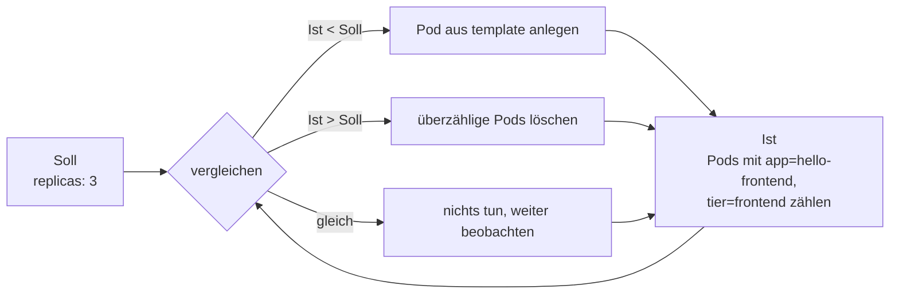

# Lab 8.1: ReplicaSets und Skalierung

**Leitfragen:**

<details>
<summary>Ein Programm stürzt nachts ab: wer startet es neu?</summary>

Stürzt nur der Container ab, startet ihn der kubelet im selben Pod neu (Spalte `RESTARTS`). Verschwindet der ganze Pod, etwa weil er gelöscht wurde oder sein Node ausfällt, holt ihn niemand zurück. Dafür braucht es ein Objekt, das ständig nachzählt und fehlende Pods ersetzt: das ReplicaSet.

</details>

<details>
<summary>Was passiert, wenn jemand von Hand eine weitere Kopie mit denselben Labels startet?</summary>

Ein ReplicaSet zählt alle Pods, die zu seinem Selector passen, nicht nur die selbst erzeugten. Bei vier statt drei passenden Pods löscht es einen, meist den neuesten.

</details>

- Ein Controller vergleicht ständig Soll und Ist und gleicht ab (Regelkreis aus Lab 5.1); das ReplicaSet ist der Controller für „genau N gleiche Pods".
- Das Frontend läuft ab jetzt als ReplicaSet `hello-frontend` mit drei Pods hinter dem Service `frontend`; das Backend bleibt bis Lab 8.2 bei den Pods `backend` und `backend-2`.

## Begriffe

| Begriff | Bedeutung |
| --- | --- |
| Controller | Programm in der Control Plane (Lab 5.1), das für eine Objektart Soll und Ist vergleicht und Unterschiede ausgleicht; wie ein Thermostat |
| ReplicaSet | Objekt, das dafür sorgt, dass immer eine feste Zahl gleicher Pods läuft |
| Replika | eine der gleichen Kopien (Pods) einer Anwendung |
| `replicas` | Soll-Anzahl der Pods |
| `selector` | Label-Bedingung (Lab 7.1), an der das ReplicaSet „seine" Pods erkennt |
| `template` | Bauplan für neue Pods: Labels und `spec` wie in einem Pod-Manifest |
| Self-Healing | fehlende Pods werden automatisch ersetzt, ohne dass jemand eingreift |
| skalieren | die Soll-Anzahl ändern, z. B. von 3 auf 5 Pods |
| Owner Reference | Vermerk im Pod, welches Objekt ihn verwaltet; `kubectl describe` zeigt ihn als `Controlled By` |

## Regelkreis eines ReplicaSets



Jeder Eingriff von außen (Pod löschen, Node fällt aus) ändert nur das Ist; der Controller stellt das Soll wieder her. Das Soll ändert nur, wer das ReplicaSet ändert.

## Aufbau eines ReplicaSets


_Quelle: Kubernetes-Dokumentation, „Using a Service to Expose Your App" (https://kubernetes.io/docs/tutorials/kubernetes-basics/expose/expose-intro/), CC BY 4.0, The Kubernetes Authors, abgerufen am 24.11.2026._

Rechts im Bild umschließt das ReplicaSet `rs` die drei Pods mit `app: A`; der Pod mit `app: B` gehört nicht dazu. Genauso zählt `hello-frontend` nur Pods mit seinen Labels.

```yaml
# playground/k8s/30-frontend-replicaset.yaml
apiVersion: apps/v1                    # ReplicaSets gehören zur API-Gruppe "apps"
kind: ReplicaSet
metadata:
  name: hello-frontend
  labels:
    app: hello-frontend
    tier: frontend
spec:
  replicas: 3                          # Soll: drei laufende Pods
  selector:                            # welche Pods zählt das ReplicaSet?
    matchLabels:                       # alle mit genau diesen Labels (ohne version)
      app: hello-frontend
      tier: frontend
  template:                            # Bauplan für jeden neuen Pod
    metadata:
      labels:                          # müssen zum Selector passen
        app: hello-frontend
        tier: frontend
        version: v1
    spec:                              # wie spec im Pod-Manifest aus Lab 7.1
      containers:
        - name: frontend
          image: hello-frontend:v1
          imagePullPolicy: Never
          ports:
            - containerPort: 80
          env:
            - name: BACKEND_URL
              value: "http://backend"  # Service "backend" aus Lab 7.2
```

| Feld | Hinweis |
| --- | --- |
| `apiVersion: apps/v1` | Workload-Objekte wie ReplicaSet und Deployment liegen in der API-Gruppe `apps` (`kubectl api-resources`, Lab 5.3) |
| `selector.matchLabels` | passt er nicht zu `template.metadata.labels`, lehnt die API das Objekt ab |
| `version` nicht im Selector | die Version ändert sich bei Updates (Lab 8.2); der Selector soll alle Versionen umfassen |
| `template.spec` | genau das, was im Pod-Manifest unter `spec` steht |
| Pod-Namen | `<ReplicaSet-Name>-<5 Zeichen>`, z. B. `hello-frontend-x2kqp` |

Der Service `frontend` (Lab 7.3) wählt Pods mit `app: hello-frontend`. Er findet die drei neuen Pods ohne Änderung und verteilt die Anfragen auf sie.

## Self-Healing beobachten

`kubectl get … -w` (watch) läuft weiter und druckt jede Änderung als neue Zeile, bis **Strg+C**. Wird ein Pod gelöscht, legt das ReplicaSet sofort einen neuen an, mit neuem Namen und neuer IP:

```text
$ kubectl get pods -l app=hello-frontend -w
NAME                   READY   STATUS              RESTARTS   AGE
hello-frontend-7mh4d   1/1     Running             0          2m
hello-frontend-p9wzl   1/1     Running             0          2m
hello-frontend-x2kqp   1/1     Running             0          2m
hello-frontend-x2kqp   1/1     Terminating         0          2m
hello-frontend-c5r8n   0/1     Pending             0          0s
hello-frontend-c5r8n   0/1     ContainerCreating   0          0s
hello-frontend-c5r8n   1/1     Running             0          1s
```

`kubectl get rs` zeigt Soll (`DESIRED`), vorhandene (`CURRENT`) und bereite Pods (`READY`):

```text
NAME             DESIRED   CURRENT   READY   AGE
hello-frontend   3         3         3       2m
```

## ReplicaSet skalieren

 

_Quelle: Kubernetes-Dokumentation, „Running Multiple Instances of Your App" (https://kubernetes.io/docs/tutorials/kubernetes-basics/scale/scale-intro/), CC BY 4.0, The Kubernetes Authors, abgerufen am 24.11.2026._

Links läuft eine Anwendung mit einem Pod, rechts nach dem Skalieren mit vier Pods; der Service davor verteilt die Anfragen. Im Docker-Desktop-Cluster gibt es nur den Node `docker-desktop`, alle Pods landen dort.

| Weg | Befehl | Hält bis |
| --- | --- | --- |
| imperativ | `kubectl scale rs hello-frontend --replicas=5` | zum nächsten `kubectl apply` der Datei |
| deklarativ | `replicas: 5` in der Datei, dann `kubectl apply -f …` | dauerhaft, die Datei ist die Wahrheit |

Ein `kubectl apply` mit `replicas: 3` nach einem `scale` auf 5 setzt das Soll zurück auf 3; zwei Pods werden gelöscht.

Die Lastverteilung zeigt eine kleine Schleife über den NodePort aus Lab 7.3; jede Anfrage landet bei einem zufällig gewählten Pod:

```text
$ for i in 1 2 3 4 5 6; do curl -s http://localhost:30080/ | grep -o 'Frontend:</b> [^<]*'; done
Frontend:</b> hello-frontend-p9wzl (10.1.0.32)
Frontend:</b> hello-frontend-7mh4d (10.1.0.31)
Frontend:</b> hello-frontend-p9wzl (10.1.0.32)
Frontend:</b> hello-frontend-k4tzb (10.1.0.36)
Frontend:</b> hello-frontend-c5r8n (10.1.0.33)
Frontend:</b> hello-frontend-q7vxd (10.1.0.37)
```

## Fremde Pods mit passenden Labels

Ein ReplicaSet übernimmt jeden Pod **ohne** eigenen Besitzer, dessen Labels zum Selector passen, und trägt sich als Owner ein (`Controlled By: ReplicaSet/hello-frontend`). Pods, die schon einem anderen Controller gehören, lässt es in Ruhe. Deshalb:

- Vor dem Anlegen des ReplicaSets den Einzel-Pod `frontend` aus Lab 7.1 löschen, sonst zählt er als einer der drei.
- Ein von Hand gestarteter Pod mit passenden Labels ist überzählig und wird sofort wieder gelöscht:

```text
$ kubectl run extra --image=hello-frontend:v1 --image-pull-policy=Never --labels=app=hello-frontend,tier=frontend
pod/extra created
$ kubectl get pods -l app=hello-frontend
NAME                   READY   STATUS        RESTARTS   AGE
extra                  0/1     Terminating   0          1s
hello-frontend-7mh4d   1/1     Running       0          5m
...
```

`kubectl run` startet einen einzelnen Pod direkt per Befehl, ohne Manifest.

## ReplicaSets im Dashboard

 Pods mit Diagrammen für CPU und Speicher, darunter eine Pod-Liste; im Menü links die Einträge Deployments, Pods und Replica Sets" width="680">

_Quelle: Kubernetes-Dokumentation, „Deploy and Access the Kubernetes Dashboard" (https://kubernetes.io/docs/tasks/access-application-cluster/web-ui-dashboard/), CC BY 4.0, The Kubernetes Authors, abgerufen am 24.11.2026._

Im Dashboard aus Lab 6.2 steht das ReplicaSet unter **Workloads > Replica Sets** (Namespace `hello` wählen); die Detailseite listet seine Pods. Das Bild zeigt die Pod-Liste derselben Oberfläche.

## Grenzen des ReplicaSets

Ändert sich das `template` (z. B. ein neues Image), behalten laufende Pods ihre alte Version; nur neu entstehende Pods bekommen das neue Template. Versionswechsel übernimmt das Deployment (Lab 8.2).

## Typische Fehler

| Symptom | Ursache | Lösung |
| --- | --- | --- |
| `selector does not match template labels` | Labels in `selector` und `template.metadata.labels` verschieden | gleiche Werte für `app` und `tier` eintragen |
| nur zwei neue Pods statt drei | alter Pod `frontend` mit passenden Labels wurde übernommen | `kubectl delete pod frontend`; das ReplicaSet legt den dritten an |
| `error validating data: … replicas` oder `matchLabels: Required value` | TODO im Starter leer gelassen | Wert bzw. Labels eintragen |
| Pods `ErrImageNeverPull` | Image-Tag im Template falsch | Template korrigieren, Pods löschen (`kubectl delete pods -l app=hello-frontend`) |
| nach `apply` wieder 3 statt 5 Pods | Datei enthält `replicas: 3` | Wert in der Datei ändern |
| `kubectl delete pod` hilft nicht, Pod kommt zurück | Pod gehört einem ReplicaSet | das ReplicaSet löschen oder auf 0 skalieren |

## Fazit

- Controller gleichen Soll und Ist in einem Regelkreis ab; das ReplicaSet hält `replicas` gleiche Pods am Leben.
- Selector und Template-Labels müssen zusammenpassen; gezählt wird jeder passende Pod ohne anderen Besitzer.
- `kubectl scale` ändert das Soll sofort, die Datei bei jedem `apply`; der Service verteilt auf alle Pods.

In der Übung ersetzt ein ReplicaSet den Frontend-Pod, ein gelöschter Pod kommt mit neuer IP zurück, und fünf Pods teilen sich die Anfragen.
