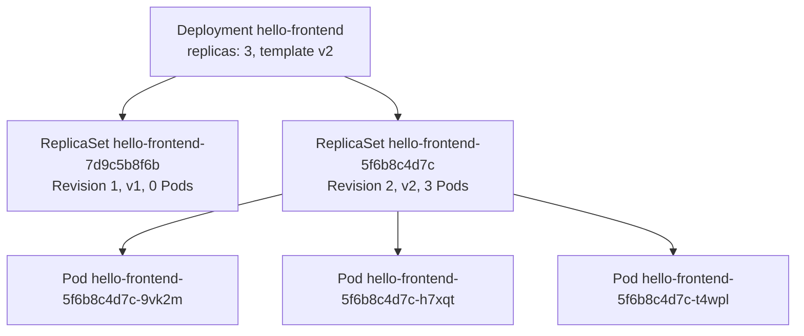
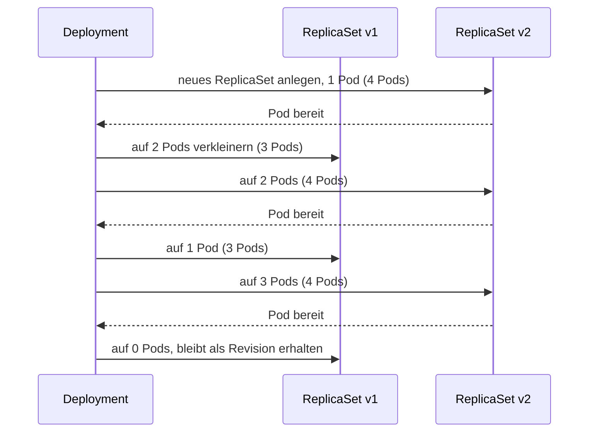

# Lab 8.2: Deployments: Rollout und Rollback

**Leitfragen:**

<details>
<summary>Wie tauscht man die Reifen eines fahrenden Busses?</summary>

Einen nach dem anderen, mit einem Ersatzrad in Reserve: erst ein neues Rad anbringen, dann ein altes abnehmen. Ein Deployment tauscht Pods genauso: neuen Pod starten, warten bis er bereit ist, alten Pod beenden, bis alle getauscht sind. Der Dienst läuft währenddessen weiter.

</details>

<details>
<summary>Eine neue Version ist kaputt: was ist schneller, reparieren oder zurück?</summary>

Zurück. Die alte Version liegt als altes ReplicaSet noch im Cluster; `kubectl rollout undo` stellt sie in Sekunden wieder her. Repariert wird danach ohne Zeitdruck.

</details>

- Ein Deployment verwaltet ReplicaSets, ein ReplicaSet verwaltet Pods; im Alltag wird nur das Deployment angelegt und geändert.
- Jede Änderung am Pod-Template startet einen Rollout: neue Pods ersetzen alte schrittweise, die alte Version bleibt für den Rückweg erhalten.
- Backend und Frontend laufen ab jetzt als Deployments `hello-backend` und `hello-frontend`; das Frontend wechselt von `v1` (hellblau) auf `v2` (hellgrün).

## Begriffe

| Begriff | Bedeutung |
| --- | --- |
| Deployment | Objekt für zustandslose Anwendungen: legt ReplicaSets an, skaliert und tauscht Versionen schrittweise aus |
| zustandslos | Anwendung, die keine Daten in sich speichert; jede Kopie ist gleichwertig austauschbar |
| Rollout | Übergang eines Deployments auf ein neues Pod-Template, z. B. ein neues Image |
| Revision | nummerierter Stand des Templates; zu jeder Revision gehört ein ReplicaSet |
| `RollingUpdate` | Strategie: Pods schrittweise austauschen, alt und neu laufen kurz nebeneinander (Standard) |
| `Recreate` | Strategie: alle alten Pods beenden, dann alle neuen starten; dazwischen ist die Anwendung weg |
| `maxSurge` | wie viele Pods während des Rollouts über `replicas` hinaus laufen dürfen |
| `maxUnavailable` | wie viele bereite Pods während des Rollouts unter `replicas` fehlen dürfen |
| Annotation | Notiz an einem Objekt unter `metadata.annotations`; anders als ein Label wählt niemand danach aus |
| `kubernetes.io/change-cause` | Annotation mit dem Grund einer Änderung; erscheint in `kubectl rollout history` |
| Rollback | Rückkehr zu einer früheren Revision mit `kubectl rollout undo` |
| `pod-template-hash` | Label, das das Deployment an ReplicaSet und Pods hängt: ein Kurzwert aus dem Template, damit sich Versionen nicht vermischen |

## Deployment, ReplicaSet und Pod



| Ebene | Aufgabe | Name |
| --- | --- | --- |
| Deployment | Version und Anzahl verwalten, Updates steuern | `hello-frontend` |
| ReplicaSet | genau N Pods einer Version am Leben halten (Lab 8.1) | `hello-frontend-<hash>` |
| Pod | einen Container ausführen | `hello-frontend-<hash>-<5 Zeichen>` |

| | ReplicaSet direkt (Lab 8.1) | Deployment |
| --- | --- | --- |
| Anzahl halten, Self-Healing | ja | ja, über sein ReplicaSet |
| neue Version ausrollen | nein, laufende Pods bleiben alt | ja, schrittweise |
| zur alten Version zurück | nein | ja, `kubectl rollout undo` |
| Versionshistorie | nein | ja, alte ReplicaSets bleiben als Revisionen |

Die Kubernetes-Dokumentation empfiehlt deshalb, ReplicaSets nicht direkt anzulegen, sondern über Deployments (Quelle: [ReplicaSet](https://kubernetes.io/docs/concepts/workloads/controllers/replicaset/), Stand: 24.11.2026).


_Quelle: Headlamp-README (https://github.com/kubernetes-sigs/headlamp), Apache-2.0, abgerufen am 24.11.2026._

Headlamp, der Nachfolger des Dashboards (Lab 6.2), zeigt unter **Workloads** Deployments und ReplicaSets nebeneinander; der Name `headlamp-5678cffdb7` folgt demselben Muster `<Deployment>-<hash>` wie `hello-frontend-7d9c5b8f6b`. Im Dashboard stehen dieselben Objekte unter **Workloads > Deployments** und **Replica Sets**.

## Manifest des Frontend-Deployments

Gegenüber dem ReplicaSet aus Lab 8.1 ändern sich nur drei Stellen: `kind`, die Annotation und die Strategie.

```yaml
# playground/k8s/30-frontend-deployment.yaml
apiVersion: apps/v1
kind: Deployment                       # statt ReplicaSet
metadata:
  name: hello-frontend
  labels:
    app: hello-frontend
    tier: frontend
  annotations:
    kubernetes.io/change-cause: "Start mit v1"   # Grund, erscheint in rollout history
spec:
  replicas: 3
  strategy:
    type: RollingUpdate
    rollingUpdate:
      maxSurge: 1                      # höchstens 4 Pods gleichzeitig
      maxUnavailable: 0                # nie weniger als 3 bereite Pods
  selector:
    matchLabels:                       # app + tier, nie version
      app: hello-frontend
      tier: frontend
  template:                            # jede Änderung hier startet einen Rollout
    metadata:
      labels:
        app: hello-frontend
        tier: frontend
        version: v1
    spec:
      containers:
        - name: frontend
          image: hello-frontend:v1
          imagePullPolicy: Never
          ports:
            - containerPort: 80
          env:
            - name: BACKEND_URL
              value: "http://backend"
```

Das Backend-Deployment `hello-backend` ist genauso aufgebaut (2 Replikas, Labels `app: hello-backend`, `tier: backend`). Eine Vorlage für solche Dateien erzeugt `kubectl create deployment hello-backend --image=hello-backend:v1 --port=80 --dry-run=client -o yaml` (Prinzip aus Lab 5.3). Die Services `backend` und `frontend` bleiben unverändert: Sie wählen nach dem Label `app` und finden die neuen Pods von selbst.

## Strategien RollingUpdate und Recreate

| | `RollingUpdate` | `Recreate` |
| --- | --- | --- |
| Ablauf | schrittweise, alt und neu gleichzeitig | erst alle alten weg, dann alle neuen |
| Ausfall | keiner, wenn genug Pods bereit bleiben | ja, bis die neuen Pods laufen |
| wann | Standard für zustandslose Web-Anwendungen | wenn zwei Versionen nie gleichzeitig laufen dürfen (z. B. altes und neues Datenbankschema) |

Ohne Angabe gilt `RollingUpdate` mit je `25 %`. Bei drei Replikas rundet Kubernetes `maxSurge` auf (1) und `maxUnavailable` ab (0); die explizite Angabe macht dasselbe Verhalten sichtbar.

| Änderung | Rollout? |
| --- | --- |
| `spec.template` (Image, `env`, Template-Labels, Ports) | ja, neue Revision |
| `replicas` (`kubectl scale`) | nein, nur mehr oder weniger Pods derselben Revision |
| `strategy`, Annotations am Deployment | nein |

## Ablauf eines Rolling Updates

Mit `maxSurge: 1` und `maxUnavailable: 0` startet immer zuerst ein neuer Pod; erst wenn er bereit ist, endet ein alter:



  

_Quelle: Kubernetes-Dokumentation, „Performing a Rolling Update" (https://kubernetes.io/docs/tutorials/kubernetes-basics/update/update-intro/), CC BY 4.0, The Kubernetes Authors, abgerufen am 24.11.2026._

Violette Pods (neue Version, neue IP) ersetzen nacheinander die grünen. Der Service verteilt währenddessen auf alle bereiten Pods: Im Browser unter `http://localhost:30080` erscheinen kurz `v1` und `v2` im Wechsel.

## Rollout auslösen und beobachten

| Befehl | Wirkung |
| --- | --- |
| Image, Label `version` und `change-cause` in der Datei ändern, `kubectl apply -f …` | Rollout deklarativ: die Datei bleibt die Wahrheit |
| `kubectl set image deployment/hello-frontend frontend=hello-frontend:v3` | Rollout per Befehl: Container `frontend` bekommt ein neues Image, die Datei bleibt unverändert |
| `kubectl annotate deployment/hello-frontend kubernetes.io/change-cause="…" --overwrite` | Grund nachtragen (direkt nach `set image`) |
| `kubectl rollout status deployment/hello-frontend` | Fortschritt; endet, wenn der Rollout fertig ist |
| `kubectl rollout history deployment/hello-frontend` | Revisionen mit `CHANGE-CAUSE` |
| `kubectl get rs` | altes und neues ReplicaSet mit `DESIRED`/`READY` |

```text
$ kubectl rollout status deployment/hello-frontend
Waiting for deployment "hello-frontend" rollout to finish: 1 out of 3 new replicas have been updated...
Waiting for deployment "hello-frontend" rollout to finish: 2 out of 3 new replicas have been updated...
Waiting for deployment "hello-frontend" rollout to finish: 1 old replicas are pending termination...
deployment "hello-frontend" successfully rolled out

$ kubectl get rs -l app=hello-frontend
NAME                        DESIRED   CURRENT   READY   AGE
hello-frontend-5f6b8c4d7c   3         3         3       40s     # v2, Revision 2
hello-frontend-7d9c5b8f6b   0         0         0       6m      # v1, bleibt als Revision 1
```

## Fehlgeschlagener Rollout

Ein Image, das es nicht gibt (`hello-frontend:v3`), erzeugt einen neuen Pod mit `ErrImageNeverPull`. Weil `maxUnavailable: 0` gilt, beendet das Deployment keinen alten Pod: `v2` bedient weiter alle Anfragen, der Rollout steht.

```text
$ kubectl get pods -l app=hello-frontend
NAME                              READY   STATUS              RESTARTS   AGE
hello-frontend-5f6b8c4d7c-9vk2m   1/1     Running             0          5m
hello-frontend-5f6b8c4d7c-h7xqt   1/1     Running             0          5m
hello-frontend-5f6b8c4d7c-t4wpl   1/1     Running             0          5m
hello-frontend-6b7d9f5c8d-r2nzx   0/1     ErrImageNeverPull   0          30s

$ kubectl rollout status deployment/hello-frontend --timeout=30s
Waiting for deployment "hello-frontend" rollout to finish: 1 out of 3 new replicas have been updated...
error: timed out waiting for the condition
```

Ohne `--timeout` wartet `rollout status` bis zur Frist des Deployments (`progressDeadlineSeconds`, Standard 600 s) und meldet dann `exceeded its progress deadline`.

## Rollback mit rollout undo

```bash
kubectl rollout undo deployment/hello-frontend                   # zur vorherigen Revision
kubectl rollout undo deployment/hello-frontend --to-revision=1   # zu einer bestimmten Revision (Lab 8.3)
```

```text
$ kubectl rollout history deployment/hello-frontend
deployment.apps/hello-frontend
REVISION  CHANGE-CAUSE
1         Start mit v1
3         Update auf v3
4         Update auf v2
```

- Ein Rollback ist selbst ein Rollout: das alte ReplicaSet wird wieder hochgefahren und bekommt die nächste Nummer (aus 2 wird 4).
- Nach einem Rollback muss die Datei zum Cluster passen. Kam der Fehler per `kubectl set image`, steht in der Datei noch die gute Version; kam er per Datei, Datei zurücksetzen, sonst bringt das nächste `kubectl apply` den Fehler zurück.
- Kubernetes hebt standardmäßig 10 alte ReplicaSets auf (`revisionHistoryLimit`).

## Typische Fehler

| Symptom | Ursache | Lösung |
| --- | --- | --- |
| `selector does not match template labels` | Labels in `selector` und `template` verschieden | `app` und `tier` angleichen |
| `field is immutable` beim `apply` | `selector` eines bestehenden Deployments geändert | Selector nie ändern; sonst Deployment löschen und neu anlegen |
| Pods des alten ReplicaSets `hello-frontend` laufen weiter | ReplicaSet aus Lab 8.1 nicht gelöscht | `kubectl delete rs hello-frontend` (der Name ohne Hash) |
| vier Backend-Pods hinter dem Service | Einzel-Pods `backend`, `backend-2` nicht gelöscht | `kubectl delete pod backend backend-2` |
| kein neuer Rollout nach `apply` | nur `replicas`, `strategy` oder Annotation geändert | Image oder anderes Template-Feld ändern |
| `CHANGE-CAUSE` zeigt `<none>` oder einen falschen Text | Annotation fehlt oder wurde vor `set image` gesetzt | Annotation direkt nach `set image` setzen, in der Datei zusammen mit dem Image ändern |
| `rollout status` hängt | neuer Pod wird nie bereit (Image fehlt, Absturz) | `kubectl get pods`, `kubectl describe pod …`, dann `rollout undo` |

## Fazit

- Deployment → ReplicaSet → Pod: das Deployment ist das Objekt, das im Alltag angelegt und geändert wird.
- Änderungen am Template erzeugen eine neue Revision; `RollingUpdate` mit `maxSurge: 1` und `maxUnavailable: 0` tauscht Pods ohne Ausfall.
- `rollout status`, `history` und `undo` beobachten, dokumentieren und kehren zurück; die Datei muss danach zum Cluster passen.

In der Übung laufen Backend und Frontend als Deployments, das Frontend wird auf `v2` aktualisiert, ein kaputtes `v3` erkannt und zurückgerollt.
