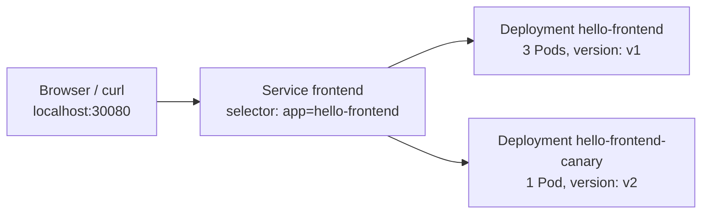

# Lab 8.3: Zwei Versionen parallel

**Leitfragen:**

<details>
<summary>Wie testet man eine neue Version mit echten Nutzern, ohne alle zu gefährden?</summary>

Nur einen kleinen Teil der Anfragen auf die neue Version schicken, beobachten und den Anteil schrittweise erhöhen. Geht etwas schief, ist nur dieser Teil betroffen, und der Anteil geht sofort auf null zurück. Diese Vorgehensweise heißt Canary.

</details>

<details>
<summary>Was kostet es, zwei vollständige Versionen gleichzeitig zu betreiben?</summary>

Doppelte Rechenleistung und doppelten Speicher für die Dauer des Umstiegs; bei Datenbanken zusätzlich Daten, die zu beiden Versionen passen müssen. Dafür ist der Rückweg ein einziger Schalter (Blue/Green).

</details>

- Eine Release-Strategie legt fest, wie Anfragen von der alten auf die neue Version wandern: alle auf einmal, Pod für Pod, per Schalter oder nach Anteil.
- Rolling Update und Recreate stecken im Deployment (Lab 8.2). Blue/Green und Canary entstehen aus zwei Deployments, Labels und einem Service: ohne zusätzliche Software.

## Begriffe

| Begriff | Bedeutung |
| --- | --- |
| Release-Strategie | Plan, wie eine neue Version die alte ablöst und wie der Rückweg aussieht |
| Blue/Green | zwei vollständige Umgebungen (blau = alt, grün = neu); ein Schalter lenkt den ganzen Verkehr um |
| Canary | die neue Version bekommt zuerst einen kleinen Anteil der Anfragen; benannt nach dem Kanarienvogel, der Bergleute früh vor Gas warnte |
| stabile Version | die Version, die den Großteil der Anfragen bedient, hier `hello-frontend` |
| Gewicht | Anteil der Anfragen für eine Version; hier ergibt er sich aus der Zahl der Pods |
| `kubectl patch` | ändert einzelne Felder eines Objekts direkt im Cluster, ohne Datei; der Text nennt nur die Felder, die sich ändern (JSON) |
| Progressive Delivery | automatisierter Canary: ein Werkzeug erhöht den Anteil Schritt für Schritt und prüft dabei Fehlerraten |

## Vier Release-Strategien

| Strategie | Ablauf | Ausfallzeit | Zusätzliche Kosten | Risiko für Nutzer | Rückweg | Mittel in Kubernetes |
| --- | --- | --- | --- | --- | --- | --- |
| Recreate | alt aus, neu an | ja, kurz | keine | alle sehen einen Fehler | neu ausrollen | `strategy.type: Recreate` (Lab 8.2) |
| Rolling Update | Pod für Pod | nein | wenige Pods extra (`maxSurge`) | wächst mit dem Fortschritt | `kubectl rollout undo` (Lab 8.2) | Standard im Deployment |
| Blue/Green | zweite Umgebung, dann umschalten | nein | doppelte Pods während des Umstiegs | alle auf einmal nach dem Schalter | Schalter zurück | Selector des Service |
| Canary | kleiner Anteil zuerst, dann mehr | nein | ein bis wenige Pods extra | nur der Anteil | Canary löschen | zweites Deployment hinter demselben Service |

 

_Quelle: Martin Fowler, „BlueGreenDeployment" (https://martinfowler.com/bliki/BlueGreenDeployment.html) und Danilo Sato, „CanaryRelease" (https://martinfowler.com/bliki/CanaryRelease.html), © martinfowler.com, abgerufen am 24.11.2026._

Links Blue/Green: Der Router schickt alles an eine Umgebung, die andere steht bereit. Rechts Canary: Der Router teilt die Nutzer nach Anteil auf. In der Hello-App übernimmt der Service `frontend` die Rolle des Routers.

| Strategie | Vorteil | Nachteil |
| --- | --- | --- |
| Blue/Green | Rückweg in Sekunden; neue Version vorab vollständig testbar | doppelte Ressourcen; Datenbank muss zu beiden Versionen passen |
| Canary | Fehler treffen nur einen kleinen Teil der Nutzer | braucht Messwerte je Version und Geduld; eine Person kann bei jedem Klick eine andere Version sehen |

## Canary mit zwei Deployments hinter einem Service

Der Service `frontend` wählt nur nach `app: hello-frontend` (Lab 7.3). Ein zweites Deployment, dessen Pods dasselbe Label tragen, landet automatisch hinter demselben Service. Das Label `version` unterscheidet die beiden.



| Objekt | Selector | Pod-Labels | Replikas |
| --- | --- | --- | --- |
| Deployment `hello-frontend` | `app`, `tier` | `app: hello-frontend`, `tier: frontend`, `version: v1` | 3 |
| Deployment `hello-frontend-canary` | `app`, `version: v2` | `app: hello-frontend`, `tier: frontend`, `version: v2` | 1 |
| Service `frontend` | `app: hello-frontend` | – | – |

`kubectl get pods -l app=hello-frontend -L version` zeigt den Wert des Labels `version` als eigene Spalte.

```yaml
# playground/k8s/35-frontend-canary-deployment.yaml
apiVersion: apps/v1
kind: Deployment
metadata:
  name: hello-frontend-canary
  labels:
    app: hello-frontend
    tier: frontend
spec:
  replicas: 1                          # 1 von 4 Pods -> etwa 25 % der Anfragen
  selector:
    matchLabels:                       # eigener Selector: nur Pods mit version v2
      app: hello-frontend
      version: v2
  template:
    metadata:
      labels:
        app: hello-frontend            # gleiches app-Label: der Service nimmt den Pod mit auf
        tier: frontend
        version: v2                    # unterscheidet Canary und stabile Version
    spec:
      containers:
        - name: frontend
          image: hello-frontend:v2
          imagePullPolicy: Never
          ports:
            - containerPort: 80
          env:
            - name: BACKEND_URL
              value: "http://backend"
```

Der Selector von `hello-frontend` passt auch auf den Canary-Pod. Trotzdem löscht das stabile Deployment ihn nicht: Ein Controller übernimmt nur Pods ohne Besitzer (Lab 8.1), und der Canary-Pod gehört seinem eigenen ReplicaSet.

Der Service verteilt jede Verbindung zufällig auf alle bereiten Pods. Bei 3 Pods `v1` und 1 Pod `v2` landen etwa 3 von 4 Anfragen bei `v1`. Eine Schleife mit `curl` zählt das nach; `grep -m1` nimmt je Seite nur den ersten Treffer, weil „Hello-App v1" im Titel und in der Überschrift steht:

```bash
for i in $(seq 1 40); do curl -s http://localhost:30080/ | grep -m1 -o 'Hello-App v[0-9]'; done | sort | uniq -c
```

```text
  29 Hello-App v1
  11 Hello-App v2
```

`sort | uniq -c` sortiert die Zeilen und zählt gleiche Zeilen. Die Zahlen schwanken von Lauf zu Lauf, weil jede Anfrage einzeln ausgelost wird. Mehr Anteil für `v2` heißt: Canary hoch- und `hello-frontend` herunterskalieren (`kubectl scale`, Lab 8.1).

## Blue/Green durch Umschalten des Selectors

Bekommt der Service zusätzlich `version: v2` in den Selector, wählt er nur noch die Pods von `v2` aus: Alle Anfragen gehen an die neue Version. Entfernt man das Label wieder, sind beide Versionen dahinter.

```bash
kubectl patch service frontend -p '{"spec":{"selector":{"version":"v2"}}}'    # umschalten: nur v2
kubectl get endpointslices -l kubernetes.io/service-name=frontend               # nur noch 1 Endpunkt
kubectl patch service frontend -p '{"spec":{"selector":{"version":null}}}'    # zurück: Label entfernen
```

```text
$ kubectl get service frontend -o jsonpath='{.spec.selector}'
{"app":"hello-frontend","version":"v2"}
```

- `kubectl patch -p '…'` ergänzt die genannten Felder; `null` löscht ein Feld. Die übrigen Felder des Selectors bleiben, wie sie sind.
- In einer echten Blue/Green-Umgebung laufen zwei vollständige Deployments (z. B. je 3 Pods `v1` und `v2`), und der Schalter wechselt zwischen `version: v1` und `version: v2`. Hier hat `v2` nur einen Pod; der Wechsel zeigt das Prinzip.
- `version` gehört sonst nie in den Selector eines Service, weil ein Rolling Update die Version wechselt. Blue/Green nutzt genau das als Schalter.
- Nach dem Umschalten bleibt blau eine Weile stehen, damit der Rückweg sofort funktioniert; danach wird es gelöscht.

## Frontend auf v2 heben und Canary löschen

Hat sich `v2` bewährt, übernimmt das stabile Deployment die neue Version, und der Canary wird überflüssig:

```bash
kubectl apply -f playground/k8s/30-frontend-deployment.yaml     # Datei enthält seit Lab 8.2 v2: Rolling Update
kubectl delete -f playground/k8s/35-frontend-canary-deployment.yaml
rm playground/k8s/35-frontend-canary-deployment.yaml
```

Danach laufen wieder ein Deployment `hello-frontend` mit 3 Pods `v2` und keine Canary-Pods.

## Feinere Gewichte: Gateway API und Argo Rollouts

Über die Replikazahl lassen sich nur grobe Anteile einstellen: 1 % bräuchte 99 stabile Pods. Werkzeuge vor dem Service teilen den Verkehr unabhängig von der Pod-Zahl (Stand: 24.11.2026):


_Quelle: Gateway API, „HTTP traffic splitting" (https://gateway-api.sigs.k8s.io/guides/traffic-splitting/), Kubernetes SIG Network, Apache-2.0, abgerufen am 24.11.2026._

| Werkzeug | Was es macht |
| --- | --- |
| [Gateway API](https://gateway-api.sigs.k8s.io/guides/traffic-splitting/) | Nachfolger von Ingress (Lab 7.4): eine HTTPRoute verteilt nach Gewichten auf mehrere Services, z. B. 90/10 |
| [Argo Rollouts](https://argoproj.github.io/rollouts/) | ersetzt das Deployment durch ein `Rollout` mit Schritten (10 %, Pause, 50 %, …) und prüft Messwerte, bevor es weitergeht |
| [Flagger](https://flagger.app/) | fährt Canary und Blue/Green automatisch und rollt bei Fehlern selbst zurück |

## Typische Fehler

| Symptom | Ursache | Lösung |
| --- | --- | --- |
| Zählung zeigt doppelt so viele Treffer wie Anfragen | `grep -o` ohne `-m1` zählt Titel und Überschrift | `grep -m1 -o` |
| Schleife zeigt nur `v2` | `hello-frontend` läuft noch auf `v2` (Lab 8.2) | `kubectl rollout undo deployment/hello-frontend --to-revision=1` |
| Canary-Pod bekommt keine Anfragen | Label `app` im Template falsch geschrieben | `app: hello-frontend` wie im Service-Selector |
| `selector does not match template labels` | `version: v2` fehlt im Template | Template-Labels ergänzen |
| nach dem Umschalten antwortet die Seite nicht | Selector-Wert vertippt (z. B. `V2`); keine passenden Pods | `kubectl get endpointslices -l kubernetes.io/service-name=frontend`, Patch mit richtigem Wert |
| Canary kommt nach `kubectl apply -f playground/k8s/` zurück | Datei liegt noch im Ordner | `rm playground/k8s/35-frontend-canary-deployment.yaml` |

## Vertiefung

Die Kubernetes-Dokumentation rät, die Selectoren verschiedener Deployments nicht überlappen zu lassen. Das Canary-Beispiel der Dokumentation gibt beiden Deployments deshalb ein eigenes Label `track: stable` bzw. `track: canary` (Quellen: [Deployments](https://kubernetes.io/docs/concepts/workloads/controllers/deployment/), [Managing Workloads, Canary deployments](https://kubernetes.io/docs/concepts/workloads/management/), Stand: 24.11.2026). Für den kurzen Canary in dieser Übung reicht die Unterscheidung über `version`.

## Fazit

- Rolling und Recreate tauschen ein Deployment aus; Blue/Green und Canary lassen zwei Versionen nebeneinander laufen.
- Canary ohne Zusatzsoftware: zweites Deployment mit gleichem `app`-Label, Anteil über die Replikazahl.
- Blue/Green: `version` im Service-Selector als Schalter; feinere Gewichte bringen Gateway API oder Argo Rollouts.

In der Übung läuft `v2` als Canary neben `v1`, die Verteilung wird gezählt, der Service kurz umgeschaltet und zum Schluss das ganze Frontend auf `v2` gebracht.
