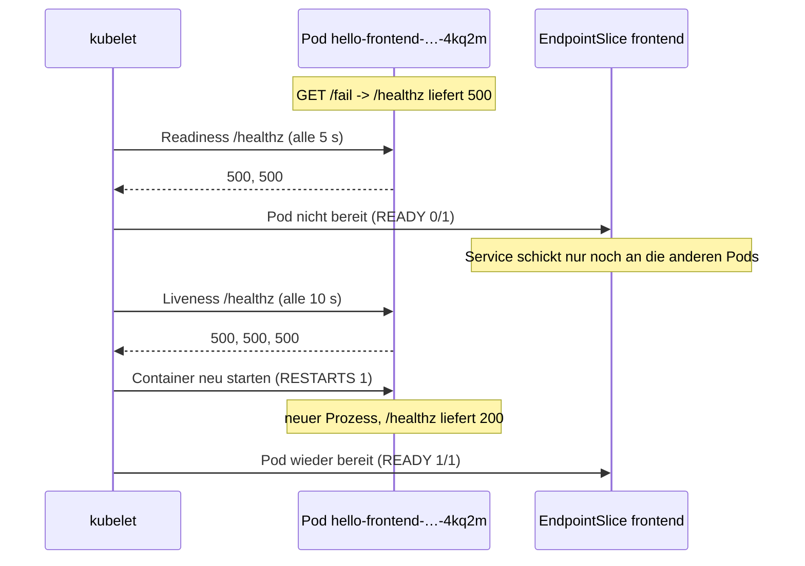

# Lab 8.4: Health Checks mit Probes

**Leitfragen:**

<details>
<summary>Ein Programm läuft, antwortet aber nicht mehr: woran merkt das Cluster das?</summary>

Am Prozess allein nicht: Er existiert ja noch. Das Cluster muss das Programm fragen, z. B. regelmäßig eine Testseite abrufen, wie der Compose-Healthcheck aus Lab 3.2. Genau das macht Kubernetes mit Probes: Der kubelet ruft `/healthz` auf und wertet die Antwort aus.

</details>

<details>
<summary>Ein Dienst braucht zwei Minuten zum Start: wann darf er Anfragen bekommen?</summary>

Erst wenn er wirklich antworten kann. Bis dahin soll ihn niemand neu starten, weil er scheinbar hängt, und der Service soll ihm keine Besucher schicken. Dafür gibt es die Readiness- und die Startup-Probe.

</details>

- Ohne Probes gilt ein Container als gesund, solange sein Prozess läuft; eine hängende App bekommt weiter Anfragen.
- Readiness entscheidet über Anfragen, Liveness über Neustarts, Startup über die Wartezeit beim Start.
- Das Frontend-Deployment `hello-frontend` bekommt eine Readiness- und eine Liveness-Probe auf `/healthz`.

## Begriffe

| Begriff | Bedeutung |
| --- | --- |
| Probe | regelmäßige Prüfung eines Containers durch den kubelet auf dem Node, wie ein Wachmann, der regelmäßig an jede Tür klopft |
| Readiness-Probe | fragt „Darf dieser Pod Anfragen bekommen?"; bei Fehlschlag bekommt der Pod über den Service keine Anfragen mehr |
| Liveness-Probe | fragt „Lebt der Container noch?"; bei Fehlschlag startet der kubelet den Container neu |
| Startup-Probe | fragt „Ist der Start fertig?"; solange sie nicht bestanden ist, ruhen Readiness und Liveness |
| Health-Endpunkt | Adresse der App nur für Prüfungen, hier `/healthz`; antwortet schnell mit `200` oder einem Fehlercode |
| `periodSeconds` | Abstand zwischen zwei Prüfungen |
| `failureThreshold` | so viele Fehlschläge in Folge, bis die Probe als gescheitert gilt |
| `READY` | Spalte in `kubectl get pods`: bereite Container / alle Container, z. B. `0/1` |
| `kubectl exec` | führt einen Befehl in einem laufenden Container aus, wie `docker exec` aus Lab 1.3 |

## Readiness-, Liveness- und Startup-Probe

| Probe | Frage | Bei Fehlschlag | Typischer Endpunkt |
| --- | --- | --- | --- |
| `readinessProbe` | Darf der Pod Anfragen bekommen? | Pod steht in der EndpointSlice (Lab 7.2) mit `Ready: false`, der Service schickt ihm nichts mehr; der Container läuft weiter | `/ready`, `/healthz` |
| `livenessProbe` | Lebt der Container noch? | Container wird neu gestartet (`RESTARTS` + 1) | `/healthz`, `/livez` |
| `startupProbe` | Ist der Start abgeschlossen? | nach `failureThreshold × periodSeconds` Neustart; vorher ruhen die anderen Probes | wie Liveness |


_Quelle: Google Cloud Blog, „Kubernetes best practices: Setting up health checks with readiness and liveness probes" (https://cloud.google.com/blog/products/containers-kubernetes/kubernetes-best-practices-setting-up-health-checks-with-readiness-and-liveness-probes), abgerufen am 24.11.2026._


_Quelle: Google Cloud Blog, wie oben, abgerufen am 24.11.2026._

Oben nimmt die Readiness-Probe einen Pod aus dem Verkehr, unten startet die Liveness-Probe einen Container neu.

## Prüfmethoden

| Methode | Prüft | Bestanden, wenn | Beispiel |
| --- | --- | --- | --- |
| `httpGet` | HTTP-Anfrage an Pfad und Port | Statuscode 200–399 | Web-Apps wie die Hello-App |
| `tcpSocket` | Verbindung zu einem Port | Verbindung klappt | Datenbanken, Dienste ohne HTTP |
| `exec` | Befehl im Container | Exit-Code 0 | `pg_isready`, Prüfskript |

## Probes der Hello-App

Frontend und Backend haben `/healthz`. Das Frontend kann einen Ausfall simulieren: Nach `GET /fail` antwortet `/healthz` mit `500`, bis `GET /recover` aufgerufen wird oder der Container neu startet. Der Schalter gilt nur für den einen Pod, der `/fail` bekommen hat.

```yaml
# Ausschnitt aus playground/k8s/30-frontend-deployment.yaml, im Container frontend
          readinessProbe:
            httpGet:
              path: /healthz           # Antwort 200-399 = bestanden
              port: 80
            periodSeconds: 5           # alle 5 Sekunden
            failureThreshold: 2        # 2 Fehlschläge in Folge (ca. 10 s) -> nicht bereit
          livenessProbe:
            httpGet:
              path: /healthz
              port: 80
            periodSeconds: 10          # alle 10 Sekunden
            failureThreshold: 3        # 3 Fehlschläge in Folge (ca. 30 s) -> Neustart
```

| Parameter | Standard | Bedeutung |
| --- | --- | --- |
| `initialDelaySeconds` | 0 | Wartezeit nach Containerstart bis zur ersten Prüfung |
| `periodSeconds` | 10 | Abstand zwischen Prüfungen |
| `timeoutSeconds` | 1 | so lange darf eine Antwort dauern |
| `failureThreshold` | 3 | Fehlschläge in Folge bis „gescheitert" |
| `successThreshold` | 1 | Erfolge in Folge bis „wieder gut" |

Reaktionszeit ≈ `periodSeconds × failureThreshold`. Readiness reagiert hier nach etwa 10 Sekunden, Liveness nach etwa 30: Ein kurzer Aussetzer nimmt den Pod nur aus dem Verkehr, erst ein längerer führt zum Neustart (Quelle: [Configure Liveness, Readiness and Startup Probes](https://kubernetes.io/docs/tasks/configure-pod-container/configure-liveness-readiness-startup-probes/), Stand: 24.11.2026).

## Probes und Compose-Healthcheck

| | Compose-Healthcheck (Lab 3.2) | Kubernetes-Probes |
| --- | --- | --- |
| Anzahl | ein `healthcheck` je Dienst | bis zu drei Probes je Container |
| Prüfung | Befehl im Container (`test`, z. B. `wget`) | `httpGet`, `tcpSocket`, `exec` |
| Takt | `interval`, `timeout`, `retries`, `start_period` | `periodSeconds`, `timeoutSeconds`, `failureThreshold`, Startup-Probe |
| Folge bei Fehlschlag | Status `unhealthy`; steuert `depends_on`, kein automatischer Neustart | Readiness: kein Verkehr; Liveness: Neustart |

## Simulierter Ausfall im Frontend



Den Ausfall löst `kubectl exec` im Pod selbst aus; `wget` ist im Alpine-Image der Hello-App enthalten:

```bash
kubectl exec hello-frontend-8b6f5c7d9-4kq2m -- wget -qO- http://127.0.0.1/fail
```

`--` trennt die kubectl-Optionen vom Befehl, der im Container läuft.


_Quelle: Kubernetes Blog, „From Kubernetes Dashboard to Headlamp" (https://kubernetes.io/blog/2026/06/01/dashboard-to-headlamp/), CC BY 4.0, The Kubernetes Authors, abgerufen am 24.11.2026._

Grafische Oberflächen zeigen dieselben Werte wie `kubectl get pods`: Ein Pod mit `Ready 0/1` und vielen Restarts läuft zwar, besteht aber seine Probes nicht. Im Dashboard (Lab 6.2) stehen die Neustarts in der Spalte **Restarts** der Pod-Liste.

## Readiness bei Rollouts

Beim Rollout (Lab 8.2) zählt ein neuer Pod erst als verfügbar, wenn seine Readiness-Probe besteht. Mit `maxUnavailable: 0` entfernt das Deployment keinen alten Pod, bevor ein neuer bereit ist. Eine falsche Readiness-Probe (z. B. Pfad `/nope`) hält deshalb den Rollout an, statt die Seite abzuschalten; der Rückweg ist `kubectl rollout undo` oder die korrigierte Datei.

## Startup-Probe für langsame Starts

Manche Apps brauchen beim Start lange (Caches laden, Datenbank migrieren). Eine Liveness-Probe würde sie vorher als „tot" neu starten, immer wieder: `CrashLoopBackOff`. Die Startup-Probe gibt dem Start ein eigenes Zeitbudget:

```yaml
          startupProbe:
            httpGet:
              path: /healthz
              port: 80
            periodSeconds: 5
            failureThreshold: 24       # bis zu 24 x 5 s = 120 s für den Start
```

Das Frontend kann mit der Umgebungsvariablen `STARTUP_DELAY` (Sekunden) einen langsamen Start nachstellen.

## Typische Fehler

| Symptom | Ursache | Lösung |
| --- | --- | --- |
| alle Frontend-Pods starten neu, sobald das Backend ausfällt | Liveness prüft auch das Backend | Liveness prüft nur den eigenen Prozess; Abhängigkeiten höchstens in der Readiness |
| `CrashLoopBackOff`, Events `Liveness probe failed: … connection refused` direkt nach dem Start | App startet langsamer als `periodSeconds × failureThreshold` | Startup-Probe ergänzen |
| Pod bleibt `0/1`, Event `Readiness probe failed: HTTP probe failed with statuscode: 404` | falscher Pfad | Pfad korrigieren (`/healthz`) |
| Event `… connect: connection refused` mit falschem Port | Port der Probe ≠ `containerPort` | `port: 80` |
| `error converting YAML to JSON` beim `apply` | Probe falsch eingerückt | `readinessProbe` auf gleicher Höhe wie `image` und `env` |
| `kubectl exec` meldet `container not found` oder `pod not found` | Name eines alten Pods (vor dem Rollout) verwendet | `kubectl get pods -l app=hello-frontend` und aktuellen Namen nehmen |

## Fazit

- Readiness steuert, ob ein Pod Anfragen bekommt; Liveness steuert Neustarts; Startup schützt langsame Starts.
- Reaktionszeit = `periodSeconds × failureThreshold`; Readiness kürzer als Liveness wählen.
- Liveness prüft nur die App selbst; eine falsche Readiness-Probe hält einen Rollout an, statt die Seite abzuschalten.

In der Übung bekommt das Frontend beide Probes, ein Pod fällt über `/fail` aus, verschwindet aus dem Verkehr und wird neu gestartet, während die Seite erreichbar bleibt.
