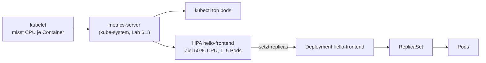

# Lab 8.5: Autoscaling mit HPA

**Leitfragen:**

<details>
<summary>Montags um 9 Uhr kommt dreimal so viel Last wie sonst: wie viele Kopien sollen dauerhaft laufen?</summary>

So viele wie für die Spitze nötig wäre teuer, so wenige wie im Leerlauf zu knapp. Besser ist eine Untergrenze für ruhige Zeiten und eine Obergrenze für Spitzen; dazwischen passt ein Automat die Zahl an.

</details>

<details>
<summary>Woher soll ein Automat wissen, dass gerade viel los ist?</summary>

Aus Messwerten: CPU-Last, Speicher, Anfragen pro Sekunde oder Länge einer Warteschlange. Im Kurs-Cluster misst der metrics-server aus Lab 6.1 CPU und Speicher; der Horizontal Pod Autoscaler vergleicht sie mit einem Zielwert.

</details>

- Requests sagen, wie viel CPU und Speicher ein Container braucht; Limits, wie viel er höchstens nehmen darf.
- Der Horizontal Pod Autoscaler (HPA) ändert die Replikazahl eines Deployments automatisch, statt `kubectl scale` von Hand (Lab 8.1); Bezugsgröße ist der CPU-Request.
- `hello-frontend` bekommt Requests und Limits und einen HPA mit 1 bis 5 Pods bei 50 % CPU.

## Begriffe

| Begriff | Bedeutung |
| --- | --- |
| Rechenressourcen | CPU und Arbeitsspeicher, die ein Container verbraucht; nicht zu verwechseln mit den API-Ressourcen aus Lab 5.3 (Objekte wie Pod oder Service) |
| Request | Menge CPU/Speicher, die der Scheduler für den Container auf einem Node reserviert; wie ein reservierter Tisch im Restaurant |
| Limit | Obergrenze, die der Container zur Laufzeit nicht überschreiten darf |
| Millicore (`m`) | Tausendstel eines CPU-Kerns: `100m` = 0,1 Kern, `1` = ein ganzer Kern |
| `Mi` | Mebibyte (1024 × 1024 Byte); `Gi` entsprechend Gibibyte |
| `OOMKilled` | „Out of Memory": der Container belegt mehr Speicher als sein Limit und wird beendet; Exit-Code 137 wie in Lab 4.3 |
| horizontal skalieren | mehr oder weniger Pods derselben Art, wie zusätzliche Kassen im Supermarkt |
| vertikal skalieren | einem Pod mehr oder weniger CPU/Speicher geben, wie eine schnellere Kasse |
| Horizontal Pod Autoscaler (HPA) | Controller, der die Replikazahl zwischen Minimum und Maximum an einen Zielwert anpasst |
| Auslastung (Utilization) | gemessener Verbrauch in Prozent des Requests: 50m bei Request 100m = 50 % |
| Stabilisierungsfenster | Wartezeit, bevor der HPA herunterskaliert, damit die Zahl nicht ständig springt |
| Lastgenerator | Pod, der in einer Schleife Anfragen schickt, um Last zu erzeugen |

## Requests und Limits

```yaml
# Ausschnitt aus playground/k8s/30-frontend-deployment.yaml, im Container frontend
          resources:
            requests:                  # Planung: so viel reserviert der Scheduler
              cpu: 100m                # 0,1 CPU-Kern; der HPA rechnet in Prozent davon
              memory: 64Mi
            limits:                    # Obergrenze zur Laufzeit
              cpu: 500m                # darüber: gedrosselt
              memory: 128Mi            # darüber: OOMKilled
```

| | Request | Limit |
| --- | --- | --- |
| Wer nutzt den Wert? | Scheduler beim Platzieren des Pods | Linux-Kernel zur Laufzeit |
| Bedeutung | „so viel brauche ich mindestens" | „mehr darf ich nicht" |
| Fehlt der Wert | Pod zählt als 0, der Node kann überbucht werden; der HPA kann keine Prozente rechnen | keine Obergrenze |
| Zu hoch gewählt | Pod bleibt `Pending` (`Insufficient cpu`) | kaum Schutz für die anderen Pods |
| CPU darüber | – | Container wird gedrosselt, läuft langsamer weiter |
| Speicher darüber | – | Container wird beendet (`OOMKilled`) und neu gestartet |

| Docker (Lab 4.3) | Kubernetes |
| --- | --- |
| `docker run --cpus=0.5 --memory=128m` | `limits: { cpu: 500m, memory: 128Mi }` |
| `deploy.resources.limits` in Compose | `resources.limits` im Container |
| keine Entsprechung in Lab 4.3 | `resources.requests`: Planungsgröße für den Scheduler |


_Quelle: Kubernetes Dashboard, README (https://github.com/kubernetes-retired/dashboard), Apache-2.0, abgerufen am 24.11.2026._

Das Dashboard aus Lab 6.2 zeigt unter **Cluster > Nodes** je Node, welcher Anteil von CPU und Speicher durch Requests reserviert und durch Limits zugesagt ist. Dieselbe Summe liefert `kubectl describe node docker-desktop` im Abschnitt `Allocated resources`.

## Vom Messwert zur Replikazahl




_Quelle: Kubernetes-Dokumentation, „Horizontal Pod Autoscaling" (https://kubernetes.io/docs/tasks/run-application/horizontal-pod-autoscale/), CC BY 4.0, The Kubernetes Authors, abgerufen am 24.11.2026._

Der HPA startet keine Pods selbst: Er ändert nur `replicas` des Deployments, den Rest erledigen Deployment und ReplicaSet wie in Lab 8.1 und 8.2.

## HPA für das Frontend

```bash
kubectl autoscale deployment hello-frontend --cpu=50% --min=1 --max=5
```

Der Befehl legt ein Objekt `HorizontalPodAutoscaler` mit dem Namen des Deployments an. Ältere kubectl-Versionen kennen nur `--cpu-percent=50`. Als Manifest (`autoscaling/v2`) sieht derselbe HPA so aus:

```yaml
# project/examples/m08-deployments/l05-autoscaling/50-frontend-hpa.yaml
apiVersion: autoscaling/v2
kind: HorizontalPodAutoscaler
metadata:
  name: hello-frontend
spec:
  scaleTargetRef:                      # welches Objekt skaliert wird
    apiVersion: apps/v1
    kind: Deployment
    name: hello-frontend
  minReplicas: 1
  maxReplicas: 5
  metrics:
    - type: Resource                   # CPU oder Speicher aus dem metrics-server
      resource:
        name: cpu
        target:
          type: Utilization            # Prozent des CPU-Requests (100m)
          averageUtilization: 50       # Ziel: im Mittel 50m je Pod
```

Der HPA rechnet etwa alle 15 Sekunden:

```text
gewünschte Replikas = aufrunden( aktuelle Replikas × aktueller Wert / Zielwert )
Beispiel: 1 Pod mit 450 % CPU -> aufrunden(1 × 450 / 50) = 9 -> begrenzt auf maxReplicas = 5
```

| Verhalten | Standard |
| --- | --- |
| Prüfintervall | 15 Sekunden |
| Toleranz | Abweichungen bis 10 % vom Ziel lösen nichts aus |
| Hochskalieren | sofort, ohne Wartezeit |
| Herunterskalieren | erst nach 5 Minuten Stabilisierungsfenster (`behavior.scaleDown.stabilizationWindowSeconds: 300`) |

(Quelle: [Horizontal Pod Autoscaling](https://kubernetes.io/docs/tasks/run-application/horizontal-pod-autoscale/), Stand: 24.11.2026)

Sobald ein HPA das Deployment steuert, gehört `replicas` nicht mehr ins Manifest. Sonst setzt jedes `kubectl apply` die Zahl auf den Wert in der Datei zurück, und der HPA korrigiert wieder. Fehlt das Feld beim Anwenden, gilt einmalig der Standardwert 1, danach übernimmt der HPA.

## Last erzeugen und beobachten

Der Endpunkt `/work` des Frontends rechnet bei jedem Aufruf etwa 0,2 Sekunden. Ein Pod mit `busybox:1.37` ruft ihn in einer Endlosschleife über den Service `frontend` auf:

```bash
kubectl run load --image=busybox:1.37 --restart=Never -- /bin/sh -c "while true; do wget -q -O- http://frontend/work; done"
kubectl get hpa -w
```

`kubectl run` startet einen einzelnen Pod per Befehl (Lab 8.1); `--restart=Never` macht ihn zu einem einfachen Pod ohne Neustart, alles nach `--` ist der Befehl im Container.

```text
NAME             REFERENCE                   TARGETS         MINPODS   MAXPODS   REPLICAS   AGE
hello-frontend   Deployment/hello-frontend   cpu: 1%/50%     1         5         1          2m
hello-frontend   Deployment/hello-frontend   cpu: 452%/50%   1         5         1          2m45s
hello-frontend   Deployment/hello-frontend   cpu: 452%/50%   1         5         5          3m
hello-frontend   Deployment/hello-frontend   cpu: 98%/50%    1         5         5          3m45s
```

Mehr als 500 % sind nicht möglich: Das CPU-Limit `500m` bremst den einen Pod bei der fünffachen Menge seines Requests.

## Horizontal und vertikal skalieren

| | Horizontal (HPA) | Vertikal |
| --- | --- | --- |
| ändert | Anzahl der Pods | CPU/Speicher je Pod |
| passt zu | zustandslosen Diensten wie dem Frontend | Einzelinstanzen, Datenbanken |
| Grenze | `maxReplicas`, Platz auf den Nodes | Größe eines Nodes |
| Werkzeug | HPA (eingebaut) | [Vertical Pod Autoscaler](https://kubernetes.io/docs/concepts/workloads/autoscaling/vertical-pod-autoscale/) (Zusatz) |

Reicht der Platz auf den Nodes nicht für neue Pods, bleiben sie `Pending`; in der Cloud fügt dann ein Cluster-Autoscaler Nodes hinzu.

## Typische Fehler

| Symptom | Ursache | Lösung |
| --- | --- | --- |
| `kubectl get hpa` zeigt `cpu: <unknown>/50%` | kein CPU-Request im Deployment oder noch keine Messwerte | Requests setzen, 1–2 Minuten warten |
| `error: Metrics API not available` | metrics-server fehlt oder läuft nicht | `helm list -n kube-system`, `kubectl get pods -n kube-system` (Lab 6.1) |
| Pod-Zahl springt bei jedem `kubectl apply` | `replicas` steht noch im Deployment-Manifest | Feld entfernen |
| nach Ende der Last bleiben 5 Pods | Stabilisierungsfenster von 5 Minuten | normal; nach der Pause prüfen |
| neue Pods `Pending`, `Insufficient cpu` | Node voll | `maxReplicas` oder Requests senken, Docker Desktop mehr CPUs geben |
| `OOMKilled`, Exit-Code 137 | Memory-Limit unter dem Bedarf | Limit erhöhen; Bedarf mit `kubectl top pods` messen |
| Lastgenerator meldet `wget: bad address 'frontend'` | Pod läuft in einem anderen Namespace | Standard-Namespace `hello` prüfen (`kubectl config get-contexts`) |

## Fazit

- Rechenressourcen: Requests planen (Scheduler), Limits begrenzen (CPU gedrosselt, Speicher `OOMKilled`).
- metrics-server misst, der HPA vergleicht mit dem Ziel in Prozent des Requests und setzt `replicas` des Deployments.
- Hochskalieren geht sofort, Herunterskalieren erst nach 5 Minuten; `replicas` gehört dann nicht mehr ins Manifest.

In der Übung bekommt das Frontend Requests und Limits und einen HPA, ein Lastgenerator treibt die CPU über 50 %, und die Replikazahl steigt bis 5.
