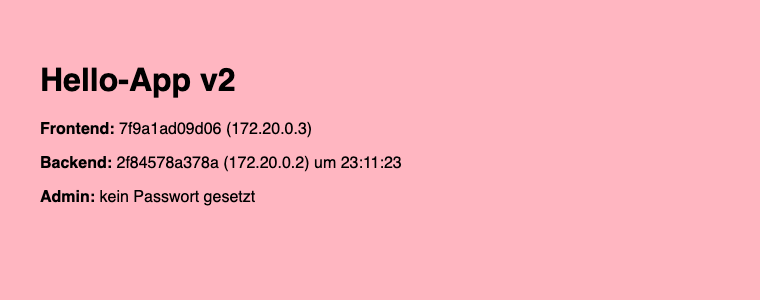
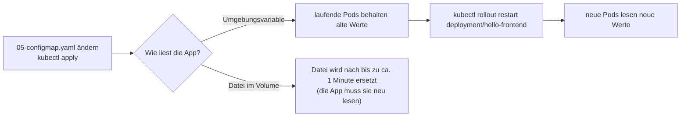

# Lab 9.1: ConfigMaps

**Leitfragen:**

<details>
<summary>Dasselbe Image soll in Test und Produktion laufen, mit verschiedenen Backends: wo steht die Adresse?</summary>

Nicht im Image, sondern in der Umgebung, in der es läuft. Kubernetes legt solche Einstellungen in eine ConfigMap, ein eigenes Objekt im Cluster, und reicht sie als Umgebungsvariablen oder Dateien in den Container.

</details>

<details>
<summary>Was kostet es, eine Einstellung zu ändern, die im Code steht?</summary>

Code ändern, Image neu bauen, testen, ausrollen: für eine Farbe oder eine Adresse ein kompletter Release. Steht die Einstellung außerhalb des Images, reichen eine geänderte Datei und ein Neustart der Pods.

</details>

- Bisher steht `BACKEND_URL` fest im Deployment `hello-frontend` und `APP_COLOR` im Image (`lightgreen` aus dem Build von `v2`, Lab 2.2). Beides gehört zur Umgebung, nicht zum Image.
- Eine ConfigMap sammelt solche Einstellungen als Schlüssel-Wert-Paare; das Frontend übernimmt sie mit `envFrom` als Umgebungsvariablen.

## Begriffe

| Begriff | Bedeutung |
| --- | --- |
| Konfiguration | alles, was sich zwischen Umgebungen (Test, Produktion) unterscheidet: Adressen, Farben, Schalter, Grenzwerte |
| Zwölf-Faktor-App | verbreitete Sammlung von zwölf Regeln für Cloud-Anwendungen; Regel III: Konfiguration in der Umgebung speichern |
| ConfigMap | Kubernetes-Objekt mit nicht geheimen Einstellungen als Schlüssel-Wert-Paare; wie ein Merkzettel neben der Maschine statt einer Gravur im Gehäuse |
| `data` | Abschnitt der ConfigMap mit den Einträgen; jeder Wert ist Text |
| `envFrom` | übernimmt alle Schlüssel einer ConfigMap als Umgebungsvariablen in einen Container |
| `configMapKeyRef` | übernimmt einen einzelnen Schlüssel als eine Umgebungsvariable |
| `kubectl rollout restart` | ersetzt alle Pods eines Deployments schrittweise durch neue, ohne das Manifest zu ändern |

## Konfiguration außerhalb des Images

Die Zwölf-Faktor-Regel III fordert eine strikte Trennung: Dasselbe Image läuft überall, nur die Konfiguration wechselt (Quelle: [The Twelve-Factor App, III. Konfiguration](https://12factor.net/de/config), abgerufen am 24.11.2026).

| Einstellung | gehört zu | Grund | Ort ab diesem Lab |
| --- | --- | --- | --- |
| `APP_VERSION` | Image | beschreibt den Code im Image; ein Rollback auf `v1` muss auch „v1" anzeigen | `ARG`/`ENV` im Dockerfile (Lab 2.2) |
| `APP_COLOR` | Umgebung | Test und Produktion sollen sich auf einen Blick unterscheiden | ConfigMap `hello-config` |
| `BACKEND_URL` | Umgebung | hängt davon ab, wo und wie das Backend läuft | ConfigMap `hello-config` |
| Admin-Passwort | Umgebung, geheim | darf weder ins Image noch in eine ConfigMap | Secret (Lab 9.2) |

Docker kennt dasselbe Prinzip: `docker run -e APP_COLOR=…` und `environment:` in Compose (Modul 3) setzen Werte von außen. Die ConfigMap ist der Ort dafür im Cluster.

## ConfigMap der Hello-App

```yaml
# playground/k8s/05-configmap.yaml
apiVersion: v1
kind: ConfigMap
metadata:
  name: hello-config
  labels:
    app: hello-frontend
data:                           # Schlüssel: Wert
  BACKEND_URL: http://backend   # Service backend aus Lab 7.2
  APP_COLOR: lightyellow        # überschreibt APP_COLOR=lightgreen aus dem v2-Image
```

- Werte sind immer Text. Zahlen und `true`/`false` brauchen Anführungszeichen (`MAX_ITEMS: "50"`).
- Schlüssel, die als Umgebungsvariable dienen, bestehen aus Buchstaben, Ziffern und `_`.
- Eine ConfigMap ist für kleine Einstellungen gedacht (höchstens 1 MiB).

Ohne YAML entsteht dieselbe ConfigMap per Befehl; mit `--dry-run=client -o yaml` wird daraus eine Vorlage für eine Datei:

```bash
kubectl create configmap hello-config \
  --from-literal=BACKEND_URL=http://backend \
  --from-literal=APP_COLOR=lightyellow \
  --dry-run=client -o yaml
```

## ConfigMap als Umgebungsvariablen

```yaml
# Ausschnitt playground/k8s/30-frontend-deployment.yaml
      containers:
        - name: frontend
          image: hello-frontend:v2
          envFrom:                       # alle Schlüssel -> Umgebungsvariablen
            - configMapRef:
                name: hello-config
          # vorher (Lab 8.2 bis 8.5):
          # env:
          #   - name: BACKEND_URL
          #     value: "http://backend"
```

| Form | holt | geeignet für |
| --- | --- | --- |
| `envFrom` + `configMapRef` | alle Schlüssel | ConfigMap, die nur für diese App da ist (Hello-App) |
| `env` + `valueFrom.configMapKeyRef` | einen Schlüssel, Variablenname frei wählbar | gemeinsame ConfigMap, aus der eine App nur einzelne Werte braucht |

Steht eine Variable doppelt, gewinnt `env` vor `envFrom`; beide gewinnen vor `ENV` aus dem Dockerfile. Deshalb verschwindet der feste `env`-Eintrag mit `BACKEND_URL` aus dem Deployment, sonst würde er die ConfigMap verdecken.



_Quelle: eigener Screenshot, Hello-App `hello-frontend:v2` mit `APP_COLOR=lightpink` von außen gesetzt (aufgenommen mit `docker run`; im Cluster steht statt der Container-ID der Pod-Name), 24.11.2026._

Dasselbe Image `v2`, das ohne Einstellung grün ist, zeigt hier Rosa: Die Farbe kommt nur aus der Umgebungsvariablen.

## ConfigMap als Datei

Manche Programme lesen eine Konfigurationsdatei statt Umgebungsvariablen (z. B. `nginx.conf`, `appsettings.json`). Dann wird jeder Schlüssel zu einer Datei in einem Ordner des Containers. Die Hello-App braucht das nicht; so sähe es aus:

```yaml
# Ausschnitt aus einem Pod-Template: ConfigMap app-files mit dem Schlüssel config.json
      containers:
        - name: app
          volumeMounts:
            - name: config
              mountPath: /etc/app        # ergibt /etc/app/config.json
              readOnly: true
      volumes:
        - name: config                   # Volume: Ordner, den Kubernetes in den Container einhängt (Lab 9.3)
          configMap:
            name: app-files
```

## Änderungen in laufende Pods übernehmen



- Umgebungsvariablen werden nur beim Start eines Containers gesetzt. `kubectl rollout restart` ersetzt die Pods danach schrittweise wie ein Rollout in Lab 8.2, ohne Ausfall.
- Ändert sich das Pod-Template selbst (z. B. `env` → `envFrom`), startet schon `kubectl apply` einen Rollout.


_Quelle: Kubernetes Dashboard, README (https://github.com/kubernetes-retired/dashboard), Apache-2.0, abgerufen am 24.11.2026._

Das Dashboard aus Lab 6.2 listet ConfigMaps links unter **Config and Storage → Config Maps**. Eine Änderung dort wirkt wie `kubectl apply`, landet aber nicht in der Datei unter `playground/k8s/`; die Datei bleibt deshalb die Quelle.

## HPA und feste Replikazahl

Der HPA aus Lab 8.5 bestimmt bisher, wie viele Frontend-Pods laufen; das Deployment hat deshalb kein `replicas`. Für die Labs dieses Moduls wird der HPA gelöscht (`kubectl delete hpa hello-frontend`), und das Manifest legt wieder `replicas: 3` fest. So bleiben Pod-Zahl und Beobachtungen vorhersehbar.

## Typische Fehler

| Symptom | Ursache | Lösung |
| --- | --- | --- |
| Pod im Status `CreateContainerConfigError`, Event `configmap "hello-config" not found` | ConfigMap fehlt oder Name falsch geschrieben | `kubectl get configmap`; ConfigMap anlegen oder Namen korrigieren |
| `cannot unmarshal bool into Go struct field ConfigMap.data of type string` | Wert `true`, `false` oder Zahl ohne Anführungszeichen | Wert in Anführungszeichen setzen |
| Farbe ändert sich nach `kubectl apply` der ConfigMap nicht | Umgebungsvariablen gelten erst für neue Pods | `kubectl rollout restart deployment/hello-frontend` |
| Seite bleibt grün | `envFrom` fehlt oder Deployment nicht angewendet | `kubectl exec deploy/hello-frontend -- env \| grep APP_` |
| `Backend nicht erreichbar (http://backed)` | Tippfehler in `BACKEND_URL` | Wert korrigieren, anwenden, `rollout restart` |
| `spec.selector: Invalid value … field is immutable` | Deployment stammt aus einem anderen Stand mit anderem Selector | `kubectl delete deployment hello-frontend`, Datei erneut anwenden |

## Fazit

- Konfiguration gehört in die Umgebung, nicht ins Image; die Version bleibt als Eigenschaft des Codes im Image.
- Eine ConfigMap liefert Werte als Umgebungsvariablen (`envFrom`, `configMapKeyRef`) oder als Dateien (Volume).
- Geänderte Umgebungsvariablen wirken erst nach `kubectl rollout restart`.

In der Übung bezieht das Frontend `BACKEND_URL` und `APP_COLOR` aus der ConfigMap `hello-config`, und eine neue Farbe erscheint ohne neues Image.
