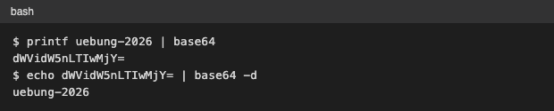
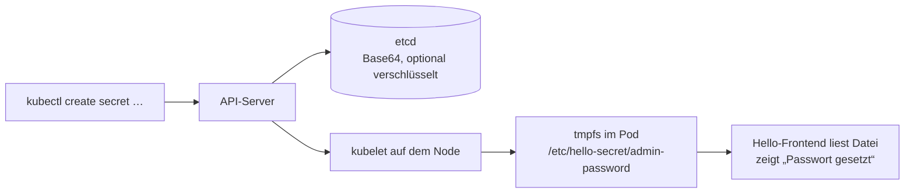
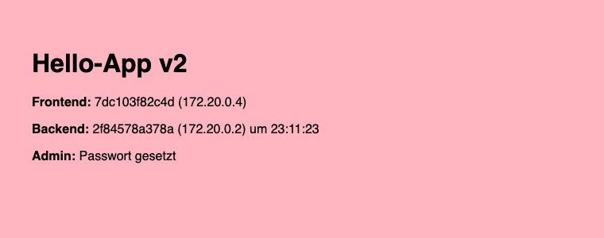

# Lab 9.2: Secrets

**Leitfragen:**

<details>
<summary>Wer in der Firma darf das Datenbankpasswort der Produktion sehen?</summary>

So wenige wie möglich: die Anwendung selbst und eine kleine Betriebsgruppe. Alle anderen, die Manifeste schreiben oder Pods ansehen, brauchen das Passwort nicht. In Kubernetes regeln das Zugriffsrechte auf Secrets, nicht das Secret selbst.

</details>

<details>
<summary>Ist ein Passwort sicher, wenn es nicht im Klartext dasteht?</summary>

Nur, wenn es verschlüsselt ist. Kubernetes speichert Secrets Base64-codiert; das ist eine Umschreibung, die jeder mit `base64 -d` zurückübersetzt. Schutz entsteht durch Zugriffsrechte, Verschlüsselung im Speicher des Clusters und Ablage außerhalb von Git.

</details>

- Ein Secret ist eine ConfigMap für vertrauliche Werte: Passwörter, Tokens, Schlüssel, Zertifikate.
- Das Hello-Frontend liest ein Admin-Passwort aus der Datei `/etc/hello-secret/admin-password` (Umgebungsvariable `SECRET_FILE`) und zeigt nur „Passwort gesetzt", nie den Wert. Bisher fehlt die Datei: „kein Passwort gesetzt".

## Begriffe

| Begriff | Bedeutung |
| --- | --- |
| Secret | Kubernetes-Objekt für vertrauliche Werte als Schlüssel-Wert-Paare; wird wie eine ConfigMap eingebunden, aber getrennt berechtigt |
| Base64 | Verfahren, beliebige Bytes als Buchstaben und Ziffern zu schreiben; keine Verschlüsselung, jeder kann es zurückwandeln |
| `data` / `stringData` | Abschnitte eines Secrets: `data` erwartet Base64-Werte, `stringData` nimmt Klartext an und wird beim Speichern umgewandelt |
| `Opaque` | Standard-Typ eines Secrets: beliebige Schlüssel |
| etcd | Datenbank der Control Plane (Lab 5.1), in der auch alle Secrets liegen |
| Volume | Ordner, den Kubernetes in einen Container einhängt; hier mit dem Inhalt eines Secrets (Volume-Arten: Lab 9.3) |
| `volumes` / `volumeMounts` | `volumes` im Pod nennt die Quelle, `volumeMounts` im Container den Ordner; verbunden über den Namen |
| tmpfs | Dateisystem im Arbeitsspeicher; Secret-Dateien im Pod liegen dort und nie auf der Festplatte des Nodes |

## Secret und ConfigMap im Vergleich

| | ConfigMap (Lab 9.1) | Secret |
| --- | --- | --- |
| Inhalt | Adressen, Farben, Schalter | Passwörter, API-Tokens, Zertifikate |
| Speicherung | Klartext | Base64, optional verschlüsselt in etcd |
| Anzeige | `kubectl describe` zeigt Werte | `kubectl describe` zeigt nur die Länge in Bytes |
| Rechte | oft für alle Entwickler lesbar | eng begrenzt |
| Einbinden | `envFrom`, `configMapKeyRef`, Volume | `envFrom`, `secretKeyRef`, Volume |

## Secret der Hello-App anlegen

Im Alltag entsteht ein Secret per Befehl, damit der Wert in keiner Datei landet. `generic` erzeugt den Typ `Opaque`:

```bash
kubectl create secret generic hello-secret --from-literal=admin-password=uebung-2026
```

Als Manifest sieht dasselbe Secret so aus. `uebung-2026` ist ein Übungswert; mit echten Passwörtern gehört eine solche Datei nie in ein Git-Repository:

```yaml
# examples/m09-config-storage/l02-secrets/06-secret.yaml (Übungswert)
apiVersion: v1
kind: Secret
metadata:
  name: hello-secret
type: Opaque
stringData:                     # Klartext beim Anlegen
  admin-password: uebung-2026   # Schlüssel = späterer Dateiname
```

## Base64 ist keine Verschlüsselung

```bash
kubectl get secret hello-secret -o yaml
```

```yaml
apiVersion: v1
data:
  admin-password: dWVidW5nLTIwMjY=     # Base64 von "uebung-2026"
kind: Secret
metadata:
  name: hello-secret
  namespace: hello
  # creationTimestamp, uid, resourceVersion …: für jetzt unwichtig
type: Opaque
```



_Quelle: eigener Screenshot, bash unter macOS, 24.11.2026._

- Hin und zurück braucht es keinen Schlüssel: Base64 ist nur eine andere Schreibweise.
- Im Cluster liest `kubectl get secret hello-secret -o jsonpath='{.data.admin-password}' | base64 -d` den Wert direkt aus; `-o jsonpath=…` gibt nur dieses eine Feld aus.
- Wer Secrets im Namespace lesen darf, kennt damit jedes Passwort. Dasselbe gilt für `kubectl exec`: Wer in einen Pod darf, liest die eingebundene Datei.

## Secret als Datei einbinden

Ein Volume besteht aus zwei Teilen: `volumes` im Pod sagt, woher der Inhalt kommt (hier: Secret `hello-secret`), `volumeMounts` im Container sagt, in welchem Ordner er erscheint. Jeder Schlüssel wird zu einer Datei.

```yaml
# Ausschnitt playground/k8s/30-frontend-deployment.yaml
      containers:
        - name: frontend
          envFrom:
            - configMapRef:
                name: hello-config
          volumeMounts:
            - name: admin-secret             # verweist auf das Volume unten
              mountPath: /etc/hello-secret   # ergibt /etc/hello-secret/admin-password
              readOnly: true
      volumes:
        - name: admin-secret                 # frei wählbarer Name, eindeutig im Pod
          secret:
            secretName: hello-secret
```



| | als Datei (Volume) | als Umgebungsvariable (`secretKeyRef`) |
| --- | --- | --- |
| Sichtbarkeit | nur wer die Datei liest | landet leicht in Logs, Fehlerberichten, Kindprozessen |
| Änderung | Datei wird nach bis zu ca. 1 Minute ersetzt | erst nach `rollout restart` |
| Empfehlung | bevorzugt | nur, wenn die Software es nicht anders kann |



_Quelle: eigener Screenshot, Hello-App `hello-frontend:v2` mit eingebundener Datei `/etc/hello-secret/admin-password` (aufgenommen mit `docker run`; im Cluster steht statt der Container-ID der Pod-Name), 24.11.2026._

## Schutz von Secrets in der Praxis

| Maßnahme | schützt gegen | Quelle |
| --- | --- | --- |
| Zugriffsrechte (RBAC: Rollen legen fest, wer welche Objekte lesen darf) | neugierige oder gekaperte Konten im Cluster | [RBAC Good Practices](https://kubernetes.io/docs/concepts/security/rbac-good-practices/) |
| Verschlüsselung in etcd | Diebstahl von etcd-Backups oder Festplatten | [Encrypting Confidential Data at Rest](https://kubernetes.io/docs/tasks/administer-cluster/encrypt-data/) |
| External Secrets Operator | Passwörter in Git; holt Werte aus einem externen Tresor und legt Secrets an | [external-secrets.io](https://external-secrets.io/) |
| Sealed Secrets | Klartext in Git; nur der Controller im Cluster kann entschlüsseln | [github.com/bitnami-labs/sealed-secrets](https://github.com/bitnami-labs/sealed-secrets) |


_Quelle: External Secrets Operator, Dokumentation (https://external-secrets.io/latest/), Apache-2.0, abgerufen am 24.11.2026._

Der Tresor (Vault, Azure Key Vault, AWS Secrets Manager …) bleibt die einzige Stelle mit dem Klartext; im Git-Repository steht nur, welcher Wert geholt wird. Weitere Regeln: [Good practices for Kubernetes Secrets](https://kubernetes.io/docs/concepts/security/secrets-good-practices/) (Stand: 24.11.2026).

> **Merksatz:** Ein Secret schützt nicht durch Base64, sondern durch Rechte, Verschlüsselung und dadurch, dass der Wert nie in Git steht.

## Typische Fehler

| Symptom | Ursache | Lösung |
| --- | --- | --- |
| Pods bleiben in `ContainerCreating`, Event `MountVolume.SetUp failed … secret "hello-secret" not found` | Secret fehlt oder liegt in einem anderen Namespace | `kubectl get secret`; Secret im Namespace `hello` anlegen |
| Seite zeigt weiter `kein Passwort gesetzt` | `mountPath` passt nicht zu `/etc/hello-secret` oder Schlüssel heißt nicht `admin-password` | `kubectl exec deploy/hello-frontend -- ls /etc/hello-secret` |
| `error: failed to create secret secrets "hello-secret" already exists` | Secret wurde schon angelegt | `kubectl delete secret hello-secret` und neu anlegen |
| `illegal base64 data at input byte …` | Klartext unter `data:` statt unter `stringData:` | Klartext nach `stringData:` verschieben |
| `spec.template.spec.containers[0].volumeMounts[0].name: Not found` | Name in `volumeMounts` und `volumes` verschieden | beide Namen angleichen |

## Fazit

- Secrets sind ConfigMaps für vertrauliche Werte; Base64 ist nur eine Schreibweise, keine Verschlüsselung.
- Secrets per `kubectl create secret` anlegen und bevorzugt als Datei (`readOnly`) einbinden.
- Echter Schutz: Zugriffsrechte, Verschlüsselung in etcd, Tresor-Anbindung, nie Klartext in Git.

In der Übung entsteht das Secret `hello-secret`, das Frontend zeigt „Passwort gesetzt", und der Klartext lässt sich mit einem Befehl zurückgewinnen.
