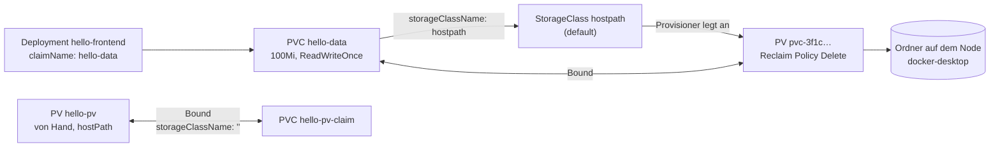

# Lab 9.3: Volumes und PersistentVolumes

**Leitfragen:**

<details>
<summary>Ein Pod wird ersetzt: was passiert mit Dateien, die er geschrieben hat?</summary>

Ohne Volume liegen sie in der beschreibbaren Schicht des Containers und verschwinden mit ihm. Ein Volume hängt einen Ordner von außen in den Container; wie lange er lebt, hängt von der Volume-Art ab.

</details>

<details>
<summary>Wer stellt in einer Firma Speicher bereit und wer nutzt ihn?</summary>

Der Betrieb kauft und verwaltet Speichersysteme (NAS, SAN, Cloud-Speicher), die Entwicklung braucht nur „100 MB für das Log". Kubernetes trennt genauso: Die StorageClass beschreibt das Angebot, der PersistentVolumeClaim ist die Bestellung, das PersistentVolume der gelieferte Speicher.

</details>

- Das Frontend schreibt bei jedem Aufruf von `/` eine Zeile nach `/data/access.log`. Ohne Volume ist das Log nach jedem Pod-Ersatz leer.
- Ein PersistentVolumeClaim bestellt Speicher, der unabhängig von jedem Pod existiert; der Pod nennt nur den Claim.

## Begriffe

| Begriff | Bedeutung |
| --- | --- |
| Container-Schicht | dünne, beschreibbare Schicht über den Image-Schichten (Lab 2.1); jeder neue Container bekommt eine leere |
| Volume | Ordner, den Kubernetes unabhängig vom Image in Container einhängt; wie ein USB-Stick im Rechner (schon gesehen für das Secret in Lab 9.2) |
| `emptyDir` | leerer Ordner, der mit dem Pod entsteht und mit ihm gelöscht wird |
| `hostPath` | ein fester Ordner des Nodes im Container; hängt am Node, nicht am Pod |
| PersistentVolume (PV) | ein Stück Speicher im Cluster (Ordner, Platte, Netzlaufwerk), das unabhängig von Pods existiert; wie ein gemieteter Lagerraum |
| PersistentVolumeClaim (PVC) | Antrag auf Speicher mit Größe und Zugriffsart; der Pod nennt nur den Claim; wie der Mietvertrag |
| StorageClass | Speicherangebot des Clusters mit Namen und Regeln; wie eine Preisliste „Standard", „schnell", „Netzlaufwerk" |
| Provisioner | Programm hinter einer StorageClass, das PVs automatisch anlegt und löscht |
| dynamische / statische Bereitstellung | PV entsteht automatisch zum Claim / jemand legt das PV vorab von Hand an |
| Bound | Zustand eines PVC, dem ein PV fest zugeordnet ist |
| Access Mode | wie viele Nodes oder Pods das Volume gleichzeitig einhängen dürfen |
| Reclaim Policy | was mit PV und Daten passiert, wenn der PVC gelöscht wird: `Delete` oder `Retain` |

## Container-Schicht und verlorene Dateien


_Quelle: Docker Docs, „Storage drivers" (https://docs.docker.com/engine/storage/drivers/), abgerufen am 24.11.2026._

`access.log` landet ohne Volume in der Container-Schicht oben im Bild. Ein neuer Pod startet mit leerer Schicht: das Log ist weg. Das ist dasselbe Verhalten wie bei `docker run` ohne Volume; in Compose löste ein benanntes Volume das Problem (Lab 3.3).

## Volume-Arten nach Lebensdauer

| Volume-Art | Daten kommen aus | Lebensdauer | Typischer Einsatz |
| --- | --- | --- | --- |
| `emptyDir` | leerer Ordner auf dem Node | so lange wie der Pod; überlebt Container-Neustarts | Zwischenspeicher, Austausch zwischen Containern eines Pods |
| `configMap`, `secret` | ConfigMap/Secret im Cluster | Inhalt kommt aus dem Objekt | Konfigurationsdateien, Passwörter (Lab 9.1, 9.2) |
| `hostPath` | fester Ordner des Nodes | so lange wie der Node; anderer Node = andere Daten | Systemwerkzeuge, die Node-Dateien lesen |
| `persistentVolumeClaim` | eigener Speicher (Platte, Netzlaufwerk, Cloud-Disk) | unabhängig vom Pod, bis der Claim gelöscht wird | Datenbanken, Uploads, Logs |

Quelle: [Volumes](https://kubernetes.io/docs/concepts/storage/volumes/), Stand: 24.11.2026. `hostPath` wirkt dauerhaft, gilt aber nur auf einem Node und gibt dem Container Zugriff auf Dateien des Nodes; im Alltag nur für Systemwerkzeuge.

| Docker (Lab 3.3) | Kubernetes |
| --- | --- |
| benanntes Volume `docker volume create` | PersistentVolumeClaim (Bestellung) + PersistentVolume (Speicher) |
| Volume-Treiber (`local`, NFS-Plugins) | StorageClass mit Provisioner |
| `volumes:` in `compose.yml` + `- daten:/data` beim Dienst | `volumes:` im Pod + `volumeMounts:` im Container |

## PV, PVC und StorageClass



```text
$ kubectl get storageclass
NAME                 PROVISIONER          RECLAIMPOLICY   VOLUMEBINDINGMODE   ALLOWVOLUMEEXPANSION   AGE
hostpath (default)   docker.io/hostpath   Delete          Immediate           false                  3d
```

Docker Desktop bringt die StorageClass `hostpath` mit; sie legt für jeden Claim einen Ordner auf dem einen Node `docker-desktop` an. In Produktion steckt dahinter Netzwerk- oder Cloud-Speicher, angebunden über Treiber nach dem Standard CSI (Container Storage Interface).


_Quelle: Kubernetes Blog, „DIY: Create Your Own Cloud with Kubernetes (Part 2)" (https://kubernetes.io/blog/2024/04/05/diy-create-your-own-cloud-with-kubernetes-part-2/), CC BY 4.0, The Kubernetes Authors, abgerufen am 24.11.2026._

Lokaler Speicher wie bei `hostpath` steckt im Node selbst: schnell und einfach, aber an diesen einen Node gebunden.

## PersistentVolumeClaim der Hello-App

```yaml
# playground/k8s/07-pvc.yaml
apiVersion: v1
kind: PersistentVolumeClaim
metadata:
  name: hello-data
spec:
  storageClassName: hostpath   # weglassen = Default-StorageClass
  accessModes:
    - ReadWriteOnce            # lesen und schreiben von einem Node aus
  resources:
    requests:
      storage: 100Mi           # Mi = Mebibyte (1024² Byte)
```

Im Deployment nennt das Volume `data` den Claim; `volumeMounts` hängt es unter `/data` ein, wo die App `access.log` schreibt (`DATA_DIR`):

```yaml
# Ausschnitt playground/k8s/30-frontend-deployment.yaml
          volumeMounts:
            - name: data
              mountPath: /data
      volumes:
        - name: data
          persistentVolumeClaim:
            claimName: hello-data      # PVC im selben Namespace
```

## Statisches PersistentVolume

Ohne StorageClass legt der Betrieb das PV selbst an, etwa für eine vorhandene Netzwerkfreigabe. Im Kurs zeigt ein `hostPath`-Ordner denselben Weg:

```yaml
# playground/k8s/08-static-pv.yaml (Ausschnitt)
apiVersion: v1
kind: PersistentVolume           # gilt für den ganzen Cluster, ohne Namespace
metadata:
  name: hello-pv
spec:
  capacity:
    storage: 100Mi
  accessModes: ["ReadWriteOnce"]
  persistentVolumeReclaimPolicy: Retain
  hostPath:
    path: /tmp/hello-pv          # Ordner auf dem Node
    type: DirectoryOrCreate
---
apiVersion: v1
kind: PersistentVolumeClaim
metadata:
  name: hello-pv-claim
spec:
  storageClassName: ""           # leer = keine StorageClass
  volumeName: hello-pv           # genau dieses PV binden
  accessModes: ["ReadWriteOnce"]
  resources:
    requests:
      storage: 100Mi
```

Fehlt `storageClassName` im Claim, trägt Kubernetes beim Anlegen die Default-StorageClass `hostpath` ein. Ohne `volumeName` legt der Provisioner dann ein neues PV an und `hello-pv` bleibt `Available`; mit `volumeName` passt die Klasse nicht zu `hello-pv`, und der Claim bleibt `Pending`. Der leere Wert `""` heißt ausdrücklich „keine StorageClass".

## Access Modes und Reclaim Policy

| Access Mode | Kurz | Bedeutung |
| --- | --- | --- |
| `ReadWriteOnce` | RWO | lesen und schreiben von **einem Node**; alle Pods auf diesem Node dürfen |
| `ReadOnlyMany` | ROX | nur lesen, von vielen Nodes |
| `ReadWriteMany` | RWX | lesen und schreiben von vielen Nodes (NFS, SMB, Cloud-Dateidienste) |
| `ReadWriteOncePod` | RWOP | lesen und schreiben von genau **einem Pod** |

`ReadWriteOnce` heißt „ein Node", nicht „ein Pod" (Quelle: [Persistent Volumes, Access Modes](https://kubernetes.io/docs/concepts/storage/persistent-volumes/#access-modes), Stand: 24.11.2026). Docker Desktop hat nur einen Node, deshalb dürfen dort mehrere Pods dasselbe RWO-Volume nutzen, z. B. Frontend und der Job aus Lab 9.4. Das Frontend läuft in diesem Lab mit einer Replika, damit alle Zeilen im Log von genau einem Pod stammen und der Pod-Ersatz eindeutig zu sehen ist.


_Quelle: Docker Docs, „Volumes – Share data between machines" (https://docs.docker.com/engine/storage/volumes/), abgerufen am 24.11.2026._

Gemeinsamer Dateispeicher wie im Bild ist der Fall `ReadWriteMany`: Repliken auf verschiedenen Nodes schreiben in dieselben Dateien.

| Reclaim Policy | Nach `kubectl delete pvc` | Einsatz |
| --- | --- | --- |
| `Delete` | PV und Daten werden gelöscht | Standard bei dynamischer Bereitstellung (`hostpath`) |
| `Retain` | PV bleibt mit Status `Released`, Daten bleiben; Freigabe von Hand | Produktionsdaten, statische PVs wie `hello-pv` |

## Typische Fehler

| Symptom | Ursache | Lösung |
| --- | --- | --- |
| PVC bleibt `Pending`, Event `storageclass.storage.k8s.io "hostpath" not found` | Cluster ohne StorageClass `hostpath` (z. B. minikube, kind) | `kubectl get storageclass`; dort genannten Namen eintragen oder Zeile weglassen |
| `hello-pv-claim` bleibt `Pending`, Event `Cannot bind to requested volume "hello-pv": storageClassName does not match` | `storageClassName: ""` fehlt im Claim, die Default-StorageClass wurde eingetragen | `kubectl delete pvc hello-pv-claim`, `storageClassName: ""` ergänzen, neu anwenden (die Klasse eines Claims ist nachträglich nicht änderbar) |
| `hello-pv-claim` bleibt `Pending`, Größe oder Access Mode im Event | Claim fordert mehr als das PV bietet | Claim fordert höchstens `100Mi` und `ReadWriteOnce` |
| `cat: can't open '/data/access.log'` | neuer PVC, Seite seitdem nicht aufgerufen | Seite einmal aufrufen; die App legt die Datei an |
| PVC hängt in `Terminating` | ein Pod nutzt den Claim noch | erst Deployment ändern oder löschen |
| Log nach `kubectl delete -f playground/k8s/` weg | PVC mitgelöscht, Reclaim Policy `Delete` | PVC nur gezielt löschen; wichtige Daten mit `Retain` |

## Fazit

- Ohne Volume lebt eine Datei nur so lange wie der Container; `emptyDir` lebt mit dem Pod, ein PVC unabhängig davon.
- Der Pod nennt nur den PVC; die StorageClass legt das PV automatisch an, ein statisches PV bindet ein Claim mit `storageClassName: ""`.
- `ReadWriteOnce` bindet an einen Node, nicht an einen Pod; Reclaim Policy `Delete` löscht die Daten mit dem PVC.

In der Übung bekommt das Frontend den PVC `hello-data`, `access.log` übersteht das Löschen des Pods, und ein von Hand angelegtes PV wird gebunden.
