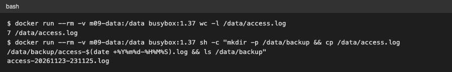
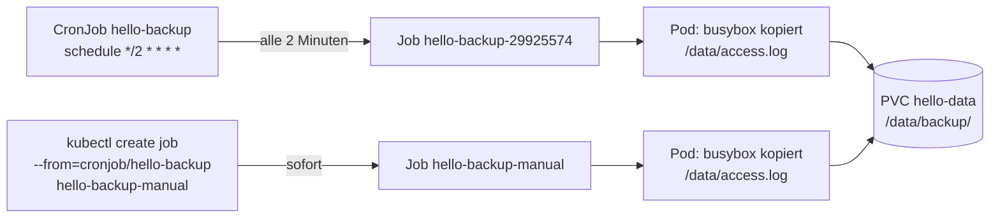

# Lab 9.4: Jobs und CronJobs

**Leitfragen:**

<details>
<summary>Was unterscheidet einen Webserver von einer nächtlichen Sicherung?</summary>

Der Webserver soll immer laufen und wird nach jedem Ende neu gestartet. Die Sicherung läuft einmal, soll dann fertig sein und nach Plan wiederkommen. Kubernetes hat dafür eigene Controller: Job und CronJob statt Deployment.

</details>

<details>
<summary>Eine Aufgabe schlägt fehl: wie oft soll sie es erneut versuchen?</summary>

Ein paar Mal, aber nicht endlos: Ein kurzer Netzaussetzer verdient einen zweiten Versuch, ein kaputtes Skript scheitert jedes Mal. Ein Job legt die Zahl der Wiederholungen mit `backoffLimit` fest und meldet danach `Failed`.

</details>

- Deployment, Job und CronJob sind Controller (Lab 8.1) für unterschiedliche Arten von Arbeit; alle legen Pods nach einem Bauplan (`template`) an.
- Die Hello-App bekommt einen Job, der die Zeilen in `access.log` zählt, und einen CronJob, der das Log alle zwei Minuten sichert.

## Begriffe

| Begriff | Bedeutung |
| --- | --- |
| Workload | Oberbegriff für alles, was im Cluster Pods laufen lässt |
| Job | Controller für Arbeit mit Ende: startet Pods, bis die gewünschte Zahl erfolgreich beendet ist |
| CronJob | legt nach Zeitplan Jobs an, wie `cron` unter Linux oder die Windows-Aufgabenplanung |
| Cron-Ausdruck | Zeitplan aus fünf Feldern: Minute, Stunde, Tag, Monat, Wochentag |
| `restartPolicy` | was nach dem Ende eines Containers passiert: `Always` (Deployment), `OnFailure` oder `Never` (Job) |
| `backoffLimit` | wie oft ein Job nach Fehlern erneut versucht, bevor er als `Failed` gilt (Standard 6) |
| `jobTemplate` | Bauplan des Jobs im CronJob, darin wieder der Pod-Bauplan |
| `concurrencyPolicy` | was geschieht, wenn der vorige Lauf beim nächsten Termin noch arbeitet |
| busybox | sehr kleines Image mit Standard-Werkzeugen der Shell (`sh`, `wc`, `cp`, `date`); gut für kurze Aufgaben |

## Workload-Typen im Vergleich

| Workload | Läuft | Pod-Namen | Beispiel |
| --- | --- | --- | --- |
| Deployment (Lab 8.2) | dauerhaft, n gleiche Replikas | zufällig: `hello-frontend-6d9f7c8b5-w4hvn` | Hello-Frontend, Web-APIs |
| Job | einmal bis zum erfolgreichen Ende | `<job>-<zufall>` | Zeilen zählen, Datenbank-Migration, Import |
| CronJob | nach Zeitplan, je Lauf ein Job | `<cronjob>-<zeitnummer>-<zufall>` | Backup, Bericht, Aufräumen |
| StatefulSet | dauerhaft, Pods mit festem Namen (`db-0`, `db-1`) und je eigenem PVC | fest und nummeriert | Datenbanken, Kafka |
| DaemonSet | dauerhaft, genau ein Pod je Node | `<name>-<zufall>` je Node | `kube-proxy`, Log-Sammler, Monitoring-Agenten |

Quelle: [Workloads](https://kubernetes.io/docs/concepts/workloads/), Stand: 24.11.2026.

## Job zum Zählen der Log-Zeilen

```yaml
# playground/k8s/50-job-count.yaml
apiVersion: batch/v1
kind: Job
metadata:
  name: hello-count
spec:
  backoffLimit: 2                   # bei Fehler höchstens 2 weitere Versuche
  template:                         # Pod-Bauplan wie beim Deployment
    spec:
      restartPolicy: Never          # Job-Pods enden; Always ist hier verboten
      containers:
        - name: count
          image: busybox:1.37
          command: ["wc", "-l", "/data/access.log"]   # Befehl statt des Standardbefehls des Images
          volumeMounts:
            - name: data
              mountPath: /data
              readOnly: true
      volumes:
        - name: data
          persistentVolumeClaim:
            claimName: hello-data   # derselbe Claim wie das Frontend (Lab 9.3)
```

Ein Job-Pod endet absichtlich: Status `Completed`. Deshalb ist `restartPolicy: Always` verboten. `Never` startet bei einem Fehler einen neuen Pod, `OnFailure` startet den Container im selben Pod neu; in beiden Fällen zählt `backoffLimit` die Versuche. Der Job und das Frontend hängen denselben RWO-Claim ein; das geht, weil beide Pods auf dem einen Node `docker-desktop` laufen (Lab 9.3).



_Quelle: eigener Screenshot, die Befehle des Jobs und des CronJobs mit `docker run` und einem Docker-Volume ausgeführt, 24.11.2026._

Der Container im Job tut nichts anderes als diese beiden `docker run`-Aufrufe: Image starten, Befehl ausführen, enden. Kubernetes ergänzt Wiederholungen, Zeitplan und Protokoll.

## CronJob für die Sicherung



```yaml
# playground/k8s/60-cronjob-backup.yaml
apiVersion: batch/v1
kind: CronJob
metadata:
  name: hello-backup
spec:
  schedule: "*/2 * * * *"               # immer in Anführungszeichen: * hat in YAML eine Sonderbedeutung
  concurrencyPolicy: Forbid             # kein zweiter Lauf, solange einer läuft
  successfulJobsHistoryLimit: 3         # so viele erledigte Jobs bleiben sichtbar
  failedJobsHistoryLimit: 1
  jobTemplate:                          # Bauplan des Jobs ...
    spec:
      backoffLimit: 2
      template:                         # ... mit Pod-Bauplan
        spec:
          restartPolicy: Never
          containers:
            - name: backup
              image: busybox:1.37
              command:
                - /bin/sh
                - -c
                - mkdir -p /data/backup && cp /data/access.log /data/backup/access-$(date +%Y%m%d-%H%M%S).log && ls /data/backup
              volumeMounts:
                - name: data
                  mountPath: /data
          volumes:
            - name: data
              persistentVolumeClaim:
                claimName: hello-data
```

### Cron-Ausdruck

```text
 ┌──────── Minute        (0–59)    */2 = jede zweite Minute
 │ ┌────── Stunde        (0–23)
 │ │ ┌──── Tag im Monat  (1–31)
 │ │ │ ┌── Monat         (1–12)
 │ │ │ │ ┌ Wochentag     (0–6, 0 = Sonntag)
 * * * * *
```

| Ausdruck | Bedeutung |
| --- | --- |
| `*/2 * * * *` | alle 2 Minuten |
| `0 2 * * *` | täglich um 02:00 |
| `30 6 * * 1-5` | montags bis freitags um 06:30 |
| `0 0 1 * *` | am Ersten jedes Monats um Mitternacht |

Die Uhrzeit ist die Zeitzone des Clusters, meist UTC; das Feld `timeZone: Europe/Berlin` legt sie fest. `suspend: true` pausiert einen CronJob, ohne ihn zu löschen.

| `concurrencyPolicy` | Wenn der vorige Lauf noch arbeitet |
| --- | --- |
| `Allow` (Standard) | neuer Lauf startet trotzdem |
| `Forbid` | neuer Lauf fällt aus |
| `Replace` | voriger Lauf wird abgebrochen, neuer startet |

## Befehle für Jobs und CronJobs

| Befehl | Wirkung |
| --- | --- |
| `kubectl get jobs` | Jobs mit `STATUS` und `COMPLETIONS` (`1/1` = fertig) |
| `kubectl logs job/hello-count` | Ausgabe des Job-Pods |
| `kubectl get cronjobs` | Zeitplan, `SUSPEND`, `ACTIVE`, `LAST SCHEDULE` |
| `kubectl create job --from=cronjob/hello-backup hello-backup-manual` | Job sofort aus dem Bauplan des CronJobs starten, unabhängig vom Zeitplan |
| `kubectl delete job hello-count` | Job samt Pod löschen, z. B. um ihn erneut auszuführen |


_Quelle: Headlamp, README (https://github.com/kubernetes-sigs/headlamp), Apache-2.0, abgerufen am 24.11.2026._

Headlamp, der Nachfolger des Dashboards (Lab 6.2), zeigt alle Workload-Typen unter **Workloads**. Die Jobs `hello-28184532` … im Bild stammen von einem CronJob: Die Zahl ist die geplante Startzeit in Minuten seit 1970. Das Dashboard listet dieselben Objekte unter **Workloads → Cron Jobs** und **Jobs**.

## Typische Fehler

| Symptom | Ursache | Lösung |
| --- | --- | --- |
| `spec.template.spec.restartPolicy: Unsupported value: "Always"` | `restartPolicy` im Job vergessen oder `Always` | `Never` oder `OnFailure` |
| `error converting YAML to JSON: yaml: line …: did not find expected alphabetic or numeric character` | `schedule: */2 * * * *` ohne Anführungszeichen | `schedule: "*/2 * * * *"` |
| `The Job "hello-count" is invalid: spec.template: … field is immutable` | geänderten Job erneut angewendet | `kubectl delete job hello-count`, dann neu anwenden |
| Job `Failed`, Log: `wc: /data/access.log: No such file or directory` | Seite seit dem Anlegen des PVC nicht aufgerufen | Seite einmal aufrufen, Job löschen und neu anlegen |
| `no matches for kind "CronJob" in version "batch/v1beta1"` | altes Beispiel aus dem Internet | `apiVersion: batch/v1` |
| Zeitstempel im Dateinamen eine Stunde früher | Container-Uhr läuft in UTC | normal; bei Bedarf `timeZone` setzen |

## Fazit

- Deployment für Dauerläufer, Job für Arbeit mit Ende, CronJob für Jobs nach Zeitplan; StatefulSet und DaemonSet für Pods mit festem Namen bzw. einen Pod je Node.
- Ein Job braucht `restartPolicy: Never` oder `OnFailure`; `backoffLimit` begrenzt die Versuche.
- `kubectl create job --from=cronjob/…` testet einen CronJob sofort, ohne auf den Zeitplan zu warten.

In der Übung zählt der Job `hello-count` die Zeilen in `access.log`, und der CronJob `hello-backup` legt Sicherungskopien auf dem PVC an.
