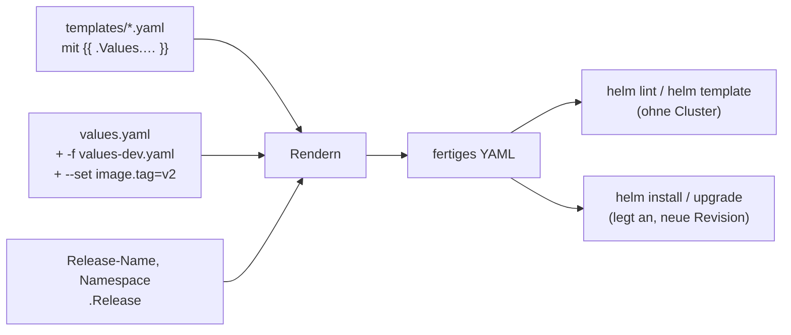
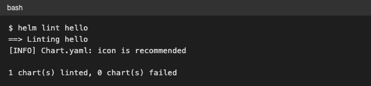
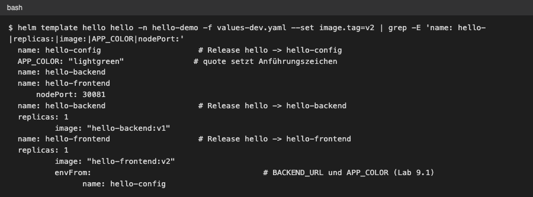
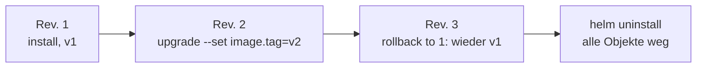

# Lab 10.1: Die Hello-App als Helm-Chart

**Leitfragen:**

<details>
<summary>Welche Werte in den Hello-Manifesten ändern sich zwischen Test und Produktion?</summary>

Image-Tag, Anzahl der Replikas, Hintergrundfarbe und der Port nach außen. Namen, Labels, Probes und Container-Ports bleiben gleich. Genau die wechselnden Stellen werden im Chart zu Platzhaltern.

</details>

<details>
<summary>Wie installiert man die Hello-App auf zehn Clustern gleich?</summary>

Mit einem Paket statt zehnmal sechs Dateien von Hand: dasselbe Chart, je Cluster ein Befehl und höchstens eine kleine Datei mit den Abweichungen. Helm merkt sich jede Installation als Release mit Revisionen und kann sie zurückrollen.

</details>

- In Modul 6 hat Helm fertige Charts installiert (metrics-server, Dashboard). Hier entsteht ein eigenes Chart `hello` aus den Manifesten des Tages.
- Ergebnis: die ganze Hello-App mit einem Befehl installieren, mit `--set` ändern und mit `helm rollback` zurückholen.

## Begriffe

| Begriff | Bedeutung |
| --- | --- |
| Chart | Paket aus Vorlagen und Standardwerten, aus dem Helm Kubernetes-Manifeste erzeugt (Lab 6.1) |
| `Chart.yaml` | Steckbrief des Charts: Name, Chart-Version, App-Version |
| `values.yaml` | Standardwerte für alle Platzhalter; gleichzeitig die Bedienungsanleitung des Charts |
| `templates/` | Ordner mit den Vorlagen; jede Datei wird zu einem Manifest |
| `{{ … }}` | Platzhalter in einer Vorlage; Helm ersetzt ihn beim Rendern durch einen Wert (Sprache: Go-Templates) |
| Rendern | Vorlagen mit Werten füllen; heraus kommt normales Kubernetes-YAML |
| Release | eine Installation eines Charts unter einem Namen in einem Namespace (Lab 6.1) |
| Revision | fortlaufende Nummer je Release; jede Installation, jedes Upgrade, jeder Rollback bekommt eine neue |
| `helm lint` / `helm template` | Chart prüfen / fertiges YAML anzeigen, beides ohne Cluster |
| Werte-Datei je Umgebung | `values-dev.yaml`, `values-prod.yaml`: nur die Abweichungen von `values.yaml` |

## Aufbau des Charts hello

```text
examples/m10-helm-chart/l01-own-chart/
├── hello/
│   ├── Chart.yaml                  # Steckbrief
│   ├── values.yaml                 # Standardwerte
│   └── templates/
│       ├── configmap.yaml          # BACKEND_URL, APP_COLOR (Lab 9.1)
│       ├── backend-deployment.yaml
│       ├── backend-service.yaml
│       ├── frontend-deployment.yaml  # mit Probes und Ressourcen (Lab 8.4, 8.5)
│       ├── frontend-service.yaml   # NodePort
│       └── NOTES.txt               # Text nach der Installation
├── values-dev.yaml                 # Abweichungen für Test
└── values-prod.yaml                # Abweichungen für Produktion
```

```yaml
# hello/Chart.yaml
apiVersion: v2          # Chart-API v2, gilt für Helm 3 und 4
name: hello
description: Hello-App (Frontend und Backend) aus dem Kurs Docker & Kubernetes Grundlagen
type: application       # installierbar
version: 0.1.0          # Version des Charts
appVersion: "v1"        # Version der App, nur Information
```

```yaml
# hello/values.yaml
image:
  repository: hello-frontend
  tag: v1                # v1 oder v2
  pullPolicy: Never      # lokal gebautes Image (Lab 2.2)
replicas: 2              # Anzahl Frontend-Pods
color: lightyellow       # landet in der ConfigMap
nodePort: 30080          # Port auf dem Node, je Cluster nur einmal vergeben
backend:
  repository: hello-backend
  tag: v1
  replicas: 2
```

Nicht im Chart: das Secret (Passwörter gehören nicht in Chart-Dateien, Lab 9.2), PVC, Job und CronJob (Modul 9). Das Chart bleibt damit klein; ein echtes Chart nimmt sie als weitere Vorlagen auf.

## Vom Manifest zur Vorlage



Aus `30-frontend-deployment.yaml` des Moduls 9 wird so eine Vorlage (Ausschnitt):

```yaml
# hello/templates/frontend-deployment.yaml
metadata:
  name: {{ .Release.Name }}-frontend          # vorher: hello-frontend
spec:
  replicas: {{ .Values.replicas }}            # vorher: 3
  template:
    spec:
      containers:
        - name: frontend
          image: "{{ .Values.image.repository }}:{{ .Values.image.tag }}"   # vorher: hello-frontend:v2
          imagePullPolicy: {{ .Values.image.pullPolicy }}
          envFrom:
            - configMapRef:
                name: {{ .Release.Name }}-config
```

| Ausdruck | Ergebnis bei `helm install hello …` | Wozu |
| --- | --- | --- |
| `{{ .Values.replicas }}` | `2` | Wert aus `values.yaml`; Punkte trennen die Ebenen |
| `{{ .Values.image.tag }}` | `v1` | verschachtelter Wert |
| `{{ .Release.Name }}-frontend` | `hello-frontend` | Namen je Release eindeutig |
| `{{ .Release.Namespace }}` | `hello-demo` | Namespace aus `-n` |
| `{{ .Values.color \| quote }}` | `"lightyellow"` | `\|` reicht den Wert an eine Funktion weiter, hier: Anführungszeichen setzen |

Mit dem Release-Namen `hello` heißen die Objekte genauso wie im Modul 9: `hello-frontend`, `hello-backend`, `hello-config`. Die Services heißen `hello-frontend` und `hello-backend`; deshalb setzt die ConfigMap `BACKEND_URL: "http://{{ .Release.Name }}-backend"`.

## Werte je Umgebung

```yaml
# values-dev.yaml – nur, was von values.yaml abweicht
replicas: 1
color: lightgreen
nodePort: 30081          # 30080 belegt der Service frontend aus dem Namespace hello
backend:
  replicas: 1
```

Reihenfolge bei jedem Aufruf: `values.yaml` des Charts → `-f values-dev.yaml` → `--set …`; der spätere Wert gewinnt.


_Quelle: Artifact Hub, Screenshots im README (https://github.com/artifacthub/hub), Apache-2.0, abgerufen am 24.11.2026._

Artifact Hub ([artifacthub.io](https://artifacthub.io), Katalog öffentlicher Charts) und `helm show values <chart>` zeigen die `values.yaml` eines Charts samt Kommentaren; jeder Wert im Chart `hello` hat deshalb einen kurzen Kommentar.

## Prüfen vor dem Installieren



_Quelle: eigener Screenshot, Helm v4.3.2, 24.11.2026._

`helm lint` prüft Aufbau, `Chart.yaml` und Template-Syntax; der Hinweis auf ein fehlendes Icon ist kein Fehler.



_Quelle: eigener Screenshot, Helm v4.3.2, 24.11.2026._

`helm template` rendert das Chart, ohne etwas anzulegen; mit `grep` gefiltert zeigt sich, dass jeder Wert an der richtigen Stelle landet: Farbe und Port aus `values-dev.yaml`, Tag `v2` aus `--set`.

## Release-Lebenslauf



- `helm upgrade` ändert nur, was sich im gerenderten YAML unterscheidet; das Deployment rollt dann wie in Lab 8.2 aus.
- `helm rollback` löscht keine Revision, sondern schreibt eine neue mit dem alten Stand.
- `helm uninstall` löscht alle Objekte des Releases, den Namespace nicht.

## Befehle zum Nachmachen

Voraussetzung: Images `hello-frontend:v1`, `hello-frontend:v2`, `hello-backend:v1` vorhanden (sonst `bash build-images.sh`). Die Hello-App im Namespace `hello` darf weiterlaufen; das Release kommt in den eigenen Namespace `hello-demo` mit NodePort `30081`.

```bash
cd examples/m10-helm-chart/l01-own-chart      # aus dem Ordner project/

# 1. Prüfen und ansehen, ohne Cluster
helm lint hello
helm template hello hello -n hello-demo -f values-dev.yaml

# 2. Installieren (Revision 1, Frontend v1, grün, 1 Replika)
helm install hello hello -n hello-demo --create-namespace -f values-dev.yaml
kubectl get all -n hello-demo
# Browser: http://localhost:30081

# 3. Upgrade auf v2 (Revision 2); -f values-dev.yaml immer mitgeben
helm upgrade hello hello -n hello-demo -f values-dev.yaml --set image.tag=v2
kubectl rollout status deployment/hello-frontend -n hello-demo
# Browser: Titel "Hello-App v2"

# 4. Historie und Rollback auf Revision 1 (wird Revision 3)
helm history hello -n hello-demo
helm rollback hello 1 -n hello-demo
helm list -n hello-demo

# 5. Aufräumen
helm uninstall hello -n hello-demo
kubectl delete namespace hello-demo
```

Ausgabe von Schritt 2 (Ausschnitt):

```text
NAME: hello
LAST DEPLOYED: Tue Nov 24 16:12:03 2026
NAMESPACE: hello-demo
STATUS: deployed
REVISION: 1
DESCRIPTION: Install complete
TEST SUITE: None
NOTES:
Hello-App installiert: Release "hello" im Namespace "hello-demo" (Chart hello-0.1.0).

Frontend v1, Replikas: 1, Adresse: http://localhost:30081
```

Ausgabe von `helm history` nach dem Rollback:

```text
REVISION  UPDATED                   STATUS      CHART        APP VERSION  DESCRIPTION
1         Tue Nov 24 16:12:03 2026  superseded  hello-0.1.0  v1           Install complete
2         Tue Nov 24 16:13:40 2026  superseded  hello-0.1.0  v1           Upgrade complete
3         Tue Nov 24 16:14:55 2026  deployed    hello-0.1.0  v1           Rollback to 1
```

Die Spalte `APP VERSION` bleibt `v1`, obwohl Revision 2 das Image `v2` nutzt; die Spalte zeigt nur `appVersion` aus `Chart.yaml`. Welche Version läuft, zeigt die Seite oder `helm get values hello -n hello-demo`.

Die zweite Werte-Datei funktioniert genauso: `helm install hello hello -n hello-prod --create-namespace -f values-prod.yaml` legt ein unabhängiges Release mit drei Replikas, blauer Seite und NodePort `30082` an.

## Typische Fehler

| Symptom | Ursache | Lösung |
| --- | --- | --- |
| `Service "hello-frontend" is invalid: spec.ports[0].nodePort: Invalid value: 30080: provided port is already allocated` | NodePort schon vergeben (Service `frontend` in `hello`) | eigenen Port setzen: `-f values-dev.yaml` oder `--set nodePort=30081` |
| nach `helm upgrade --set …` wieder 2 Replikas und gelbe Seite | `-f values-dev.yaml` beim Upgrade vergessen | jedes Upgrade mit derselben Werte-Datei |
| `nil pointer evaluating interface {}.tag` | Pfad in `.Values.…` falsch geschrieben | Pfad mit `values.yaml` vergleichen (Groß-/Kleinschreibung) |
| Pods `ErrImageNeverPull` | Image lokal nicht vorhanden | `bash build-images.sh` |
| `cannot re-use a name that is still in use` | Release `hello` existiert schon im Namespace | `helm upgrade` statt `install` oder vorher `helm uninstall` |

## Fazit

- Ein Chart besteht aus `Chart.yaml`, `values.yaml` und `templates/`; nur was sich je Umgebung ändert, wird zum Wert.
- `helm lint` und `helm template` prüfen ohne Cluster; `helm install`, `upgrade --set` und `rollback` erzeugen je eine Revision.
- Werte-Dateien je Umgebung machen aus einem Chart beliebig viele gleich aufgebaute Installationen.

Alle Schritte der Demo stehen unter „Befehle zum Nachmachen" und laufen mit dem Chart aus `examples/m10-helm-chart/l01-own-chart/` auf dem eigenen Cluster.
